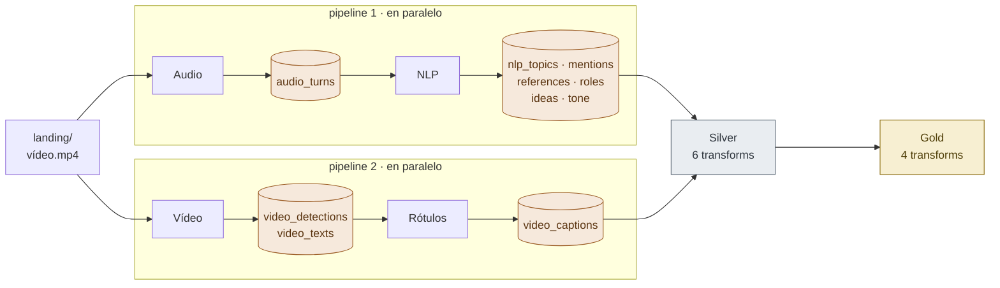
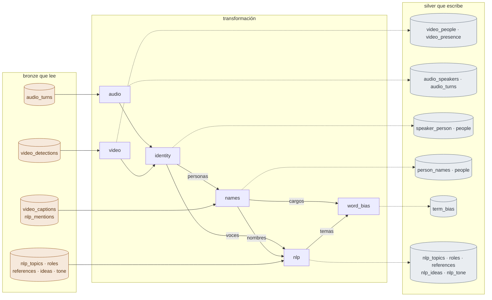
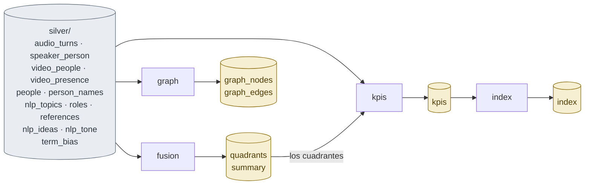

<!--
SPDX-FileCopyrightText: 2026 Equipo 1: Attention Is All She Needs (Alba Camiña García, Pilar de la Fuente Diez, Rocío Jiménez Villén)
SPDX-License-Identifier: Apache-2.0
-->

# Arquitectura de AIASN

Cada vídeo es procesado por cuatro pipelines de datos y los resultados se organizan en un Data Lake de tres capas siguiendo una arquitecturaMedallion:bronze, silver y gold. Los resultados vuelven al front para completar el análisis de paridad.

**Contenido:** [Visión general](#visión-general) · [Orden de ejecución](#orden-de-ejecución) · [Audio](#pipeline-de-audio) · [Vídeo](#pipeline-de-vídeo) · [NLP](#pipeline-de-nlp) · [Rótulos](#pipeline-de-rótulos) · [Silver](#silver-de-las-detecciones-a-las-personas) · [Gold](#gold-el-dictamen) · [API y front](#api-y-front) · [Todas las tablas](#todas-las-tablas-del-lago)

## Visión general

La demo local consiste en cuatro contenedores en un `docker compose`: el front, la API, el almacén S3 y el worker. El worker no está levantado siempre, sino que la API arranca un contenedor cuando se quiere iniciar el procesamiento de un vídeo, simulando un comportamiento serverless. Ningún procesamiento sucede en la API. Solo manda el vídeo al backend, lanza el worker y finalmente, lee los datos resultantes de gold. El worker es el único que escribe bronze, silver y gold. 

Nota: Sin Docker, la API lanza el worker como proceso hijo y el lago es la carpeta local `data/`.

| Componente | Descripción |
|---|---|
| Front | nginx en `:8080` con `frontend-piloto/`; |
| API | FastAPI en `:8000`. Lanza los workers por `docker.sock`. |
| Worker | `python -m aiasn.run_pipelines --video-id ID`, un contenedor por vídeo, con GPU NVIDIA si la hay. Modelos locales en el volumen `aiasn-models` (`/models`). |
| Almacén S3 | SeaweedFS, bucket `s3://aiasn`, Parquet por `video_id=`. Carpetas `landing/` (vídeo subido), `bronze/` (salida de modelos, 10 tablas), `silver/` (personas y hechos, 13 tablas), `gold/` (KPIs y dictamen, 6 tablas) y `runs/` (manifest con el estado de cada paso del pipeline). |
| OVHcloud AI Endpoints | Whisper large v3 para speech to text y Llama 3.3 70B como LLM. |
| Langfuse (opcional) | Perfil `langfuse` del compose: trazas de las llamadas al LLM, agrupadas por vídeo. Se activa con `LANGFUSE_ENABLED`. |

## Orden de ejecución

Dos pipelines corren a la vez en distintos hilos: audio y después NLP (que necesita la transcripción), y vídeo y después rótulos (que necesita los textos del OCR). Cuando acaban los dos, silver une lo que dicen, limpia y transforma y gold calcula los KPIs, el dictamen y los datos para generar la constelación en el frontend.

## Pipeline de audio

`lee landing/` → `escribe bronze/audio_turns`. Quién habla, cuándo, qué dice y con qué voz.

| Paso | Modelo | Qué hace |
|---|---|---|
| 1. `extract` | ffmpeg | Audio mono a 16 kHz, en `tmp/`. |
| 2. `asr` | Whisper large v3 de OVHcloud | Transcripción con diarización: turnos con inicio, fin, hablante y texto. |
| 3. `gender` | prithivMLmods/Common-Voice-Gender-Detection | Clasificador binario de Género de la voz por turno, con su probabilidad |

| Tabla | Una fila por | Columnas |
|---|---|---|
| `audio_turns` | turno de palabra | turn, start, end, speaker, text, gender, gender_prob |

## Pipeline de vídeo

`lee landing/` → `escribe bronze/video_detections y video_texts`. Quién sale, dónde, si habla y qué textos aparecen. Es el paso que usa la GPU.

| Paso | Modelo | Qué hace |
|---|---|---|
| 1. `extract` | ffmpeg | Fotogramas a 25 fps y audio a 16 kHz, en `tmp/`. |
| 2. `shots` | TransNetV2 | Cortes de plano. |
| 3. `detect` | YOLO11m-pose · InsightFace buffalo_l · MiVOLO v2 | Personas y su seguimiento (1 de cada 4 fotogramas), caras, y género por cara y cuerpo. |
| 4. `RE-ID` | ArcFace (InsightFace) | Reidentificación: Une las pistas de una misma persona entre planos: agrupa la cara media de cada pista por distancia coseno (< 0,6). Los vectores no se guardan.  |
| 5. `asd` | TalkNet | Active Speaker Recognition: Reconoce quién está hablando en cada fotograma, cruzando cara y audio. |
| 6. `ocr` | EasyOCR | Textos en pantalla a 1 fps |

| Tabla | Una fila por | Columnas |
|---|---|---|
| `video_detections` | persona y fotograma analizado | frame, shot, track_id, person_id, x1, y1, x2, y2, head, face_x1…face_y2, gender, gender_prob, age, frame_width, frame_height, speaking_score |
| `video_texts` | texto leído | frame, shot, text, conf, x1, y1, x2, y2 |

## Pipeline de NLP

Lee `bronze/audio_turns` → `escribe 6 tablas nlp_*`. Seis tareas independientes sobre la transcripción, lanzadas a la vez (hasta 6 llamadas) al LLM Llama 3.3 70B de OVHcloud por LiteLLM. Para evitar alucinaciones, cada cita que devuelve el modelo se comprueba contra la transcripción (`found`) y lo que no aparece en el texto se descarta.

| Tarea | Qué extrae |
|---|---|
| `mentions` | Quién alude a quién en la conversación, y si dice su nombre y cargo. |
| `topics` | Temas de la conversación entera y qué hablantes tratan cada uno, guiado por una lista de temas incluidos en el prompt. |
| `references` | Personas históricas, famosas o conocidas citadas como referente, con su género. El modelo razona antes si cada una lo es. |
| `roles` | Formato de la pieza y rol de cada hablante: presentador/a, entrevistado/a, experto/a, testimonio… |
| `ideas` | Ideas clave de la pieza y quién las aporta. |
| `tone` | Tono de cada turno: técnico/asertivo, colaborativo o disenso. Con el LLM o, si se elige desde la configuración, con clasificación zero-shot con mDeBERTa en local. |

| Tabla | Una fila por | Columnas |
|---|---|---|
| `nlp_mentions` | mención a un participante | turn, speaker, literal, name, title, gender, referred_speaker, found |
| `nlp_topics` | tema y hablante que lo trata | speaker, topic, topic_es, evidence, found |
| `nlp_references` | referente citado | turn, speaker, name, literal, gender, found |
| `nlp_roles` | hablante | speaker, role, role_es |
| `nlp_ideas` | idea y hablante que la aporta | idea_id, idea, speaker |
| `nlp_tone` | turno | turn, speaker, tone, score, evidence, found |

## Pipeline de rótulos

Lee `bronze/video_texts` y escribe`bronze/video_captions`. El LLM lee los textos del OCR y separa los rótulos de persona: nombre, cargo, el cargo en inglés (lo necesitaremos para word2vec) y si el cargo muestra autoridad experta o institucional.

| Tabla | Una fila por | Columnas |
|---|---|---|
| `video_captions` | rótulo de persona en un fotograma | frame, shot, text, name, title, title_en, title_authority, found |

## Silver

Seis transformaciones deterministas, en pandas. En esta fase se cruzan los resultados de video y transcripción para decidir quién es cada persona, de qué género (con abstención por debajo de una probabilidad de 0,80) y qué dijo.

Flechas continuas: lo que una transformación necesita de otra. Discontinuas: lo que escribe. `people` lo crea identity y lo completa names; es la tabla central de silver, con un participante por fila (`p…` si sale en pantalla, `v…` si solo es una voz).

| Transformación | Qué decide | Escribe |
|---|---|---|
| `video` | Género de cada persona por voto de los fotogramas con cara (sin cara visible en la mitad de ellos: no determinado); tiempo en pantalla y hablando, área y centralidad; tramos de presencia, con el estado de habla suavizado en 1 s. | `video_people`, `video_presence` |
| `audio` | Género de cada voz con todos sus turnos; turnos con su hablante. | `audio_speakers`, `audio_turns` |
| `identity` | Qué voz es qué cara. Primero por TalkNet: las enlaza si hablan a la vez al menos 1 s y el 30 % de su voz. Si no, por copresencia: la única persona en pantalla durante al menos el 60 % de esa voz, y en pantalla sobre todo mientras habla, si los géneros no se contradicen. Crea los participantes y funde el género de cara y voz (si se contradicen, no determinado). | `speaker_person`, `people` |
| `names` | Nombre y cargo de cada participante, de sus rótulos y de cómo lo mencionan. | `person_names`, `people` |
| `nlp` | Pasa las tablas del LLM de hablante a participante. Autoridad por rol o por rótulo con cargo; quien habla en pantalla no puede ser «narrador/a en off». | `nlp_topics`, `nlp_references`, `nlp_roles`, `nlp_ideas`, `nlp_tone` |
| `word_bias` | Sesgo de género en word2vec (w2vNEWS, Bolukbasi 2016) de cada tema y cargo: positivo hacia «she», negativo hacia «he». | `term_bias` |

## Gold: el dictamen

Cuatro transformaciones. La fusión cruza voz y pantalla en el tiempo y de ahí salen los cuadrantes y el veredicto.

Cada KPI se guarda como `valor` y `base`: la cifra de un vídeo es valor / base, y la de varios vídeos, la suma de valores entre la suma de bases.

**fusion → quadrants y summary**

- Cuadrante 1: voz activa en pantalla. Cuadrante 2: presencia muda. Cuadrante 3: voz en off.
- % de voz y de pantalla sobre el tiempo de género conocido; lo no determinado, aparte.
- Ratio voz/pantalla = % voz ÷ % pantalla.
- Equality-washing: pantalla ≥ 35 % y (ratio < 0,30 o voz < 20 %).
- Infrarrepresentación: pantalla < 40 % y ratio < 1.
- Salvaguarda de paridad (ADR-0006), Test de Interlocución Femenina con tres estados y resumen en lectura fácil.

**kpis → kpis**

- `parity`: segundos de voz, pantalla y cada cuadrante; área y centralidad.
- `authority`: voz desde un rol o un rótulo de autoridad.
- `topics`: participantes por tema y género. `tone`: turnos por tono.
- `references`: referentes citados. `naming`: menciones con cargo.
- `ideas`: ideas aportadas, con otras personas y en exclusiva.
- `stereotype`: sesgo word2vec medio de temas y cargos.

**index → index**

- Índice global de representación (0–100): media ponderada de pantalla, voz, espacio y autoridad. Provisional hasta cerrar la señal de autoridad; no se muestra en el front.

**graph → graph_nodes y graph_edges**

- Nodos: cada participante (con género, rol, autoridad, tiempos, área y centralidad) y cada tema (con su sesgo y el número de personas que lo tratan).
- Aristas: `menciona` (A nombra a B), `turno` (B habla después de A), `comparte_plano` (salen a la vez, en segundos) y `habla_de` (persona → tema).

## API y front

La API solo reorganiza lo que ya está calculado (ADR-0001): no hay ningún KPI calculado en el navegador.

| Llamada | Qué hace |
|---|---|
| `POST /videos` | Guarda el vídeo en `landing/`, deja el manifest «en cola» y lanza el worker. 409 si ya hay otro en marcha. |
| `GET /videos/{id}` | Estado y pasos del manifest y, cuando está «ok», el resultado por secciones. Si el worker ha muerto, marca el vídeo como error. |
| `GET /videos` | Todos los vídeos del lago con su estado, el más reciente primero. |
| `GET /health` | Comprueba que la API responde. |

**De dónde sale cada sección del resultado**

| Sección | Lo que pinta el front | Viene de |
|---|---|---|
| `veredicto` | Alertas, TIF, salvaguarda, lectura fácil | `summary` (y `index`) |
| `metricas` | % de voz y pantalla, ratio, parte sin determinar, referentes | `kpis` |
| `personas` | Ficha de cada estrella | `graph_nodes`, `people` |
| `temas` | Segregación temática con su sesgo | `kpis`, `graph_nodes` |
| `poder`, `roles`, `autoridad` | Señales de rol protagonista, jerarquía de rol y autoridad | `kpis`, `graph_nodes`, `nlp_references` |
| `clima` | Tono por género | `kpis` |
| `constelacion` | El cielo: estrellas, temas y vínculos | `graph_nodes`, `graph_edges` |
| `segmentos`, `segmentos_dudosos` | Supervisión humana de los tramos sin género | `quadrants`, `speaker_person` |

## Todas las tablas del lago

Una carpeta por tabla y por vídeo: `s3://aiasn/<capa>/<tabla>/video_id=<id>/part-0.parquet`.

| Tabla | Capa | La escribe | Columnas |
|---|---|---|---|
| `audio_turns` | bronze | audio | turn, start, end, speaker, text, gender, gender_prob |
| `video_detections` | bronze | vídeo | frame, shot, track_id, person_id, x1…y2, head, face_x1…face_y2, gender, gender_prob, age, frame_width, frame_height, speaking_score |
| `video_texts` | bronze | vídeo | frame, shot, text, conf, x1, y1, x2, y2 |
| `video_captions` | bronze | rótulos | frame, shot, text, name, title, title_en, title_authority, found |
| `nlp_mentions` | bronze | NLP | turn, speaker, literal, name, title, gender, referred_speaker, found |
| `nlp_topics` | bronze | NLP | speaker, topic, topic_es, evidence, found |
| `nlp_references` | bronze | NLP | turn, speaker, name, literal, gender, found |
| `nlp_roles` | bronze | NLP | speaker, role, role_es |
| `nlp_ideas` | bronze | NLP | idea_id, idea, speaker |
| `nlp_tone` | bronze | NLP | turn, speaker, tone, score, evidence, found |
| `video_people` | silver | video | person_id, genero, prob_mujer, age, screen_time_s, speaking_time_s, area, centrality |
| `video_presence` | silver | video | person_id, tiempo_i, tiempo_f, hablando |
| `audio_speakers` | silver | audio | speaker_id, genero, prob_mujer, speech_time_s, n_turns |
| `audio_turns` | silver | audio | turn, tiempo_i, tiempo_f, speaker_id, transcripcion, genero_inferido |
| `speaker_person` | silver | identity | speaker_id, person_id, overlap_s, share, fuente |
| `people` | silver | identity y names | participant_id, person_id, speaker_id, genero, genero_fuente, screen_time_s, speaking_time_s, speech_time_s, area, centrality, name, title, name_source, title_authority, title_en |
| `person_names` | silver | names | participant_id, name, title, title_en, title_authority, source, tiempo_i, seconds, said_by, turn |
| `nlp_topics` | silver | nlp | participant_id, topic, topic_es, evidence |
| `nlp_references` | silver | nlp | participant_id, turn, name, genero |
| `nlp_roles` | silver | nlp | participant_id, role, role_es, authority, authority_source |
| `nlp_ideas` | silver | nlp | idea_id, idea, participant_id |
| `nlp_tone` | silver | nlp | participant_id, turn, tone, tone_es, score |
| `term_bias` | silver | word_bias | termino, tipo, sesgo |
| `quadrants` | gold | fusion | tiempo_i, tiempo_f, duracion_s, cuadrante, tipo_cuadrante, genero, hablante_id, track_id, rotulo_nombre, rotulo_cargo, area, centrality, transcripcion |
| `summary` | gold | fusion | totales de voz y pantalla (todos y determinados), % de mujeres, % sin determinar, alertas y motivos, salvaguarda_\*, bechdel_\* (TIF: estado, motivo, reglas, recuentos), resumen_lectura_facil |
| `kpis` | gold | kpis | kpi, genero, categoria, categoria_es, valor, base |
| `index` | gold | index | indice, pantalla, voz, espacio, autoridad, provisional |
| `graph_nodes` | gold | graph | node_id, tipo, label, clave, size, sesgo, genero, genero_fuente, role, role_es, authority, authority_source, title, screen_time_s, speech_time_s, area, centrality |
| `graph_edges` | gold | graph | source, target, tipo, peso, peso_extra |

Además, `runs/video_id=<id>/manifest.json` guarda el estado del vídeo (en cola, procesando, ok o error) y, por cada paso, su estado, hora de inicio, segundos y error. Es a la vez la cola, el progreso que enseña el front y lo que permite reanudar un vídeo sin repetir lo hecho.
