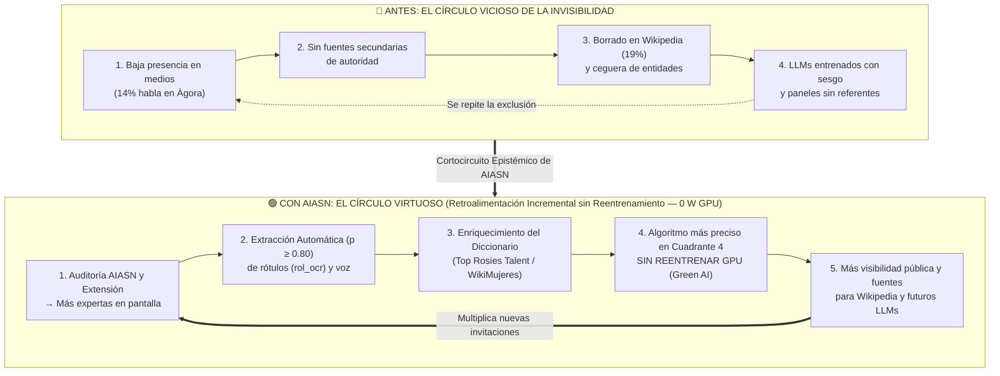

<!--
SPDX-FileCopyrightText: 2026 Equipo 1: Attention Is All She Needs (Alba Camiña García, Pilar de la Fuente Diez, Rocío Jiménez Villén)
SPDX-License-Identifier: Apache-2.0
-->

# 📖 Glosario Maestro de Términos, Elementos Clave de la Solución y el «Círculo Virtuoso»
## Proyecto: «Attention Is All She Needs» (AIASN) — Reto «Mujeres por la IA Abierta»

> **Propósito:**  
> Documento canónico de referencia rápida de los **27 conceptos, piezas arquitectónicas, métricas y salvaguardas ético-legales** que conforman la solución **AIASN**, junto con el desglose visual y técnico de su innovación disruptiva y *Green AI*: el paso del **«Círculo Vicioso de la Invisibilidad»** al **«Círculo Virtuoso de Referentes Femeninos»** (*Retroalimentación Incremental sin Reentrenamiento*).

---

## 1. Identidad y Marco Conceptual de Género (El *«Porqué»*)

| # | Término / Elemento | Definición en AIASN y Origen Teórico |
| :-: | :--- | :--- |
| **1** | **Giro Epistémico de *«Attention Is All She Needs»* (*El Peso de la Atención*)** | Resignificación del artículo fundacional de los Transformers (*Attention Is All You Need*, Vaswani et al., 2017). Si las redes neuronales asignan «pesos de atención» matemáticos a lo relevante, AIASN audita cómo la esfera pública ha concentrado históricamente la atención en los hombres (**86 % en `Àgora`**) y exige dirigirla hacia la **voz efectiva, el criterio experto y el liderazgo de las mujeres**. |
| **2** | **Aniquilación Simbólica (*Symbolic Annihilation*)** | Concepto sociológico (Gaye Tuchman, 1978) que describe cómo los medios invisibilizan a las mujeres mediante tres mecanismos que AIASN mide empíricamente: **omisión** (no aparecen), **trivialización** (aparecen sin voz experta o en temas secundarios) y **condena/subordinación**. |
| **3** | ***Equality-Washing* / *Purplewashing* (Presencia Figurativa)** | Práctica engañosa en la que una organización coloca a mujeres en pantalla, fotos o carteles para aparentar paridad ($\ge 35\,\%$ de presencia visual), pero les concede una fracción marginal de la palabra o de los roles de autoridad (ratio voz/pantalla $\le 0{,}30$). |
| **4** | **Masa Crítica y Suelo de Paridad (35 % – 40 %)** | Basado en la *Teoría de las Proporciones* de Rosabeth Moss Kanter (1977) y en la **Ley Orgánica 2/2024** (suelo legal del 40 %): por debajo del 35 %, las mujeres operan como minoría simbólica (*tokens*); a partir del 40 % existe representación equilibrada real. |
| **5** | **Círculo Virtuoso de Referentes (*Green AI Flywheel*)** | **Nombre estratégico/comercial:** *Círculo Virtuoso de Referentes Femeninos*. **Nombres técnicos de ingeniería:** *Retroalimentación Incremental sin Reentrenamiento (Zero-Retraining Feedback Loop)* / *Enriquecimiento Autónomo del Diccionario de Referentes*. Bucle de retroalimentación positiva por el cual cada contenido auditado extrae automáticamente por consenso de alta confianza ($p \ge 0{,}80$) los nombres y cargos de mujeres expertas (`rol_ocr`), enriqueciendo un diccionario ligero (`.csv`/`.json`) interoperable con **`Top Rosies Talent`**, **`ReDivIAcat`**, **`tFemTIC`** (`IDEAI-UPC` / `donesCOEINF`) y **`WikiMujeres`**. Permite que el sistema reconozca a más profesionales en futuros análisis (Cuadrante 4) **sin gastar GPU en reentrenar modelos**. |
| **6** | ***Debiasing by Design* en Temáticas de Cuidados** | Ajuste inspirado en la *Ética del cuidado* (Carol Gilligan, 1982) y el marco europeo *LifeComp* para que las intervenciones sobre salud, educación, conciliación o sostenibilidad tengan el mismo peso de autoridad epistémica que economía, tecnología o geopolítica. |

---

## 2. Matriz Multimodal y Métricas Deterministas (El *«Qué mide»*)

| # | Término / Elemento | Definición en AIASN y Origen Técnico |
| :-: | :--- | :--- |
| **7** | **Matriz de los 4 Cuadrantes (*Seeing and Hearing*)** | Marco analítico de la Dra. Verónica Vilaplana (`IDEAI-UPC`) implementado en `aiasn/core/fusion.py` que cruza presencia visual y voz: • **Cuadrante 1 (`en_pantalla_y_hablando`):** Protagonismo activo y voz experta. • **Cuadrante 2 (`en_pantalla_en_silencio`):** Presencia muda / alerta de figuración (*equality-washing*). • **Cuadrante 3 (`fuera_de_pantalla_y_hablando`):** Voz en *off* o locución. • **Cuadrante 4 (`mencionada_en_texto`):** Referencia pasiva o cita de autoridad en el discurso. |
| **8** | **Ratio Voz / Pantalla (*Voice-to-Screen Ratio*)** | Cociente determinista entre el porcentaje de tiempo de habla femenina y su porcentaje de tiempo en pantalla. Si la presencia supera el 35 % pero este ratio cae por debajo de $0{,}30$, salta la alerta automática de **Lavado de Imagen (*Equality-Washing*)**. |
| **9** | **Centralidad (`centrality`) y Área Visual (`area`)** | Métricas geométricas de encuadre (heredadas del baseline de Verónica Vilaplana) que cuantifican si las mujeres ocupan el centro del plano con primeros planos o quedan desplazadas a las esquinas/fondo con menor tamaño relativo. |
| **10** | **Constelación del Protagonismo** | Grafo del frontend con las personas (estrellas, por tiempo de voz) y los temas, unidos por menciones, turnos de palabra, planos compartidos y qué tema trata cada persona; muestra qué géneros dominan qué temas (**Índice de Segregación Temática**). |
| **11** | **Índice de Clima Conversacional y Fricción Acústica (ADR-0009)** | Medición objetiva de interrupciones (*manterrupting*), solapes de turno (en milisegundos) y hostilidad/valencia léxica en texto, **sin utilizar reconocimiento biométrico de emociones**. |
| **12** | **Capa de Confianza (*Trust Layer* en 4 Estados)** | Sistema de sellos comprensible en 5 segundos que combina el rigor metodológico de una Denominación de Origen (DOP) con la usabilidad ciudadana (estilo BlaBlaCar/Wallapop): `✅ Verificado`, `📈 En Proceso`, `⚠️ Cobertura Parcial` y `🚨 Alerta de Lavado de Imagen`. |
| **13** | **Test de Interlocución Femenina — TIF (ADR-0011)** | Adaptación determinista de AIASN del Test de Bechdel-Wallace a contenidos audiovisuales de no ficción (`aiasn/core/fusion.py`, 0 W GPU). Emite veredicto en **tres estados**: `no_evaluable` (sin quorum conversacional o sin contraste), `no_supera` (< 2 mujeres con voz) y `evaluado` con puntuación 0 a 3: (1) pluralidad activa (≥ 2 mujeres con voz), (2) acreditación pública (rótulo OCR de cargo) y (3) interlocución horizontal directa (transición de turno de habla Mujer_A → Mujer_B sin mediación masculina). Supera la prueba únicamente con 3/3. |

---

## 3. Arquitectura, Sostenibilidad (*Green AI*) y Modelos Abiertos (El *«Cómo funciona»*)

| # | Término / Elemento | Definición en AIASN y Origen Técnico |
| :-: | :--- | :--- |
| **14** | **Separación entre Inferencia y Cálculo Determinista (ADR-0001)** | Principio arquitectónico central: los modelos de IA abierta (`Whisper`, `YOLOX`/`YOLO11m`, `miVOLO`, `EasyOCR`, `GLiNER`) solo extraen datos brutos con marcas de tiempo; **el 100 % de las métricas, solapes y alertas los calcula determinísticamente Python (`pandas`)**, impidiendo alucinaciones. |
| **15** | **Prevalencia Jerárquica del Dato Declarado (`rol_ocr`)** | Regla en código por la cual el nombre, pronombre o cargo leído por OCR en el rótulo en pantalla (*chiron* / faldón) o en el acta oficial prevalece siempre sobre cualquier inferencia biométrica de voz o rostro. |
| **16** | **Muestreo Temporal `STRIDE` (ADR-0003)** | Técnica de *Algoritmos Verdes* para no analizar todos los fotogramas con todos los modelos: el vídeo se extrae a 25 fps y se buscan caras en todos los fotogramas, porque el detector de hablante activo (TalkNet) los necesita; las personas se detectan en 1 de cada 4 fotogramas y los rótulos a 1 fps. El ahorro frente a analizarlo todo está pendiente de medir. |
| **17** | **Arquitectura *Split Edge-to-Cloud* (99,99 % ahorro y ENS)** | Diseño híbrido donde el archivo pesado (`.mp4` de varios GB) se procesa de forma efímera en local (*Edge*) y hacia la nube (AI Endpoints de OVHcloud) o el repositorio solo viajan kilobytes de texto y tablas anónimas (`.csv`/`.tsv`). Ahorra el **99,99 % de red y almacenamiento cloud** y permite a entes públicos (RTVE, TV3, universidades, ministerios) cumplir el **Esquema Nacional de Seguridad (ENS)**. |
| **18** | **Adaptadores Desacoplados de Licencia (`CSVPrecomputedAdapter` y `PermissiveYOLOXAdapter`)** | Cortafuegos técnico-jurídico (ADR-0002 / ADR-0008) en `aiasn/core/compliance.py` que busca aislar el núcleo `Apache-2.0` frente al copyleft `AGPL-3.0` de Ultralytics, permitiendo ingerir tablas `.csv`/`.tsv` (doctrina de separación de procesos de la FSF). La visión local permisiva (`YOLOX` Apache-2.0 + `EasyOCR` Apache-2.0; `InsightFace`: código MIT, pesos de uso no comercial) es **hoja de ruta**: hoy `PermissiveYOLOXAdapter` es un esqueleto sin inferencia sobre vídeo. |
| **19** | **Extensión en Caliente para las 4 Modalidades (*Shift-Left Parity*)** | Capacidad del motor para inyectarse como asistente preventivo en tiempo real durante la grabación, edición o redacción en **Vídeo** (`OBS Studio`, `DaVinci`, `Premiere`), **Audio/Podcasts** (`Audacity`, `Audition`), **Imagen/Cartelería** (`Canva`, `Figma`) y **Texto/Prensa** (`WordPress`, `Docs`), corrigiendo desequilibrios antes de publicar. |

---

## 4. Gobernanza Ética, Legal (RIA / RGPD) y Certificación (El *«Blindaje»*)

| # | Término / Elemento | Definición en AIASN y Base Jurídica |
| :-: | :--- | :--- |
| **20** | **Umbral de Abstención Ética ($p < 0{,}80 \rightarrow \text{no\_determinado}$)** | Cortafuegos probabilístico (ADR-0005, siguiendo a Karina Gibert, Verónica Vilaplana y Adrián Fonollosa): si la certeza del clasificador es menor del 80 %, el sistema no adivina ni fuerza un binario; asigna `no_determinado`, reporta el **Índice de Cobertura** y deriva a revisión humana. |
| **21** | ***Zero Facial Retention* (Biometría Efímera en RAM)** | Salvaguarda de privacidad (ADR-0004 / RGPD) ejecutada por `BaseVisionAdapter.validar_y_sanitizar_contrato()`: los vectores faciales (`embedding`, `face_vector`) solo existen en memoria RAM volátil durante el conteo y **se purgan automáticamente antes de devolver la tabla**. Prohibición absoluta de bases de datos biométricas. |
| **22** | **Exclusión de Emociones Biométricas (Art. 5.1.f RIA)** | Salvaguarda legal (ADR-0009 y Directrices CE `C(2025) 884`) que prohíbe usar IA para inferir emociones o estados psicológicos a partir del rostro o el timbre de voz, evitando además el sesgo fisiognómico contra las mujeres. |
| **23** | **Botón Preceptivo «Asumo / No asumo» (*HitL*) e ID Pseudonimizado (`operador_supervision_id`)** | Mecanismo operativo de supervisión humana efectiva (**Art. 14 RIA**, recomendado por Karina Gibert y Ángela Gasch). Al pulsar «Asumo», registra un identificador de rol o token pseudonimizado (Art. 5.1.c RGPD) dentro del hash `SHA-256`, garantizando trazabilidad pericial ante la AESIA o un juez sin exponer el nombre civil ni el DNI de la trabajadora en el sello público. *Estado en v0.1.0: diseño objetivo; el panel de revisión del piloto no guarda decisiones y `emitir_sello_auditoria` es una librería aún no integrada en la API.* |
| **24** | **Sostenibilidad *Social Open Steward* (Democratización de la Validación)** | Estatuto del **Art. 1 del Código Ético**: el fin último es la justicia epistémica; los ingresos B2B procedentes de grandes corporaciones obligadas por ley (LO 2/2024 y Directiva CSRD) financian que la validación sea **100 % libre, abierta y gratuita a perpetuidad para ciudadanía, escuelas, universidades, periodistas y ONGs**. |
| **25** | **Cláusula Anti-Lavado (*No-Wash Policy*), Ventana de 3 Años y Rehabilitación (*Self-Cleaning*)** | Bajo el **Art. 6 de Apache-2.0 (*Trademarks*)** y el **Art. 3 del Código Ético**, `emitir_sello_auditoria()` deniega el Sello Oficial Pleno a entidades con sanciones firmes en los **últimos 3 años** (LISOS, Art. 71.1.d LCSP sin Plan de Igualdad en REGCON, o Art. 31 bis CP). Si la entidad ha reparado el daño, inscrito su Plan en REGCON y aporta **2 a 3 años/ciclos de informes históricos** (*Self-Cleaning*, Art. 57.6 Directiva 2014/24/UE), recibe el **«Sello en Observación / Rehabilitación Verificada»**. |
| **26** | **Huella Criptográfica Inmutable (`SHA-256`) y Regla de No-Compensación** | Firma criptográfica de 64 caracteres hexadecimales generada sobre las métricas, la elegibilidad y el `operador_supervision_id`. Si una entidad altera un decimal del informe o hace *cherry-picking* de un solo vídeo, el hash se rompe y el sello queda revocado. Además, un buen resultado comunicativo jamás compensa brechas salariales o de consejos. |
| **27** | **Soberanía Lingüística Cooficial, Accesibilidad Universal por Diseño y Reutilización en las AAPP (ADR-010)** | Soporte nativo sin traducción intermedia para todas las **lenguas cooficiales del Estado (`es`, `ca`, `gl`, `eu`) + `en`** (`whisper-large-v3`, `bge-m3`, `EasyOCR`, `GLiNER`), **Accesibilidad Universal** (**Directiva UE 2019/882**, **RD 1112/2018**, **WCAG 2.2 AA** con paleta Okabe-Ito, **Lectura Fácil UNE 153101** en `resumen_lectura_facil` para lectores de pantalla y subtitulado **UNE 153010**), y cumplimiento del **Art. 157 de la Ley 40/2015 (LRJSP)**, **ENI** y **ENS** para su reutilización inmediata en todas las Administraciones Públicas del Estado. |

---

## 5. Del «Círculo Vicioso» al «Círculo Virtuoso» de AIASN: Explicación Estratégica, Nomenclatura Técnica y Diagrama Visual

> **Por qué esta pieza es nuestro mayor activo de Innovación Disruptiva (Reto de Montse Guàrdia) y de *Algoritmos Verdes* (*Green AI*):**  
> Conecta directamente con los directorios de talento femenino de la Universitat Politècnica de Catalunya (**`Top Rosies Talent`**, **`ReDivIAcat`** y **`tFemTIC`** de `IDEAI-UPC` / `donesCOEINF`, liderados por la Dra. Karina Gibert) y con **`WikiMujeres` / `Wikidata`**, logrando que el sistema se vuelva más inteligente con cada vídeo auditado **sin gastar un solo vatio ni euro de GPU en reentrenar modelos**.

### 5.1. Doble Nomenclatura (Estratégica vs. Ingeniería de Software)

| Ámbito de Uso | Denominación Oficial en AIASN |
| :--- | :--- |
| **Presentación (*Pitch*), Estrategia Comercial e Innovación Social** | **«El Círculo Virtuoso de Referentes Femeninos»** *(Green AI Flywheel)* |
| **Arquitectura de Software, Memoria Técnica y *Green AI*** | **1. «Retroalimentación Incremental sin Reentrenamiento»** *(Zero-Retraining Feedback Loop)* **2. «Enriquecimiento Autónomo del Diccionario de Referentes»** *(Autonomous Knowledge-Dictionary Enrichment, Offline/Batch & Synced)* |

---

### 5.2. Comparativa Paso a Paso: Cómo AIASN invierte el bucle sistémico

#### 🔴 1. El «Círculo Vicioso» actual (sin AIASN)
1. **Invisibilidad en medios y paneles:** En los debates y eventos casi no se invita a mujeres como expertas (**solo 14 % de tiempo de habla en `Àgora`**).
2. **Falta de fuentes secundarias:** Como no aparecen ni son rotuladas en medios, no existen evidencias secundarias verificables que acrediten su relevancia pública (*notability*, Francesca Tripodi 2021).
3. **Borrado en Wikipedia y ceguera en datos:** Sin esas fuentes secundarias, en Wikipedia se borran o rechazan sus biografías (estancada en un 15 %–19 % de biografías femeninas) y los extractores de entidades estándar no reconocen sus nombres cuando se las cita en un texto.
4. **Sesgo en los Modelos de IA (LLMs):** Los grandes modelos fundacionales (`GPT`, `Llama`, `Qwen`, `Gemini`) se entrenan sobre Wikipedia y medios, aprendiendo que la autoridad técnica es masculina.
5. **Reproducción de la exclusión:** Cuando un periodista, un congreso o un asistente de IA busca referentes sobre un tema, solo encuentra nombres de hombres y vuelve a invitar a hombres *(vuelta al Paso 1, agravando la brecha)*.

#### 🟢 2. El «Círculo Virtuoso» de AIASN (cómo se retroalimenta solo)
1. **Más auditoría $\rightarrow$ Más expertas en pantalla:** Las empresas, congresos y medios utilizan AIASN (y la extensión en caliente en sala de edición) para no suspender en paridad real (Cuadrante 1), por lo que invitan y rotulan a más mujeres profesionales.
2. **Más expertas en pantalla $\rightarrow$ Extracción automática ($p \ge 0{,}80$):** AIASN lee de forma autónoma sus rótulos (`rol_ocr`) y sus intervenciones en esos vídeos mediante consenso multimodal (`EasyOCR` + `Whisper` + `GLiNER`), reservando el arbitraje humano solo para casos dudosos ($p < 0{,}80$).
3. **Extracción $\rightarrow$ Diccionario más rico (`Top Rosies Talent` / `ReDivIAcat` / `WikiMujeres`):** Esos nombres, cargos y marcas de tiempo verificadas se añaden automáticamente al diccionario ligero (`.csv`/`.json`), tanto en ejecución local desconectada (*offline/batch*) como sincronizada.
4. **Diccionario más rico $\rightarrow$ Algoritmo más inteligente sin reentrenar GPU (*Green AI*):** En el siguiente vídeo o texto que se audite, el detector ya conoce a esas profesionales cuando alguien las cita en una conversación (Cuadrante 4), **sin haber gastado ni un euro ni un vatio de GPU en reentrenar la red neuronal (*zero fine-tuning*)**.
5. **Más visibilidad $\rightarrow$ Más invitaciones y mejores LLMs:** Al quedar registradas con evidencias secundarias trazables al segundo en **`Top Rosies Talent`**, **`ReDivIAcat`** y **`WikiMujeres`**, sus biografías superan el filtro de Wikipedia (corrigiendo la base de entrenamiento de los futuros LLMs) y más organizadores las encuentran y las llaman para nuevos debates *(vuelta al Paso 1, multiplicando exponencialmente el impacto)*.

---

### 5.3. Representación Visual para la Presentación y el Repositorio

