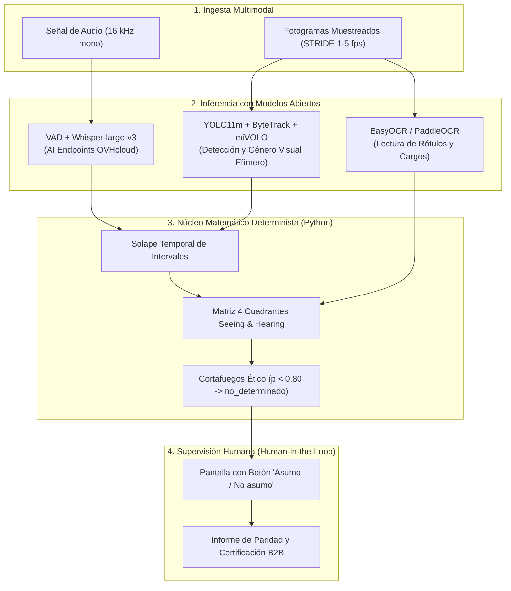

# Attention Is All She Needs (AIASN)

> **Auditoría de paridad, protagonismo y perspectiva de género en medios audiovisuales mediante Inteligencia Artificial Abierta.**  
> Proyecto desarrollado para el **Reto «Mujeres por la IA Abierta»** convocado por la **Secretaría de Estado de Digitalización e Inteligencia Artificial (SEDIA)**, la **Comunidad IA de Código Abierto (`ComunidadIA-OS`)**, el **IDEAI-UPC**, **donesCOEINF** y **OVHcloud**.

[](./LICENSE)
[](./pyproject.toml)
[](https://opensource.org/ai)
[](./ETHICS_CHECKLIST.md)

---

## 👥 Equipo 1: «Attention Is All She Needs»
* **Rocío Jiménez Villén** ([@rjvillen](https://github.com/rjvillen)) — Procesamiento de texto, embeddings semánticos, grafos de conocimiento y visión por computador.
* **Pilar de la Fuente Diez** ([@pilarfuente1992](https://github.com/pilarfuente1992)) — Interlocución oficial, estrategia de producto, modelo de negocio B2B (EIPs / Ley 2/2024) y presentación presencial.
* **Alba Camiña García** ([@ewigkeitt-cloud](https://github.com/ewigkeitt-cloud)) — Marco conceptual, gobernanza ética y regulatoria (RIA / Sandbox), arquitectura desacoplada y Algoritmos Verdes (*Green AI*).

---

## 💡 El Giro Epistémico: «Attention Is All She Needs»

El nombre del proyecto rinde homenaje y resignifica el artículo fundacional de la arquitectura Transformer:  
> **Vaswani, A. et al. (2017). *Attention Is All You Need*. NeurIPS.**

En las redes neuronales, el mecanismo de **autoatención (*self-attention*)** calcula matemáticamente qué elementos de una secuencia merecen peso y cuáles constituyen ruido contextual.  
En la esfera pública y mediática, históricamente los «pesos de atención» se han concedido de forma casi exclusiva a los hombres (reflejado en el escaso **14 % de habla femenina** registrado en el corpus de debate `Àgora` de la UPC), relegando a las mujeres a los márgenes (*aniquilación simbólica*) o a la presencia física muda (*equality-washing*).

**AIASN** proclama que lo que las mujeres necesitan no es condescendencia ni cuotas cosméticas de imagen, sino que el foco de la atención algorítmica, mediática y social se pose con rigor objetivo sobre su **voz efectiva, rol experto y liderazgo real**.

---

## 🏛️ Arquitectura del Sistema: Extracción Abierta + Cálculo Determinista



### Principios Rectores de Arquitectura
1. **Separación Estricta entre Inferencia y Cálculo:** Los modelos de IA abierta extraen transcripciones, coordenadas y probabilidades; el **100 % de los tiempos, porcentajes, solapes y ratios los calcula determinísticamente Python (`pandas`)**, eliminando cualquier riesgo de alucinación generativa.
2. **Prioridad al Dato Declarado sobre la Biometría:** Un rótulo leído por OCR (*«Dra. Maria Pons — Catedràtica d'Economia»*) tiene **prevalencia jerárquica estricta** sobre cualquier inferencia biométrica física.
3. **Privacidad por Diseño (*Zero Facial Retention*):** Las inferencias faciales se procesan en memoria RAM efímera y se destruyen de inmediato tras el conteo estadístico; **nunca se almacenan vectores faciales ni se crean bases de datos biométricas**.
4. **Detector de *Equality-Washing* (Matriz *Seeing and Hearing*):** Clasifica cada aparición en 4 cuadrantes:
   * **Cuadrante 1 (Voz Activa):** En pantalla y hablando $\rightarrow$ Liderazgo y voz experta.
   * **Cuadrante 2 (Presencia Muda):** En pantalla y en silencio $\rightarrow$ Alerta de figuración / lavado de imagen.
   * **Cuadrante 3 (Voz en Off):** Fuera de pantalla y hablando $\rightarrow$ Narración o locución.
   * **Cuadrante 4 (Pasivo):** Solo mencionado en el texto o subtítulo.
5. **Supervisión Humana (*Human-in-the-Loop*):** Conforme a las recomendaciones de Karina Gibert y Ángela Gasch (SEDIA), el sistema incluye una pantalla operativa con el botón **«Asumo / No asumo»** previa a la emisión de cualquier informe o certificado de paridad.

---

## ⚡ Algoritmos Verdes (*Green AI*) y Eficiencia

* **Muestreo Temporal `STRIDE`:** Se procesan entre 1 y 5 fotogramas por segundo (`STRIDE = 3` a `6`), reduciendo el consumo de GPU y la huella de carbono en más de un **80 %** frente al procesado continuo a 25/30 fps, sin pérdida de precisión estadística.
* **Optimización Hardware:** Diseñado para ejecutarse en las instancias $2 \times \text{NVIDIA V100}$ de OVHcloud con precisión de coma flotante media **`torch.float16`**.
* **Coste de Sostenibilidad:** Inferencia auditada por debajo de **0,30 € por hora de vídeo analizada**.

---

## 🚀 Instalación y Reproducción

### 1. Clonar el Repositorio
```bash
git clone https://github.com/ComunidadIA-OS/attention-is-all-she-needs.git
cd attention-is-all-she-needs
```

### 2. Entorno con `uv` (Recomendado) o `pip`
```bash
# Con uv (rápido y reproducible)
uv venv
source .venv/bin/activate  # En Linux/Mac
# o en Windows: .venv\Scripts\activate
uv pip install -e ".[audio,video,analysis]"

# Con pip clásico
pip install -e ".[audio,video,analysis]"
```

### 3. Ejecutar la Suite de Pruebas Automatizadas
```bash
python -m pytest tests/ -v
```

---

## ⚖️ Declaración de Transparencia (EU AI Act - Art. 50)

En cumplimiento del **Reglamento (UE) 2024/1689 (Reglamento Europeo de IA)** y de la obligación legal vigente desde agosto de 2026:
* Este prototipo utiliza sistemas de inteligencia artificial de código abierto para tareas de transcripción (`whisper-large-v3`), detección visual (`YOLO11m`), clasificación demográfica agregada (`miVOLO`) y embeddings (`bge-m3`).
* El sistema **no toma decisiones automatizadas vinculantes ni elabora perfiles biométricos individuales**. Su salida constituye una propuesta analítica sujeta a supervisión humana preceptiva (*Human-in-the-Loop*).
* Los datos de prueba utilizados en fase de desarrollo proceden de corpus autorizados por la UPC (`Àgora`) y de grabaciones de divulgación pública tratadas al amparo del **Art. 67 del Real Decreto-ley 24/2021** (excepción de Minería de Textos y Datos con fines de investigación).

---

## 📚 Documentación de Gobernanza y Enlaces Canónicos

* 📋 [**ETHICS_CHECKLIST.md**](./ETHICS_CHECKLIST.md): Autoevaluación formal bajo los 7 principios de ALTAI y el Sandbox de la SEDIA / AESIA.
* 🧪 [**TESTING.md**](./TESTING.md): Protocolo de pruebas con *Ground Truth*, tests unitarios y pruebas de usabilidad humana.
* 🤖 [**MODEL_CARD.md**](./MODEL_CARD.md): Ficha técnica de modelos abiertos, umbrales y limitaciones conocidas.
* 📊 [**DATASET_CARD.md**](./DATASET_CARD.md): Ficha de procedencia de datos, perfil poblacional y régimen legal de fuentes.
* 🔒 [**SECURITY.md**](./SECURITY.md): Política de seguridad y principio de *Zero Facial Retention*.
* 🤝 [**CONTRIBUTING.md**](./CONTRIBUTING.md): Guía de contribución comunitaria y flujo de ramas.
* 📜 [**CODE_OF_CONDUCT.md**](./CODE_OF_CONDUCT.md): Código de conducta (Contributor Covenant 2.1).
* 📝 [**CHANGELOG.md**](./CHANGELOG.md): Historial de versiones y evolución del prototipo.
