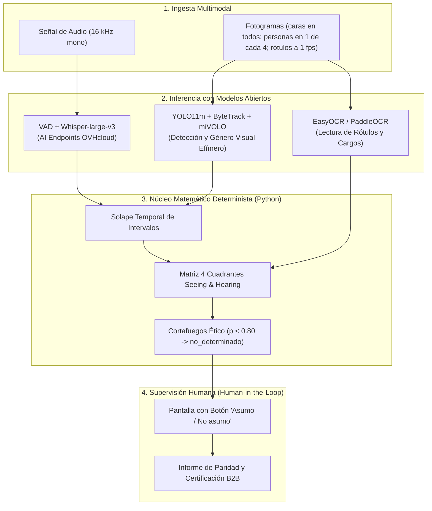
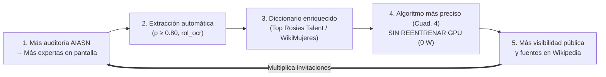

<!--
SPDX-FileCopyrightText: 2026 Equipo 1: Attention Is All She Needs (Alba Camiña García, Pilar de la Fuente Diez, Rocío Jiménez Villén)
SPDX-License-Identifier: Apache-2.0
-->

# Attention Is All She Needs (AIASN)

> **Auditoría de paridad, protagonismo y perspectiva de género en medios audiovisuales mediante Inteligencia Artificial Abierta.**
> Proyecto desarrollado para el **Reto «Mujeres por la IA Abierta»** convocado por la **Secretaría de Estado de Digitalización e Inteligencia Artificial (SEDIA)**, la **Comunidad IA de Código Abierto (`ComunidadIA-OS`)**, el **IDEAI-UPC**, **donesCOEINF** y **OVHcloud**.

[](./LICENSE)
[](https://api.reuse.software/info/github.com/ComunidadIA-OS/attention-is-all-she-needs)
[](./pyproject.toml)
[](https://opensource.org/ai)
[](./ETHICS_CHECKLIST.md)

> **Para evaluar:** comandos, vídeos de la demo y dónde mirar en [Cómo probarlo](#-cómo-probarlo).

---

## 👥 Equipo 1: «Attention Is All She Needs»
* **Rocío Jiménez Villén** ([@rjvillen](https://github.com/rjvillen)) — Arquitectura de backend (FastAPI, Docker y Medallion), orquestación de pipelines, procesamiento NLP, embeddings semánticos y convocatoria de reuniones de sincronización.
* **Pilar de la Fuente Diez** ([@pilarvolatixia-cloud](https://github.com/pilarvolatixia-cloud)) — Interlocución institucional oficial, modelo de negocio B2B (EIPs / Ley 2/2024 / CSRD), mitigación de riesgos de licencia (AGPL), prototipado de frontend y defensa presencial.
* **Alba Camiña García** ([@ewigkeitt-cloud](https://github.com/ewigkeitt-cloud)) — Giro epistémico de AIASN, motor determinista y TIF (`fusion.py`), gobernanza ética y regulatoria (RIA / Sandbox), gestión ágil del repositorio (GitHub Project, issues e hitos), arquitectura documental SSoT y diseño de innovación (Constelación, Capa Ciudadana y Shift-Left).

---

## 💡 El Giro Epistémico: «Attention Is All She Needs»

El nombre del proyecto rinde homenaje y resignifica el artículo fundacional de la arquitectura Transformer:
> **Vaswani, A. et al. (2017). *Attention Is All You Need*. NeurIPS.**

En las redes neuronales, el mecanismo de **autoatención (*self-attention*)** calcula matemáticamente qué elementos de una secuencia merecen peso y cuáles constituyen ruido contextual.
En la esfera pública y mediática, históricamente los «pesos de atención» se han concedido de forma casi exclusiva a los hombres (reflejado en el escaso **14 % de habla femenina** registrado en el corpus de debate `Àgora` de la UPC), relegando a las mujeres a los márgenes (*aniquilación simbólica*) o a la presencia física muda (*equality-washing*).

**AIASN** proclama que lo que las mujeres necesitan no es condescendencia ni cuotas cosméticas de imagen, sino que el foco de la atención algorítmica, mediática y social se pose con rigor objetivo sobre su **voz efectiva, rol experto y liderazgo real**.

### 🎯 Declaración de Propósito y Misión Social
1. **Justicia Epistémica frente a la Aniquilación Simbólica:** No toleramos la invisibilización de las mujeres en los medios ni su confinamiento a roles testimoniales o asistenciales. Reivindicamos su autoridad intelectual y su protagonismo activo como expertas y líderes de opinión.
2. **Rigor Matemático contra el *Equality-Washing*:** Rechazamos el postureo corporativo y la paridad cosmética de foto. La igualdad real se acredita con evidencias cuantitativas reproducibles: tiempo de voz activa, interlocución horizontal directa y reconocimiento público en pantalla, calculados determinísticamente y sin alucinaciones generativas.
3. **Democratización de la Validación (*Social Open Steward*):** Rompemos el monopolio de las auditorías opacas y costosas. La tecnología de AIASN es y será siempre 100 % libre, soberana y gratuita para la ciudadanía, las escuelas, las universidades, los periodistas independientes y las organizaciones sociales.
4. **Del Círculo Vicioso al Círculo Virtuoso:** Transformamos la auditoría en un motor de cambio sistémico (*Green AI Flywheel*). Cada contenido auditado enriquece los directorios públicos de talento (`Top Rosies Talent`, `WikiMujeres`) para nutrir con referentes femeninos verificados a los futuros modelos de inteligencia artificial y a la sociedad entera.

---

## 🏛️ Arquitectura del Sistema: Extracción Abierta + Cálculo Determinista



### Principios Rectores de Arquitectura
1. **Separación Estricta entre Inferencia y Cálculo:** Los modelos de IA abierta extraen transcripciones, coordenadas y probabilidades; el **100 % de los tiempos, porcentajes, solapes y ratios los calcula determinísticamente Python (`pandas`)**, eliminando cualquier riesgo de alucinación generativa.
2. **Prioridad al Dato Declarado sobre la Biometría:** Un rótulo leído por OCR (*«Dra. Maria Pons — Catedràtica d'Economia»*) tiene **prevalencia jerárquica estricta** sobre cualquier inferencia biométrica física.
3. **Privacidad por Diseño (*Zero Facial Retention*):** Los vectores faciales (*embeddings*) se calculan solo en memoria, para agrupar las apariciones de una misma persona dentro de un vídeo, y se descartan antes de escribir en el lake: **nunca se almacenan vectores faciales, no se crea ninguna base de datos biométrica y no se identifica a nadie contra un registro externo**. Al terminar, cada vídeo procesado con Docker Compose borra sus ficheros temporales (fotogramas, audio y vídeo remuestreado en `tmp/`) y, si todos los pasos han ido bien, el vídeo subido a `landing/` (`PRIVACY__DELETE_MEDIA_AFTER_RUN`; sin Docker está desactivado por defecto, para depurar) (véase [`ETHICS_CHECKLIST.md`](./ETHICS_CHECKLIST.md), punto 3.5).
4. **Detector de *Equality-Washing* (Matriz *Seeing and Hearing*):** Clasifica cada aparición en 4 cuadrantes:
* **Cuadrante 1 (Voz Activa):** En pantalla y hablando $\rightarrow$ Liderazgo y voz experta.
* **Cuadrante 2 (Presencia Muda):** En pantalla y en silencio $\rightarrow$ Alerta de figuración / lavado de imagen.
* **Cuadrante 3 (Voz en Off):** Fuera de pantalla y hablando $\rightarrow$ Narración o locución.
* **Cuadrante 4 (Pasivo):** Solo mencionado en el texto o subtítulo.
5. **Test de Interlocución Femenina (TIF, [ADR-0011](./docs/adr/0011-adopcion-test-interlocucion-femenina-tif.md)):** Adaptación AIASN del Test de Bechdel-Wallace a la no ficción, 100 % determinista (`evaluar_bechdel_conversacional`, con alias `evaluar_interlocucion_femenina`, en `aiasn/core/fusion.py`; 0 W GPU). Veredicto en **tres estados**: `no_evaluable` (sin datos de género determinado, menos de dos personas con voz —no hay conversación— o ninguna presencia masculina), `no_supera` (no aparece ninguna mujer o solo una) y `evaluado`, que puntúa de 0 a 3: (1) pluralidad femenina (≥ 2 mujeres distintas con voz activa), (2) identidad acreditada (≥ 2 mujeres con rótulo de nombre o cargo por OCR) y (3) interlocución horizontal directa (≥ 1 transición de turno Mujer_A → Mujer_B). Solo supera con 3/3.
6. **Supervisión Humana (*Human-in-the-Loop*) — parcial:** Conforme a las recomendaciones de Karina Gibert y Ángela Gasch (SEDIA), el diseño prevé una pantalla operativa con el botón **«Asumo / No asumo»** previa a la emisión de cualquier informe o certificado de paridad (especificada en [`docs/especificacion_alertas_dashboard_y_hitl.md`](./docs/especificacion_alertas_dashboard_y_hitl.md)). **Estado en v0.1.0:** el frontend piloto incluye un panel de revisión de personas con género dudoso, pero las decisiones aún no se guardan y la revisión no bloquea el informe; el botón «Asumo / No asumo», la persistencia con identificador pseudonimizado y las vistas por rol están en la hoja de ruta.

> 🏛️ **Registro Formal de Decisiones de Arquitectura (ADRs):** Todas las decisiones técnicas y éticas del proyecto están formalizadas bajo el estándar de Michael Nygard en el catálogo [`docs/adr/`](./docs/adr/README.md).

---

## ⚡ Algoritmos Verdes (*Green AI*) y Eficiencia

* **Muestreo Temporal `STRIDE`:** El vídeo se extrae a 25 fps y se buscan caras en todos los fotogramas, porque el detector de hablante activo (TalkNet) los necesita; las personas se detectan en 1 de cada 4 fotogramas y los rótulos a 1 fps. El ahorro frente a analizarlo todo está pendiente de medir.
* **Optimización Hardware:** Diseñado para ejecutarse en las instancias $2 \times \text{NVIDIA V100}$ de OVHcloud con precisión de coma flotante media **`torch.float16`**.
* **Arquitectura *Split Edge-to-Cloud* (ahorro estimado del 99,99 % en red y almacenamiento; pendiente de medir):** El vídeo pesado (.mp4 de varios GB) se procesa en local (con ficheros temporales en `tmp/`, véase `ETHICS_CHECKLIST.md`, punto 3.5); hacia la nube (AI Endpoints de OVHcloud) o el repositorio solo viajan kilobytes de texto y tablas anónimas (.csv/.tsv), reduciendo drásticamente la huella de carbono de transmisión y almacenamiento.
* **Coste de Sostenibilidad:** en medición con los vídeos de la demo; por ahora solo es oficial el precio de Whisper en OVHcloud, **≈0,15 € por hora de audio**.

### 🔄 Del «Círculo Vicioso» al «Círculo Virtuoso» de Referentes (`Top Rosies Talent` + `WikiMujeres`)
> **Nombre estratégico/comercial:** *Círculo Virtuoso de Referentes Femeninos (Green AI Flywheel)*
> **Nombres técnicos de ingeniería:** *Retroalimentación Incremental sin Reentrenamiento (`Zero-Retraining Feedback Loop`)* / *Enriquecimiento Autónomo del Diccionario de Referentes*

1. **Más auditoría $\rightarrow$ Más expertas en pantalla:** Las empresas y medios usan AIASN (y la extensión en caliente en edición) para cumplir la paridad real (Cuadrante 1), invitando y rotulando a más mujeres profesionales.
2. **Más expertas en pantalla $\rightarrow$ Extracción automática ($p \ge 0{,}80$):** AIASN lee de forma autónoma sus rótulos (`rol_ocr`) y sus intervenciones mediante consenso multimodal (`EasyOCR` + `Whisper` + `GLiNER`).
3. **Extracción $\rightarrow$ Diccionario más rico (`Top Rosies Talent` / `ReDivIAcat` / `WikiMujeres`):** Esos nombres y cargos verificados se añaden solos al diccionario ligero (`.csv`/`.json`), tanto en local desconectado (*offline/batch*) como sincronizado.
4. **Diccionario más rico $\rightarrow$ Algoritmo más inteligente sin reentrenar GPU (*Green AI*):** En el siguiente vídeo que se audite, el detector ya conoce a esas profesionales cuando alguien las cita en una conversación (Cuadrante 4), **sin gastar un solo euro ni vatio de GPU en reentrenar la red neuronal**.
5. **Más visibilidad $\rightarrow$ Más invitaciones:** Al quedar registradas con evidencias de vídeo en **`Top Rosies Talent`** (IDEAI-UPC / donesCOEINF) y **`WikiMujeres`**, más organizadores las encuentran y las llaman para nuevos debates (vuelta al punto 1, multiplicando el efecto).



---

## 🚀 Cómo probarlo

**Probado en** Ubuntu 24.04 (x86_64): AMD Ryzen 7 7840HS (16 hilos), 30 GB de RAM y GPU NVIDIA RTX 4060 Laptop (8 GB), con Docker 29 y Python 3.13. También en CPU, sin GPU, con 2 núcleos y 6 GB de RAM. En Windows, macOS (Apple Silicon) y Linux ARM las dependencias se resuelven, pero el procesado no se ha probado.

> ⚠️ **Sin GPU funciona, pero es lento.** Un vídeo de 84 s tardó **12 min** con 16 hilos y **45 min** con 2 núcleos y 6 GB de RAM (con GPU, 2 min); casi todo es la detección de personas y el OCR. Con la GPU de arriba, los vídeos de la demo tardan entre 2 y 9 min. La primera vez se suman unos minutos para descargar los modelos (~1,6 GB).

### Requisitos

* **Python 3.11+** con [uv](https://docs.astral.sh/uv/) (recomendado) o pip.
* **ffmpeg**, solo sin Docker (la imagen ya lo trae). Hay versión para Linux, macOS y Windows:
  ```bash
  sudo apt install ffmpeg     # Ubuntu / Debian
  brew install ffmpeg         # macOS
  winget install ffmpeg       # Windows
  ```
* **Token de OVHcloud AI Endpoints**, para la transcripción y el LLM: `cp .env.example .env` y rellena `OVH_AI_ENDPOINTS_ACCESS_TOKEN`. Sin él, el *worker* lo avisa al arrancar y falla al transcribir.
* **Con Docker y GPU**, el **NVIDIA Container Toolkit**. Si no está, el *worker* se lanza en CPU y la API lo avisa en su log. [Guía oficial](https://docs.nvidia.com/datacenter/cloud-native/container-toolkit/latest/install-guide.html); en Ubuntu/Debian:
  ```bash
  curl -fsSL https://nvidia.github.io/libnvidia-container/gpgkey | sudo gpg --dearmor -o /usr/share/keyrings/nvidia-container-toolkit-keyring.gpg
  curl -s -L https://nvidia.github.io/libnvidia-container/stable/deb/nvidia-container-toolkit.list \
  | sed 's#deb https://#deb [signed-by=/usr/share/keyrings/nvidia-container-toolkit-keyring.gpg] https://#g' \
  | sudo tee /etc/apt/sources.list.d/nvidia-container-toolkit.list
  sudo apt-get update && sudo apt-get install -y nvidia-container-toolkit
  sudo nvidia-ctk runtime configure --runtime=docker && sudo systemctl restart docker
  docker run --rm --gpus all ubuntu nvidia-smi   # debe mostrar tu GPU
  ```

### 1. Tests (1 minuto, sin GPU ni token)

```bash
git clone https://github.com/ComunidadIA-OS/attention-is-all-she-needs.git
cd attention-is-all-she-needs

python -m venv .venv && source .venv/bin/activate   # Windows: .venv\Scripts\Activate.ps1
pip install -e ".[dev,api]"
python -m pytest tests/ -v
```

Entre otros, validan:
* `tests/test_contracts.py`: contratos de audio, solape temporal, matriz de 4 cuadrantes *Seeing and Hearing* (Verónica Vilaplana), regla anti-*equality-washing* (Kanter 1977 / Tuchman 1978) y abstención ética ($p < 0{,}80 \rightarrow \text{no\_determinado}$).
* `tests/test_compliance_adapters.py`: purga biométrica en RAM (*Zero Facial Retention*), denegación de Sello Oficial ante sanciones LISOS o *cherry-picking* (Art. 6 Apache-2.0), rehabilitación corporativa (*Self-Cleaning*, ventana de 3 años) y firma `SHA-256` con ID de supervisión pseudonimizado (`operador_supervision_id`).

### 2. Demo con Docker

```bash
docker compose --profile jobs build   # imágenes de la API, el front y el worker (este ocupa ~12,5 GB: 10–20 min la primera vez)
docker compose up -d                  # almacén S3, API en http://localhost:8000 y front en http://localhost:8080
```

**Sin GPU NVIDIA**, o para ocupar menos disco, construye el *worker* sin CUDA: pon `WORKER_DEVICE=cpu` en `.env` antes del `build` (o `WORKER_DEVICE=cpu docker compose --profile jobs build worker`). No hay que cambiar nada más:

| *Worker* | Imagen | Vídeo de 84 s (`csic_javier_oroz.mp4`) |
|---|---|---|
| `gpu` (por defecto) | ~12,5 GB | 108 s con una RTX 4060 Laptop |
| `cpu` | ~4,4 GB | 708 s (~12 min) con 16 hilos, sin GPU |

Los modelos (~1,6 GB, en el volumen `aiasn-models`) y las versiones de las librerías (`uv.lock`) son los mismos; solo cambia el PyTorch y el ONNX Runtime sin CUDA. En la prueba, los KPIs por género salieron iguales; cambió algún *track* corto sin género determinado y el número de ideas, que varía entre ejecuciones porque el LLM no es determinista. Con la imagen `cpu` en un equipo con GPU, la GPU no se usa.

* El *worker* no queda corriendo: la API arranca un contenedor `aiasn-worker-<video_id>` por vídeo, y lo borra al lanzar el siguiente. Su log: `docker logs aiasn-worker-<video_id>`.
* La API usa el socket de Docker, lo que le da control sobre Docker en esa máquina: no la expongas fuera de tu equipo.
* ¿El puerto 8000 o el 8080 está ocupado? Cámbialos con `API_PORT` y `FRONT_PORT` en `.env`.

### 3. Demo sin Docker

```bash
uv sync --extra worker --extra api    # ~7 GB (PyTorch y CUDA)
uv run uvicorn aiasn.api.app:create_app --factory --port 8000
python -m http.server 8080 --directory frontend-piloto   # front en http://localhost:8080/?api=http://localhost:8000
```

Sin la imagen `aiasn-worker`, la API lanza el *worker* como proceso (`API__LAUNCHER=process` para forzarlo) y guarda el lake en `data/`. También se puede procesar un vídeo sin la API:

```bash
uv run python -m aiasn.run_pipelines --file video.mp4
```

### 4. Analizar un vídeo

Los vídeos de la demo, con su licencia y autoría, están en [`videos-final-demo/`](videos-final-demo/README.md).

* **Desde el front** (<http://localhost:8080>): «Elegir vídeo» → «Analizar».
* **Desde la API**:
  ```bash
  curl -F file=@video.mp4 http://localhost:8000/videos   # → {"video_id": "video-3f9a"}
  curl http://localhost:8000/videos/video-3f9a           # estado; con "ok", también el resultado
  ```
  Documentación interactiva en <http://localhost:8000/docs>.
* **Si falla** (por ejemplo, si OVHcloud corta la conexión): sin Docker, `uv run python -m aiasn.run_pipelines --video-id <video_id>` sigue desde el paso que falló; con Docker, vuelve a subir el vídeo.

### 5. Trazas del LLM con Langfuse (opcional)

Langfuse, autoalojado, guarda cada llamada al LLM: prompt, respuesta, modelo, duración y tokens. Sin él, el análisis funciona igual.

1. En `.env` (copiado de `.env.example`), activa las trazas y pon tus valores:
   ```env
   LANGFUSE_ENABLED=true
   LANGFUSE_PUBLIC_KEY=pk-lf-...          # inventadas: Langfuse crea el proyecto con estas claves al arrancar
   LANGFUSE_SECRET_KEY=sk-lf-...
   LANGFUSE_INIT_USER_EMAIL=admin@aiasn.local
   LANGFUSE_INIT_USER_PASSWORD=...        # tu usuario de la web de Langfuse
   ```
   Cambia también los secretos del servidor (`LANGFUSE_NEXTAUTH_SECRET`, `LANGFUSE_SALT`, `LANGFUSE_ENCRYPTION_KEY` y las contraseñas de Postgres, ClickHouse y Redis); genera cada uno con `openssl rand -hex 32`.
2. Arranca la demo con Langfuse. Si ya estaba construida, reconstruye las imágenes, porque el *worker* necesita el paquete `langfuse`:
   ```bash
   docker compose --profile jobs build
   docker compose --profile langfuse up -d   # la demo y Langfuse en http://localhost:3000
   ```
   Sin Docker, `LANGFUSE_BASE_URL=http://localhost:3000` apunta al mismo servidor.
3. Analiza un vídeo y abre <http://localhost:3000> con tu usuario → proyecto «AIASN piloto» → **Sessions**. Hay una sesión por vídeo, con su `video_id`, y en ella sus llamadas al LLM, cada una con el nombre de su tarea.

Si las claves no coinciden o Langfuse no está arrancado, el *worker* lo avisa en su log y sigue sin trazas.

### 6. Vídeo anotado: comprobar el resultado a ojo

Dibuja sobre el vídeo lo que ha detectado el pipeline:
* una caja por persona con `P<id> | F/M`;
* una caja verde *speaking* en la cara de quien habla;
* en amarillo, los textos que lee el OCR.

Funciona **sin Docker**, después de procesar el vídeo, porque usa los fotogramas que quedan en `tmp/<video_id>/video/frames`. Con Docker, esos fotogramas se borran con el contenedor del *worker*.

```bash
uv run python scripts/annotate_video.py <video_id>   # → tmp/<video_id>/video/annotated.mp4
```

### 💻 Modo C: Ejecución Local Permisiva, Offline y Sector Público (ENS / Art. 157 LRJSP / Zero Cloud)
> **Para todas las Administraciones Públicas del Estado (RTVE, 3Cat/TV3, EITB, CRTVG, universidades, ministerios, diputaciones y ayuntamientos) sujetas al Esquema Nacional de Seguridad (ENS), al Art. 157 de la Ley 40/2015 (reutilización de sistemas) y a la Directiva UE 2019/882 de Accesibilidad.**
* **Soberanía Lingüística Cooficial e Inclusividad por Diseño (`ADR-0010`):** Soporte nativo sin traducción intermedia para todas las **lenguas cooficiales del Estado (`es`, `ca`, `gl`, `eu`) + `en`**, e inclusión automática de resumen en **Lectura Fácil (Norma UNE 153101 / WCAG 2.2 AA)** (`resumen_lectura_facil`) compatible con lectores de pantalla (`NVDA`/`JAWS`).
* **Aislamiento de Licencias (estado real):** El pipeline de vídeo actual usa **Ultralytics YOLO (AGPL-3.0)** para detectar personas (`aiasn/model_adapters/person_tracker.py`), **InsightFace** para caras (`face_detector.py`) y **EasyOCR (Apache-2.0)** para rótulos, todos tras los adaptadores de `aiasn/model_adapters/`. En `aiasn/core/compliance.py` existen `CSVPrecomputedAdapter` (ingesta de trazas `.csv` / `.tsv`, separación de procesos) y un esqueleto `PermissiveYOLOXAdapter` (**hoja de ruta: aún no implementa inferencia sobre vídeo**). La sustitución por YOLOX (Apache-2.0) para despliegues B2B es **trabajo de Fase 2**, no está implementada. Nota: el código de InsightFace es MIT, pero sus **pesos preentrenados (p. ej. `buffalo_l`) son solo para investigación no comercial**; un uso comercial exigiría licencia o un modelo alternativo.
* **Círculo Virtuoso de Referentes Femeninos sin Reentrenamiento (*Green AI Flywheel*):** Los rótulos y menciones extraídos por consenso de alta confianza ($p \ge 0{,}80$) enriquecen un diccionario ligero local (`.csv`/`.json`) interoperable con **`Top Rosies Talent`**, **`ReDivIAcat`** y **`tFemTIC`** (`IDEAI-UPC` / `donesCOEINF`) y con **`WikiMujeres` / `Wikidata`**, mejorando el reconocimiento futuro (Cuadrante 4) tanto *offline/batch* como sincronizado sin coste de GPU en reentrenamiento.
* **Extensión en Caliente para las 4 Modalidades (*Shift-Left Parity*):** Diseñado para inyectarse como asistente preventivo en herramientas de **Vídeo** (`OBS Studio`, `DaVinci Resolve`, `Premiere`), **Audio/Podcasts** (`Audacity`, `Audition`), **Imagen/Cartelería** (`Canva`, `Figma`) y **Texto/Prensa** (`WordPress`, `Docs`), y emitir certificados con huella inmutable **`SHA-256`** (`emitir_sello_auditoria`).

---

## 🧭 Estado actual y hoja de ruta (a 28/10/2026)

AIASN es un **prototipo** del reto. Esta sección dice con claridad qué hay, qué está en revisión y qué **se pretende hacer y falta**, para que nadie lo confunda con una funcionalidad ya disponible.

**Hecho en v0.1.0 (rama `dev`):** pipelines de audio, vídeo y NLP con extracción abierta; cálculo determinista de métricas (4 cuadrantes, ratio voz/pantalla, TIF en tres estados, alertas); arquitectura *medallion* (bronze, silver, gold) con trazabilidad por vídeo; API FastAPI con procesado de un vídeo cada vez; frontend piloto (HTML/JS) con panel de revisión de personas con género dudoso; contenedores con Docker Compose; borrado del vídeo y de sus temporales al terminar; observabilidad opcional de las llamadas al LLM con Langfuse (desactivada por defecto); documentación de gobernanza (ADR, fichas, checklist ético).

**Pretendemos hacer y está pendiente (previsto para v1.0 y posteriores):**

| Área | Qué falta | Dónde se detalla |
| :--- | :--- | :--- |
| **Seguridad del despliegue** | **HTTPS (TLS)**, autenticación y control de acceso por roles, CORS restringido, cifrado en reposo, aislar el lanzador de contenedores (hoy la API monta `docker.sock`) y análisis de vulnerabilidades en dependencias. **Hoy la API y el front no deben exponerse a Internet.** | `docs/marco_normativo_y_mercado.md` (punto 11 del checklist), Anexo C del [borrador de contrato](./docs/contrato_servicios_y_condiciones_de_uso_borrador.md) |
| **Privacidad y conservación** | Plazo de conservación de las tablas derivadas (el vídeo y sus temporales ya se borran al terminar) | `ETHICS_CHECKLIST.md` (3.5) |
| **Supervisión humana** | Guardar las decisiones del panel de revisión, botón «Asumo / No asumo» con identificador pseudonimizado, que la revisión condicione el informe e integrar `emitir_sello_auditoria` en la API | `ETHICS_CHECKLIST.md` (1.1), [ADR-0005](./docs/adr/0005-tratamiento-incertidumbre-abstencion-hitl.md) |
| **Atribución del género** | Decidir el género solo con evidencias textuales y dejar cara y voz en un modo de investigación (**propuesta, sin implementar**) | [ADR-0013](./docs/adr/0013-atribucion-de-genero-por-evidencias-textuales.md) |
| **Vistas por rol y capa ciudadana** | Vistas operadora, auditora y ciudadana; valoraciones de la ciudadanía y QR real (hoy solo existe una maqueta en una rama de diseño) | `ETHICS_CHECKLIST.md` (1.3) |
| **Prevención en edición (*Shift-Left Parity*)** | Plugins y extensiones ligeras con disclaimers preventivos en herramientas de grabación y montaje (`OBS Studio`, `DaVinci Resolve`, `Adobe Premiere`, `Audacity`) que alertan en caliente al editor de los ratios de voz, pantalla y reconocimiento del protagonismo femenino antes de emitir | `CODE_OF_CONDUCT.md` (Art. 4.2), `GLOSSARY.md` (término 18) |
| **Dinámicas de debate e interrupciones (*manterrupting*)** | Medición objetiva de interrupciones asimétricas por género y solapes acústicos desde marcas de tiempo del ASR (sin biometría emocional, conforme al Art. 5 del RIA) | [ADR-0009](./docs/adr/0009-exclusion-emociones-ai-act-postergacion-sentiment.md), `GLOSSARY.md` (término 11) |
| **Lenguaje inclusivo y no sexista** | Módulo desacoplado (`aiasn-nlp-inclusive`) para detección de masculinos genéricos y sugerencia de alternativas no sexistas en transcripciones (LO 3/2007, Art. 14.11), postergado en v0.1.0 por latencia y *Green AI* | `docs/marco_normativo_y_mercado.md`, [ADR-0010](./docs/adr/0010-soberania-linguistica-cooficial-accesibilidad-universal-aapp.md) |
| **Escala** | Cola de procesado (hoy un vídeo cada vez; la API responde 409 si hay otro en marcha) | `aiasn/api/app.py` (responde 409 si ya hay un vídeo en proceso) |
| **Licencias** | Sustituir Ultralytics YOLO (AGPL-3.0) por un adaptador permisivo (YOLOX) y revisar la licencia de los pesos faciales (InsightFace: uso no comercial) | Sección «Aislamiento de Licencias» de este README |
| **Validación** | *Benchmark* con `Àgora` (WER, DER, recuperación del 14 % de habla femenina), medición de las cifras de ahorro y coste, y ejecución reproducible sobre los vídeos CC BY-SA | `DATASET_CARD.md`, `TESTING.md` |
| **Observabilidad** | Registro de accesos y de decisiones de revisión (Langfuse, opcional, solo traza las llamadas al modelo de lenguaje) | `docker-compose.yml` (perfil `langfuse`) |
| **Marco legal para terceros** | Revisión jurídica del contrato de servicios y de la plantilla del Art. 50.3, contrato de encargo con OVHcloud, y revisión de las directrices finales de la Comisión sobre clasificación (previstas a finales de 2026) | [ADR-0012](./docs/adr/0012-marco-normativo-omnibus-digital-y-proyecto-de-ley.md), [plantilla Art. 50.3](./docs/plantilla_aviso_art50_y_encargo_tratamiento.md) |
| **Fichas** | Versión final de `MODEL_CARD.md` y `DATASET_CARD.md` | PR de fichas |

### Alcance de esta entrega

| | |
| :--- | :--- |
| **Dentro del alcance (entrega y demostración del reto)** | Análisis de **vídeos cortos** (probados hasta 5 minutos), subidos de uno en uno · métricas **agregadas** de presencia y voz de mujeres y hombres · género **atribuido o percibido** con abstención por debajo de 0,80 y revisión humana de los casos dudosos · ejecución en local o con Docker Compose en una **red controlada** · datos de prueba públicos con licencia abierta |
| **Fuera del alcance (hoja de ruta o decisión futura)** | Servicio multiusuario o expuesto a Internet · producción con terceros y contrato de servicios (solo borrador) · evaluación, selección o vigilancia de personas · identificación biométrica · análisis masivo de canales o *scraping* · vídeos largos · certificación pública con el Sello · tratamiento de **menores** o de categorías especiales de datos · garantías de disponibilidad, tiempos de respuesta o exactitud |
| **Límites declarados** | Prototipo: los resultados son orientativos y exigen revisión humana · las cifras de ahorro de cómputo y coste son estimaciones sin *benchmark* · la clasificación normativa del sistema está en revisión ([ADR-0012](./docs/adr/0012-marco-normativo-omnibus-digital-y-proyecto-de-ley.md)) · los vídeos de calibración interna no se redistribuyen ([`DATASET_CARD.md`](./DATASET_CARD.md), 1.1) |

Seguimiento día a día en el [tablero del equipo](https://github.com/users/ewigkeitt-cloud/projects/1).

## ⚖️ Declaración de Transparencia (EU AI Act - Art. 50)

En cumplimiento del **Reglamento (UE) 2024/1689 (Reglamento Europeo de IA)** y de la obligación legal vigente desde agosto de 2026:
* Este prototipo utiliza sistemas de inteligencia artificial de código abierto para tareas de transcripción (`whisper-large-v3`), detección visual (`YOLO11m`), clasificación demográfica agregada (`miVOLO`) y embeddings (`bge-m3`).
* **Uso de Asistentes y Copilotos de IA en el Desarrollo:** Conforme a las directrices de la Oficina Técnica de Código Abierto (`ComunidadIA-OS` / Jorge Teixeira) y la tecnoética de SEDIA, se declara explícitamente el uso de asistentes inteligentes de código y documentación (copilotos de IA) como herramientas de aceleración y soporte metodológico. El 100 % de la arquitectura, el código generado, las decisiones de diseño y la compatibilidad de licencias han sido supervisados, comprendidos, validados y auditados directamente por las desarrolladoras del equipo (*Human-in-the-Loop* en el ciclo de ingeniería).
* El sistema **no toma decisiones automatizadas vinculantes ni elabora perfiles biométricos individuales**. Su salida constituye una propuesta analítica sujeta a supervisión humana preceptiva (*Human-in-the-Loop*).
* Los datos de prueba utilizados en fase de desarrollo proceden de corpus autorizados por la UPC (`Àgora`, datos de voz), de vídeos con licencia abierta (CC BY-SA y CC BY; véase `DATASET_CARD.md`, 1.1) y, solo para calibración interna y sin redistribuirlos, de grabaciones públicas **sin permiso expreso** de sus titulares, analizadas en local al amparo de la excepción de Minería de Textos y Datos del **Art. 67 del Real Decreto-ley 24/2021** (amparo pendiente de validar).

---

## 📚 Documentación de Gobernanza y Enlaces Canónicos

* 🖥️ [**docs/especificacion_alertas_dashboard_y_hitl.md**](./docs/especificacion_alertas_dashboard_y_hitl.md): Especificación funcional (objetivo) de las 3 vistas por rol, alertas anti-*equality-washing*, Test de Interlocución Femenina (TIF) y pantalla *«Asumo / No asumo»* (#6); el estado de implementación está en el [`ETHICS_CHECKLIST.md`](./ETHICS_CHECKLIST.md).
* ⚖️ [**docs/marco_normativo_y_mercado.md**](./docs/marco_normativo_y_mercado.md): Marco normativo integral, cumplimiento exhaustivo del RIA (Reglamento UE 2024/1689), Ley Orgánica 2/2024 de Paridad, Directiva CSRD, datos CNMV (ejercicio 2024), dimensionamiento del mercado B2B (#8) y actualización regulatoria tras el Ómnibus Digital de IA y el Proyecto de Ley Orgánica de gobernanza de la IA, que tomamos como referencia no vinculante ([ADR-0012](./docs/adr/0012-marco-normativo-omnibus-digital-y-proyecto-de-ley.md)).
* 📝 [**docs/plantilla_aviso_art50_y_encargo_tratamiento.md**](./docs/plantilla_aviso_art50_y_encargo_tratamiento.md): Borrador de aviso del Art. 50.3 RIA y de contenido mínimo del encargo del tratamiento para organizaciones que usen AIASN (**pendiente de revisión jurídica**). Contrato de servicios y condiciones de uso (incluidas las del Sello): [borrador](./docs/contrato_servicios_y_condiciones_de_uso_borrador.md), también **pendiente de revisión jurídica**. Decisión de diseño propuesta sobre cómo atribuir el género: [ADR-0013](./docs/adr/0013-atribucion-de-genero-por-evidencias-textuales.md).
* 👥 [**docs/evidencias_trabajo_en_equipo.md**](./docs/evidencias_trabajo_en_equipo.md): Informe oficial de gobernanza paritaria, evidencias de trabajo colaborativo, registro de reuniones sincrónicas y proceso deliberativo del equipo (TyC §13).
* 📐 [**docs/adr/README.md**](./docs/adr/README.md): Registro Canónico de Decisiones de Arquitectura (ADR-0001 a ADR-0013): justificación formal de la separación inferencia/cálculo, Green AI, biometría efímera, salvaguarda no binaria y TIF.
* ♿ [**docs/informe_conformidad_accesibilidad.md**](./docs/informe_conformidad_accesibilidad.md): Informe de conformidad de accesibilidad del dashboard (*WCAG 2.2 AA*, UNE 153101 EX, RD 1112/2018 y Directiva UE 2019/882): auditoría `axe-core`, doble codificación de color, contraste verificado y soporte para lectores de pantalla (#18).
* 🧭 [**docs/guia_uso_responsable_y_preguntas_orientativas.md**](./docs/guia_uso_responsable_y_preguntas_orientativas.md): Guía de uso responsable para quien despliegue AIASN: preguntas orientativas por áreas éticas y estado real de cada respuesta (medida de apoyo a la alfabetización en IA, Art. 4 RIA).
* 📖 [**GLOSSARY.md**](./GLOSSARY.md): Glosario maestro de los 25 términos, elementos clave de la solución y diagrama del Círculo Virtuoso (*Retroalimentación Incremental sin Reentrenamiento*).
* 📋 [**ETHICS_CHECKLIST.md**](./ETHICS_CHECKLIST.md): Autoevaluación formal bajo los 7 principios de ALTAI y el Sandbox de la SEDIA / AESIA.
* 🧪 [**TESTING.md**](./TESTING.md): Protocolo de pruebas con *Ground Truth*, tests unitarios y pruebas de usabilidad humana.
* 🤖 [**MODEL_CARD.md**](./MODEL_CARD.md): Ficha técnica de modelos abiertos, umbrales y limitaciones conocidas.
* 📊 [**DATASET_CARD.md**](./DATASET_CARD.md): Ficha de procedencia de datos, perfil poblacional y régimen legal de fuentes.
* 🔒 [**SECURITY.md**](./SECURITY.md): Modelo de amenazas frente a ataques adversarios (Art. 15 RIA y OWASP ML/LLM), *Zero Facial Retention* y reporte responsable.
* 🤖 [**AGENTS.md**](./AGENTS.md): Guardarraíles vinculantes de seguridad, aislamiento de licencias y ética para agentes de código (*AI Coding Guardrails*).
* 🤝 [**CONTRIBUTING.md**](./CONTRIBUTING.md): Guía de contribución comunitaria y flujo de ramas.
* 📋 [**Tablero Kanban «Sprint v0.1.0 a v1.0.0 — AIASN»**](https://github.com/users/ewigkeitt-cloud/projects/1): seguimiento de tareas del equipo en GitHub Projects (público; es un proyecto de la cuenta `ewigkeitt-cloud`, por eso no aparece vinculado en la pestaña Projects de este repositorio).
* 📜 [**CODE_OF_CONDUCT.md**](./CODE_OF_CONDUCT.md): Código Ético a medida, Estatuto de Propósito Social, Cláusula Anti-Lavado de Cara (Art. 6 Apache-2.0), Política de Uso Responsable y Código de Conducta.
* 📝 [**CHANGELOG.md**](./CHANGELOG.md): Historial de versiones y evolución del prototipo.

---

## 📄 Licencia y Conformidad REUSE

Este proyecto está licenciado bajo los términos de la **Licencia Apache 2.0**, cumpliendo estrictamente las directrices formativas de la Oficina Técnica de `ComunidadIA-OS` (Jorge Teixeira) y el estándar [REUSE Software](https://reuse.software/) de la *Free Software Foundation Europe* (FSFE):

* **Identificador SPDX:** `SPDX-License-Identifier: Apache-2.0`
* **Directorio de Licencias:** El texto íntegro y canónico se aloja en [`LICENSES/Apache-2.0.txt`](./LICENSES/Apache-2.0.txt) y en el archivo raíz [`LICENSE`](./LICENSE).
* **Aviso Formal de Copyright:**
```text
SPDX-FileCopyrightText: 2026 Equipo 1: Attention Is All She Needs
(Alba Camiña García, Pilar de la Fuente Diez, Rocío Jiménez Villén)
SPDX-License-Identifier: Apache-2.0
```
* **Aislamiento y Compatibilidad de Dependencias:** El núcleo determinista de métricas (`aiasn/core/`) es código propio bajo Apache-2.0. La detección de personas del prototipo depende de **Ultralytics YOLO (AGPL-3.0)**, aislada en el adaptador `person_tracker.py`; para clientes B2B cerrados se prevé sustituirla por YOLOX (Apache-2.0) y revisar la licencia de los pesos faciales (InsightFace: código MIT, pesos de uso no comercial). Esta sustitución es **hoja de ruta**, no funcionalidad actual. El consumo remoto por API en los AI Endpoints de OVHcloud no introduce dependencias copyleft en el cliente.
