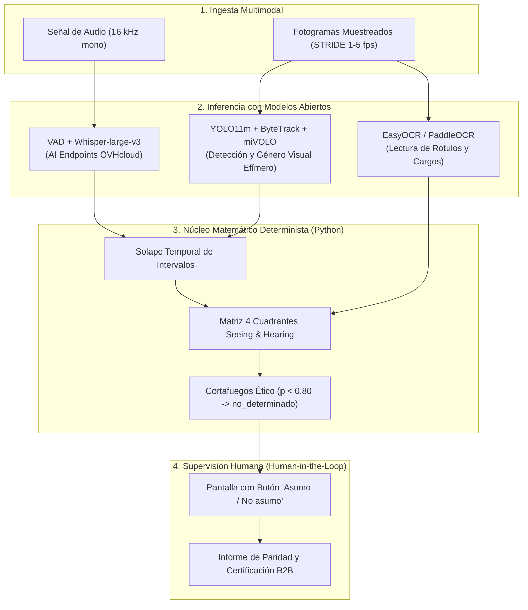
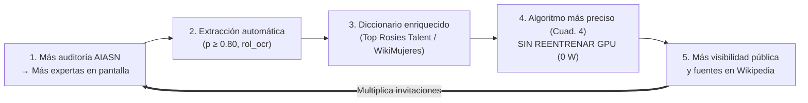

<!--
SPDX-FileCopyrightText: 2026 Equipo 1: Attention Is All She Needs (Alba Camiña García, Pilar de la Fuente Diez, Rocío Jiménez Villén)
SPDX-License-Identifier: Apache-2.0
-->

# Attention Is All She Needs (AIASN)

> **Auditoría de paridad, protagonismo y perspectiva de género en medios audiovisuales mediante Inteligencia Artificial Abierta.**
> Proyecto desarrollado para el **Reto «Mujeres por la IA Abierta»** convocado por la **Secretaría de Estado de Digitalización e Inteligencia Artificial (SEDIA)**, la **Comunidad IA de Código Abierto (`ComunidadIA-OS`)**, el **IDEAI-UPC**, **donesCOEINF** y **OVHcloud**.

[](./LICENSE)
[](https://api.reuse.software/info/github.com/ComunidadIA-OS/attention-is-all-she-needs)
[](./pyproject.toml)
[](https://opensource.org/ai)
[](./ETHICS_CHECKLIST.md)

> **Para evaluar:** comandos, vídeos de la demo y dónde mirar en [Cómo probarlo](#-cómo-probarlo).

---

## 👥 Equipo 1: «Attention Is All She Needs»
* **Rocío Jiménez Villén** ([@rjvillen](https://github.com/rjvillen)) — Procesamiento de texto, embeddings semánticos, grafos de conocimiento y visión por computador.
* **Pilar de la Fuente Diez** ([@pilarvolatixia-cloud](https://github.com/pilarvolatixia-cloud)) — Interlocución oficial, estrategia de producto, modelo de negocio B2B (EIPs / Ley 2/2024) y presentación presencial.
* **Alba Camiña García** ([@ewigkeitt-cloud](https://github.com/ewigkeitt-cloud)) — Marco conceptual, gobernanza ética y regulatoria (RIA / Sandbox), arquitectura desacoplada y Algoritmos Verdes (*Green AI*).

---

## 💡 El Giro Epistémico: «Attention Is All She Needs»

El nombre del proyecto rinde homenaje y resignifica el artículo fundacional de la arquitectura Transformer:
> **Vaswani, A. et al. (2017). *Attention Is All You Need*. NeurIPS.**

En las redes neuronales, el mecanismo de **autoatención (*self-attention*)** calcula matemáticamente qué elementos de una secuencia merecen peso y cuáles constituyen ruido contextual.
En la esfera pública y mediática, históricamente los «pesos de atención» se han concedido de forma casi exclusiva a los hombres (reflejado en el escaso **14 % de habla femenina** registrado en el corpus de debate `Àgora` de la UPC), relegando a las mujeres a los márgenes (*aniquilación simbólica*) o a la presencia física muda (*equality-washing*).

**AIASN** proclama que lo que las mujeres necesitan no es condescendencia ni cuotas cosméticas de imagen, sino que el foco de la atención algorítmica, mediática y social se pose con rigor objetivo sobre su **voz efectiva, rol experto y liderazgo real**.

---

## 🏛️ Arquitectura del Sistema: Extracción Abierta + Cálculo Determinista



### Principios Rectores de Arquitectura
1. **Separación Estricta entre Inferencia y Cálculo:** Los modelos de IA abierta extraen transcripciones, coordenadas y probabilidades; el **100 % de los tiempos, porcentajes, solapes y ratios los calcula determinísticamente Python (`pandas`)**, eliminando cualquier riesgo de alucinación generativa.
2. **Prioridad al Dato Declarado sobre la Biometría:** Un rótulo leído por OCR (*«Dra. Maria Pons — Catedràtica d'Economia»*) tiene **prevalencia jerárquica estricta** sobre cualquier inferencia biométrica física.
3. **Privacidad por Diseño (*Zero Facial Retention*):** Las inferencias faciales se procesan en memoria RAM efímera y se destruyen de inmediato tras el conteo estadístico; **nunca se almacenan vectores faciales ni se crean bases de datos biométricas**.
4. **Detector de *Equality-Washing* (Matriz *Seeing and Hearing*):** Clasifica cada aparición en 4 cuadrantes:
* **Cuadrante 1 (Voz Activa):** En pantalla y hablando $\rightarrow$ Liderazgo y voz experta.
* **Cuadrante 2 (Presencia Muda):** En pantalla y en silencio $\rightarrow$ Alerta de figuración / lavado de imagen.
* **Cuadrante 3 (Voz en Off):** Fuera de pantalla y hablando $\rightarrow$ Narración o locución.
* **Cuadrante 4 (Pasivo):** Solo mencionado en el texto o subtítulo.
5. **Test de Bechdel Digital (*Autoridad Relacional*):** Evalúa de forma 100 % determinista (`evaluar_bechdel_conversacional` en `aiasn/core/fusion.py`, 0 W GPU) tres condiciones sobre la pieza audiovisual: (1) pluralidad femenina ($\ge 2$ mujeres distintas con voz activa, superando el *Efecto Token*), (2) identidad y autoridad propia ($\ge 2$ mujeres acreditadas con nombre o cargo vía OCR/diarización), y (3) interlocución horizontal directa ($\ge 1$ transición consecutiva $\text{Mujer}_A \to \text{Mujer}_B$ sin mediación masculina).
6. **Supervisión Humana (*Human-in-the-Loop*):** Conforme a las recomendaciones de Karina Gibert y Ángela Gasch (SEDIA), el sistema incluye una pantalla operativa con el botón **«Asumo / No asumo»** previa a la emisión de cualquier informe o certificado de paridad (especificada en [`docs/especificacion_alertas_dashboard_y_hitl.md`](./docs/especificacion_alertas_dashboard_y_hitl.md)).

> 🏛️ **Registro Formal de Decisiones de Arquitectura (ADRs):** Todas las decisiones técnicas y éticas del proyecto están formalizadas bajo el estándar de Michael Nygard en el catálogo [`docs/adr/`](./docs/adr/README.md).

---

## ⚡ Algoritmos Verdes (*Green AI*) y Eficiencia

* **Muestreo Temporal `STRIDE`:** Se procesan entre 1 y 5 fotogramas por segundo (`STRIDE = 3` a `6`), reduciendo el consumo de GPU y la huella de carbono en más de un **80 %** frente al procesado continuo a 25/30 fps, sin pérdida de precisión estadística.
* **Optimización Hardware:** Diseñado para ejecutarse en las instancias $2 \times \text{NVIDIA V100}$ de OVHcloud con precisión de coma flotante media **`torch.float16`**.
* **Arquitectura *Split Edge-to-Cloud* (99,99 % de ahorro en red y almacenamiento):** El vídeo pesado (.mp4 de varios GB) se procesa de forma efímera en local; hacia la nube (AI Endpoints de OVHcloud) o el repositorio solo viajan kilobytes de texto y tablas anónimas (.csv/.tsv), reduciendo drásticamente la huella de carbono de transmisión y almacenamiento.
* **Coste de Sostenibilidad:** Inferencia auditada por debajo de **0,30 € por hora de vídeo analizada**.

### 🔄 Del «Círculo Vicioso» al «Círculo Virtuoso» de Referentes (`Top Rosies Talent` + `WikiMujeres`)
> **Nombre estratégico/comercial:** *Círculo Virtuoso de Referentes Femeninos (Green AI Flywheel)*
> **Nombres técnicos de ingeniería:** *Retroalimentación Incremental sin Reentrenamiento (`Zero-Retraining Feedback Loop`)* / *Enriquecimiento Autónomo del Diccionario de Referentes*

1. **Más auditoría $\rightarrow$ Más expertas en pantalla:** Las empresas y medios usan AIASN (y la extensión en caliente en edición) para cumplir la paridad real (Cuadrante 1), invitando y rotulando a más mujeres profesionales.
2. **Más expertas en pantalla $\rightarrow$ Extracción automática ($p \ge 0{,}80$):** AIASN lee de forma autónoma sus rótulos (`rol_ocr`) y sus intervenciones mediante consenso multimodal (`EasyOCR` + `Whisper` + `GLiNER`).
3. **Extracción $\rightarrow$ Diccionario más rico (`Top Rosies Talent` / `ReDivIAcat` / `WikiMujeres`):** Esos nombres y cargos verificados se añaden solos al diccionario ligero (`.csv`/`.json`), tanto en local desconectado (*offline/batch*) como sincronizado.
4. **Diccionario más rico $\rightarrow$ Algoritmo más inteligente sin reentrenar GPU (*Green AI*):** En el siguiente vídeo que se audite, el detector ya conoce a esas profesionales cuando alguien las cita en una conversación (Cuadrante 4), **sin gastar un solo euro ni vatio de GPU en reentrenar la red neuronal**.
5. **Más visibilidad $\rightarrow$ Más invitaciones:** Al quedar registradas con evidencias de vídeo en **`Top Rosies Talent`** (IDEAI-UPC / donesCOEINF) y **`WikiMujeres`**, más organizadores las encuentran y las llaman para nuevos debates (vuelta al punto 1, multiplicando el efecto).



---

## 🚀 Cómo probarlo

**Probado en** Ubuntu 24.04 (x86_64): AMD Ryzen 7 7840HS (16 hilos), 30 GB de RAM y GPU NVIDIA RTX 4060 Laptop (8 GB), con Docker 29 y Python 3.13. También en CPU, sin GPU, con 2 núcleos y 6 GB de RAM. En Windows, macOS (Apple Silicon) y Linux ARM las dependencias se resuelven, pero el procesado no se ha probado.

> ⚠️ **Sin GPU funciona, pero es lento.** Con 2 núcleos y 6 GB de RAM, un vídeo de 84 s tardó **45 min**: 32 min la detección de personas y 10 el OCR. Con la GPU de arriba, los vídeos de la demo tardan entre 2 y 8 min. La primera vez se suman unos minutos para descargar los modelos (~2,5 GB).

### Requisitos

* **Python 3.11+** con [uv](https://docs.astral.sh/uv/) (recomendado) o pip.
* **ffmpeg**, solo sin Docker (la imagen ya lo trae). Hay versión para Linux, macOS y Windows:
  ```bash
  sudo apt install ffmpeg     # Ubuntu / Debian
  brew install ffmpeg         # macOS
  winget install ffmpeg       # Windows
  ```
* **Token de OVHcloud AI Endpoints**, para la transcripción y el LLM: `cp .env.example .env` y rellena `OVH_AI_ENDPOINTS_ACCESS_TOKEN`. Sin él, el *worker* lo avisa al arrancar y falla al transcribir.
* **Con Docker y GPU**, el **NVIDIA Container Toolkit**. Si no está, el *worker* se lanza en CPU y la API lo avisa en su log. [Guía oficial](https://docs.nvidia.com/datacenter/cloud-native/container-toolkit/latest/install-guide.html); en Ubuntu/Debian:
  ```bash
  curl -fsSL https://nvidia.github.io/libnvidia-container/gpgkey | sudo gpg --dearmor -o /usr/share/keyrings/nvidia-container-toolkit-keyring.gpg
  curl -s -L https://nvidia.github.io/libnvidia-container/stable/deb/nvidia-container-toolkit.list \
  | sed 's#deb https://#deb [signed-by=/usr/share/keyrings/nvidia-container-toolkit-keyring.gpg] https://#g' \
  | sudo tee /etc/apt/sources.list.d/nvidia-container-toolkit.list
  sudo apt-get update && sudo apt-get install -y nvidia-container-toolkit
  sudo nvidia-ctk runtime configure --runtime=docker && sudo systemctl restart docker
  docker run --rm --gpus all ubuntu nvidia-smi   # debe mostrar tu GPU
  ```

### 1. Tests (1 minuto, sin GPU ni token)

```bash
git clone https://github.com/ComunidadIA-OS/attention-is-all-she-needs.git
cd attention-is-all-she-needs

uv sync --extra dev && uv run pytest
# o con pip:
python -m venv .venv && source .venv/bin/activate   # Windows: .venv\Scripts\Activate.ps1
pip install -e ".[dev]" && python -m pytest tests/
```

Entre otros, validan:
* `tests/test_contracts.py`: contratos de audio, solape temporal, matriz de 4 cuadrantes *Seeing and Hearing* (Verónica Vilaplana), regla anti-*equality-washing* (Kanter 1977 / Tuchman 1978) y abstención ética ($p < 0{,}80 \rightarrow \text{no\_determinado}$).
* `tests/test_compliance_adapters.py`: purga biométrica en RAM (*Zero Facial Retention*), denegación de Sello Oficial ante sanciones LISOS o *cherry-picking* (Art. 6 Apache-2.0), rehabilitación corporativa (*Self-Cleaning*, ventana de 3 años) y firma `SHA-256` con ID de supervisión pseudonimizado (`operador_supervision_id`).

### 2. Demo con Docker

```bash
docker compose --profile jobs build   # imágenes de la API, el front y el worker (este ocupa ~12,5 GB: 10–20 min la primera vez)
docker compose up -d                  # almacén S3, API en http://localhost:8000 y front en http://localhost:8080
```

* El *worker* no queda corriendo: la API arranca un contenedor `aiasn-worker-<video_id>` por vídeo, y lo borra al lanzar el siguiente. Su log: `docker logs aiasn-worker-<video_id>`.
* La API usa el socket de Docker, lo que le da control sobre Docker en esa máquina: no la expongas fuera de tu equipo.
* ¿El puerto 8000 o el 8080 está ocupado? Cámbialos con `API_PORT` y `FRONT_PORT` en `.env`.

### 3. Demo sin Docker

```bash
uv sync --extra worker --extra api    # ~7 GB (PyTorch y CUDA)
uv run uvicorn aiasn.api.app:create_app --factory --port 8000
python -m http.server 8080 --directory frontend-piloto   # front en http://localhost:8080/?api=http://localhost:8000
```

Sin la imagen `aiasn-worker`, la API lanza el *worker* como proceso (`API__LAUNCHER=process` para forzarlo) y guarda el lake en `data/`. También se puede procesar un vídeo sin la API:

```bash
uv run python -m aiasn.run_pipelines --file video.mp4
```

### 4. Analizar un vídeo

Los vídeos de la demo, con su licencia y autoría, están en [`videos-final-demo/`](videos-final-demo/README.md).

* **Desde el front** (<http://localhost:8080>): «Elegir vídeo» → «Analizar».
* **Desde la API**:
  ```bash
  curl -F file=@video.mp4 http://localhost:8000/videos   # → {"video_id": "video-3f9a"}
  curl http://localhost:8000/videos/video-3f9a           # estado; con "ok", también el resultado
  ```
  Documentación interactiva en <http://localhost:8000/docs>.
* **Si falla** (por ejemplo, si OVHcloud corta la conexión): sin Docker, `uv run python -m aiasn.run_pipelines --video-id <video_id>` sigue desde el paso que falló; con Docker, vuelve a subir el vídeo.

### 5. Vídeo anotado: comprobar el resultado a ojo

Dibuja sobre el vídeo lo que ha detectado el pipeline:
* una caja por persona con `P<id> | F/M`;
* una caja verde *speaking* en la cara de quien habla;
* en amarillo, los textos que lee el OCR.

Funciona **sin Docker**, después de procesar el vídeo, porque usa los fotogramas que quedan en `tmp/<video_id>/video/frames`. Con Docker, esos fotogramas se borran con el contenedor del *worker*.

```bash
uv run python -m aiasn.pipelines.video_annotation <video_id>   # → tmp/<video_id>/video/annotated.mp4
```

### 💻 Modo C: Ejecución Local Permisiva, Offline y Sector Público (ENS / Art. 157 LRJSP / Zero Cloud)
> **Para todas las Administraciones Públicas del Estado (RTVE, 3Cat/TV3, EITB, CRTVG, universidades, ministerios, diputaciones y ayuntamientos) sujetas al Esquema Nacional de Seguridad (ENS), al Art. 157 de la Ley 40/2015 (reutilización de sistemas) y a la Directiva UE 2019/882 de Accesibilidad.**
* **Soberanía Lingüística Cooficial e Inclusividad por Diseño (`ADR-0010`):** Soporte nativo sin traducción intermedia para todas las **lenguas cooficiales del Estado (`es`, `ca`, `gl`, `eu`) + `en`**, e inclusión automática de resumen en **Lectura Fácil (Norma UNE 153101 / WCAG 2.2 AA)** (`resumen_lectura_facil`) compatible con lectores de pantalla (`NVDA`/`JAWS`).
* **Aislamiento de Licencias (`aiasn/model_adapters/vision_adapter.py`):** Permite ingerir trazas precomputadas vía archivo plano (`.csv` / `.tsv` mediante `CSVPrecomputedAdapter`, doctrina de separación de procesos de la FSF) o ejecutar inferencia local 100 % permisiva (`PermissiveYOLOXAdapter` con **YOLOX Apache-2.0**, **InsightFace MIT** e **EasyOCR Apache-2.0**), sin contaminar entornos B2B o públicos con licencias copyleft (AGPL-3.0).
* **Círculo Virtuoso de Referentes Femeninos sin Reentrenamiento (*Green AI Flywheel*):** Los rótulos y menciones extraídos por consenso de alta confianza ($p \ge 0{,}80$) enriquecen un diccionario ligero local (`.csv`/`.json`) interoperable con **`Top Rosies Talent`**, **`ReDivIAcat`** y **`tFemTIC`** (`IDEAI-UPC` / `donesCOEINF`) y con **`WikiMujeres` / `Wikidata`**, mejorando el reconocimiento futuro (Cuadrante 4) tanto *offline/batch* como sincronizado sin coste de GPU en reentrenamiento.
* **Extensión en Caliente para las 4 Modalidades (*Shift-Left Parity*):** Diseñado para inyectarse como asistente preventivo en herramientas de **Vídeo** (`OBS Studio`, `DaVinci Resolve`, `Premiere`), **Audio/Podcasts** (`Audacity`, `Audition`), **Imagen/Cartelería** (`Canva`, `Figma`) y **Texto/Prensa** (`WordPress`, `Docs`), y emitir certificados con huella inmutable **`SHA-256`** (`emitir_sello_auditoria`).

---

## ⚖️ Declaración de Transparencia (EU AI Act - Art. 50)

En cumplimiento del **Reglamento (UE) 2024/1689 (Reglamento Europeo de IA)** y de la obligación legal vigente desde agosto de 2026:
* Este prototipo utiliza sistemas de inteligencia artificial de código abierto para tareas de transcripción (`whisper-large-v3`), detección visual (`YOLO11m`), clasificación demográfica agregada (`miVOLO`) y embeddings (`bge-m3`).
* **Uso de Asistentes y Copilotos de IA en el Desarrollo:** Conforme a las directrices de la Oficina Técnica de Código Abierto (`ComunidadIA-OS` / Jorge Teixeira) y la tecnoética de SEDIA, se declara explícitamente el uso de asistentes inteligentes de código y documentación (copilotos de IA) como herramientas de aceleración y soporte metodológico. El 100 % de la arquitectura, el código generado, las decisiones de diseño y la compatibilidad de licencias han sido supervisados, comprendidos, validados y auditados directamente por las desarrolladoras del equipo (*Human-in-the-Loop* en el ciclo de ingeniería).
* El sistema **no toma decisiones automatizadas vinculantes ni elabora perfiles biométricos individuales**. Su salida constituye una propuesta analítica sujeta a supervisión humana preceptiva (*Human-in-the-Loop*).
* Los datos de prueba utilizados en fase de desarrollo proceden de corpus autorizados por la UPC (`Àgora`) y de grabaciones de divulgación pública tratadas al amparo del **Art. 67 del Real Decreto-ley 24/2021** (excepción de Minería de Textos y Datos con fines de investigación).

---

## 📚 Documentación de Gobernanza y Enlaces Canónicos

* 🖥️ [**docs/especificacion_alertas_dashboard_y_hitl.md**](./docs/especificacion_alertas_dashboard_y_hitl.md): Especificación funcional de las 3 vistas por rol, alertas anti-*equality-washing*, Test de Bechdel Digital y pantalla *«Asumo / No asumo»* (#6).
* ♿ [**docs/informe_conformidad_accesibilidad.md**](./docs/informe_conformidad_accesibilidad.md): Informe de conformidad de accesibilidad del dashboard (*WCAG 2.2 AA*, UNE 153101 EX, RD 1112/2018 y Directiva UE 2019/882): auditoría `axe-core`, doble codificación de color, contraste verificado y soporte para lectores de pantalla (#18).
* 📖 [**GLOSSARY.md**](./GLOSSARY.md): Glosario maestro de los 25 términos, elementos clave de la solución y diagrama del Círculo Virtuoso (*Retroalimentación Incremental sin Reentrenamiento*).
* 📋 [**ETHICS_CHECKLIST.md**](./ETHICS_CHECKLIST.md): Autoevaluación formal bajo los 7 principios de ALTAI y el Sandbox de la SEDIA / AESIA.
* 🧪 [**TESTING.md**](./TESTING.md): Protocolo de pruebas con *Ground Truth*, tests unitarios y pruebas de usabilidad humana.
* 🤖 [**MODEL_CARD.md**](./MODEL_CARD.md): Ficha técnica de modelos abiertos, umbrales y limitaciones conocidas.
* 📊 [**DATASET_CARD.md**](./DATASET_CARD.md): Ficha de procedencia de datos, perfil poblacional y régimen legal de fuentes.
* 🔒 [**SECURITY.md**](./SECURITY.md): Modelo de amenazas frente a ataques adversarios (Art. 15 RIA y OWASP ML/LLM), *Zero Facial Retention* y reporte responsable.
* 🤖 [**AGENTS.md**](./AGENTS.md): Guardarraíles vinculantes de seguridad, aislamiento de licencias y ética para agentes de código (*AI Coding Guardrails*).
* 🤝 [**CONTRIBUTING.md**](./CONTRIBUTING.md): Guía de contribución comunitaria y flujo de ramas.
* 📜 [**CODE_OF_CONDUCT.md**](./CODE_OF_CONDUCT.md): Código Ético a medida, Estatuto de Propósito Social, Cláusula Anti-Lavado de Cara (Art. 6 Apache-2.0), Política de Uso Responsable y Código de Conducta.
* 📝 [**CHANGELOG.md**](./CHANGELOG.md): Historial de versiones y evolución del prototipo.

---

## 📄 Licencia y Conformidad REUSE

Este proyecto está licenciado bajo los términos de la **Licencia Apache 2.0**, cumpliendo estrictamente las directrices formativas de la Oficina Técnica de `ComunidadIA-OS` (Jorge Teixeira) y el estándar [REUSE Software](https://reuse.software/) de la *Free Software Foundation Europe* (FSFE):

* **Identificador SPDX:** `SPDX-License-Identifier: Apache-2.0`
* **Directorio de Licencias:** El texto íntegro y canónico se aloja en [`LICENSES/Apache-2.0.txt`](./LICENSES/Apache-2.0.txt) y en el archivo raíz [`LICENSE`](./LICENSE).
* **Aviso Formal de Copyright:**
```text
SPDX-FileCopyrightText: 2026 Equipo 1: Attention Is All She Needs
(Alba Camiña García, Pilar de la Fuente Diez, Rocío Jiménez Villén)
SPDX-License-Identifier: Apache-2.0
```
* **Aislamiento y Compatibilidad de Dependencias:** El núcleo determinista (`[core]`) y los adaptadores locales (`[local-ai]` vía YOLOX e InsightFace) operan bajo licencias permisivas (Apache-2.0 / MIT). Cualquier uso de modelos bajo licencias copyleft de red (como Ultralytics AGPL-3.0) queda aislado en adaptadores opcionales independientes o mediante consumo remoto vía API HTTP REST en los AI Endpoints de OVHcloud, impidiendo cualquier contaminación de código privativo en clientes y corporaciones B2B.
