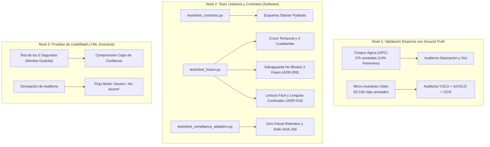

<!--
SPDX-FileCopyrightText: 2026 Equipo 1: Attention Is All She Needs (Alba Camiña García, Pilar de la Fuente Diez, Rocío Jiménez Villén)
SPDX-License-Identifier: Apache-2.0
-->

# SPDX-FileCopyrightText: 2026 Equipo 1: Attention Is All She Needs (Alba Camiña García, Pilar de la Fuente Diez, Rocío Jiménez Villén)
# SPDX-License-Identifier: Apache-2.0

# Protocolo de Pruebas y Validación (TESTING)
## Proyecto: «Attention Is All She Needs» (AIASN) — Reto «Mujeres por la IA Abierta»

> **Propósito:**  
> Este documento establece el marco formal de pruebas, verificación algorítmica y validación empírica del proyecto AIASN. Atiende a las exigencias directas formuladas por las mentoras y mentores del reto:
> 1. **Dra. Verónica Vilaplana (TALP-UPC):** Evaluación cuantitativa sobre micro-muestras anotadas a mano y auditoría de la bolsa `"unknown"` (Diap. 91 y 95).
> 2. **Dra. Montse Guàrdia Güell (Consell Social UPC):** Pruebas integradas desde el *Sprint 0* (*Test Early / Fail Fast*, min `1:27:45`) y validación de usabilidad con personas no técnicas.
> 3. **Dr. José Adrián Rodríguez Fonollosa (TALP-UPC):** Recuperación empírica del *Ground Truth* de habla femenina (**14 %**) sobre el corpus `Àgora`.
> 4. **Jorge Teixeira (ComunidadIA-OS / GPUL):** Reproductibilidad automatizada mediante tests unitarios con `pytest` e integración continua en GitHub Actions.

---

## 1. Arquitectura de Pruebas en Tres Niveles



---

## 2. Nivel 1: Pruebas con Datos Reales y *Ground Truth*

### 2.1. Validación de Voz y Diarización sobre `Àgora` (UPC)
* **Objetivo:** Verificar que el pipeline de audio (`whisper-large-v3` diarizado vía AI Endpoints de OVHcloud) recupera de forma consistente la proporción de habla femenina frente a la anotación de referencia a mano.
* **Corpus de referencia:** Subconjunto de 5 debates del corpus `Àgora` (`agora_trs.gz`), con anotaciones XML formales de cambio de turno, canal de audio y género verificado.
* **Criterio de éxito:**
  $$\left| \text{Ratio Femenino Predicho} - 14\% \right| \le 3.5\%$$
* **Tratamiento de incertidumbre:** Los turnos con baja relación señal-ruido o solapamiento de voces que obtengan certidumbre $p < 0.80$ se contabilizan en la métrica de cobertura y se derivan a la categoría `no_determinado`.

### 2.2. Validación de Visión y Presencia sobre Micro-Muestras de Vídeo
* **Objetivo:** Auditar la precisión del detector de personas (`YOLO11m`), seguimiento (`ByteTrack`), clasificador de atributos (`miVOLO`) y lectura de rótulos (`EasyOCR`).
* **Metodología (Vilaplana Diap. 95):** Se anota manualmente una muestra de 50 fotogramas clave distribuidos en planos frontales, laterales y planos generales con múltiples contertulios (procedentes del videopodcast *«Quanta, quanta IA!»* y debates institucionales del CSIC).
* **Control del Sesgo de la Diapositiva 91:**
  * En la prueba empírica de Vilaplana, el 50 % de las mujeres cayeron en la categoría `"unknown"` debido a inclinaciones de cabeza o ángulos difíciles.
  * **Test de salvaguarda:** Se comprueba que el software **nunca descarta la categoría `"unknown"`**, sino que la visibiliza en el informe bajo el estado `⚠️ Cobertura Parcial` y busca resolverla mediante el texto de los rótulos (OCR).

---

## 3. Nivel 2: Tests Unitarios Automatizados (`pytest`)

El repositorio incluye la suite ejecutable en el directorio `tests/` para verificar de forma determinista la integridad del código:

### 3.1. Ejecución Rápida y Automática
```bash
# Runner inteligente (auto-detecta Docker, uv o Python local y corre backend + frontend):
python scripts/run_tests.py

# O directamente según tu herramienta:
# docker compose run --rm backend pytest
# uv run pytest
# pytest tests/ -v
```

### 3.2. Casos de Prueba de Contratos Tabulares (`tests/test_contracts.py`)

1. **`test_audio_columns_contract`:**  
   Comprueba que cualquier exportación de audio cumple estrictamente con las 4 columnas requeridas: `tiempo_i`, `tiempo_f`, `transcripcion`, `genero_inferido`.
2. **`test_ethical_abstention_low_confidence` y `test_ethical_abstention_high_confidence`:**  
   Verifica que cualquier predicción de género con confianza inferior a $0.80$ es forzada determinísticamente a `no_determinado` (`ADR-005`), preservando la inferencia si $p \ge 0.80$.
3. **`test_temporal_overlap_exact_overlap`:**  
   Comprueba que la función en Python de cruce temporal calcula los segundos exactos de coincidencia entre los intervalos de habla y los intervalos de aparición en vídeo, sin pérdidas de redondeo ni alucinaciones.
4. **`test_four_quadrants_anti_equality_washing`:**  
   Verifica que una persona con presencia visual pero sin voz en ese intervalo es clasificada correctamente en el **Cuadrante 2 (Presencia muda)**, activando la bandera anti-*equality-washing*.
5. **`test_zero_facial_retention_schema`:**  
   Verifica que las estructuras de datos que almacenan los tracks de vídeo contienen únicamente coordenadas espaciales (`x1, y1, x2, y2`) y tiempos, sin persistir vectores ni descriptores biométricos identificativos (`ADR-004`).

### 3.3. Casos de Prueba del Motor Determinista de Fusión (`tests/test_fusion.py`)

1. **`test_solape_temporal_valores_limite`:**  
   Verificación matemática rigurosa en límites: intervalos disjuntos, solapes parciales, contención total y coincidencia idéntica.
2. **`test_clasificacion_cuadrantes`:**  
   Asignación canónica a los 4 cuadrantes *Seeing and Hearing* (Vilaplana Diap. 92): Cuadrante 1 (voz activa), Cuadrante 2 (presencia muda), Cuadrante 3 (voz en off) y Cuadrante 4 (mención).
3. **`test_umbral_etico_abstencion`:**  
   Comprobación de filtros ante valores nulos, excepciones de tipado y umbral ético $p < 0.80 \to \text{no\_determinado}$.
4. **`test_cruce_multimodal_con_fixtures`:**  
   Prueba de integración de extremo a extremo con fixtures reales del corpus `Àgora` y trazas de vídeo con detección de presencia muda de participantes reales (Marta Solé).
5. **`test_calculo_kpis_y_alerta_equality_washing`:**  
   Cálculo determinista de tiempos de voz, tiempos en pantalla, ratio voz/pantalla, resumen accesible en Lectura Fácil (`UNE 153101 EX`) y soporte nativo de lenguas cooficiales (`["es", "ca", "gl", "eu"]` — `ADR-010`).
6. **`test_salvaguarda_matematica_paridad_no_binaria_adr0006`:**  
   Verificación algorítmica de la salvaguarda progresiva en 3 fases:
   - **Fase 1 ($P_{\text{NB}} \le 20\%$):** Descuento íntegro del techo masculino ($60\% \to 40\%$) protegiendo el suelo femenino del 40 %.
   - **Fase 2 ($P_{\text{NB}} > 20\%$):** Reparto simétrico 50/50 del exceso entre ambos sexos binarios al quedar igualados en el 40 %.
   - **Fase 3 (`mesa_monografica_diversidad=True`):** Aprobación de paneles monográficos de colectivos LGTBIQ+/diversidad si no hay sobrerrepresentación masculina.
7. **`test_bechdel_conversacional_determinista`:**  
   Verifica las 3 reglas del Test de Bechdel Digital / Conversacional: pluralidad femenina ($\ge 2$ mujeres con voz activa), identidad acreditada por rótulo/cargo (`rotulo_nombre`/`rotulo_cargo`) e interlocución horizontal directa ($\text{Mujer}_A \to \text{Mujer}_B$ sin intermediación masculina).

### 3.4. Casos de Prueba de Compliance, Adaptadores y Sello B2B (`tests/test_compliance_adapters.py`)

1. **`test_purga_biometrica_en_adaptador_visual`:**  
   Garantiza que el adaptador visual (`BaseVisionAdapter.validar_y_sanitizar_contrato`) elimine cualquier columna biométrica (`embedding`, `face_vector`) en memoria antes de entregar el DataFrame ligero (`ADR-004`).
2. **`test_denegacion_sello_ante_sanciones_o_cherry_picking`:**  
   Comprueba el cortafuegos ético: deniega el Sello Oficial y activa la advertencia de solo autodiagnóstico ante sanciones LISOS/penales o muestras sesgadas (Art. 6 Apache-2.0 y Código Ético).
3. **`test_emision_sello_oficial_y_firma_sha256_inmutable`:**  
   Valida la emisión del Sello Oficial Pleno y comprueba que cualquier intento de alteración posterior de las métricas invalida la huella criptográfica SHA-256.
4. **`test_rehabilitacion_corporativa_self_cleaning_ventana_3_anios`:**  
   Comprueba la vía de Rehabilitación Activa (*Self-Cleaning*, Directiva 2014/24/UE) para entidades con sanciones en los últimos 3 años que acrediten Plan de Igualdad y $\ge 2$ informes históricos de auditoría.

---

## 4. Nivel 3: Pruebas de Usabilidad y Supervisión Humana (*HitL*)

Siguiendo las pautas de innovación de **Montse Guàrdia** (`0:35:00` y `1:47:19`) y de ética de **Karina Gibert** (`1:00:50`):

1. **Test de Comprensión en 5 Segundos:**  
   Se presenta la salida gráfica (la *Constelación del Protagonismo* y la *Capa de Confianza*) a una persona sin perfil técnico. La prueba se supera si en menos de 5 segundos identifica con claridad:
   * Si el evento cumple o incumple la paridad efectiva.
   * Si la presencia de mujeres fue con voz experta (Cuadrante 1) o meramente decorativa/muda (Cuadrante 2).
2. **Simulación de la Pantalla «Asumo / No asumo»:**  
   Se valida que la interfaz no permite exportar el certificado o informe de paridad sin que la persona responsable interactúe con el modal de supervisión humana, revisando los casos dudosos marcados como `no_determinado`.

---

## 5. Integración Continua (CI con GitHub Actions)

En el marco de la colaboración comunitaria en `ComunidadIA-OS`:
* El flujo automatizado [`.github/workflows/ci.yml`](.github/workflows/ci.yml) ejecuta la suite completa de `pytest` en entornos aislados con Python 3.11 y 3.12 ante cada `push` y Pull Request.
* Todo nuevo Pull Request debe pasar satisfactoriamente la suite de `pytest` para ser mergeado.
* Los cambios en contratos tabulares requieren actualización de los esquemas `Pydantic` correspondientes.
