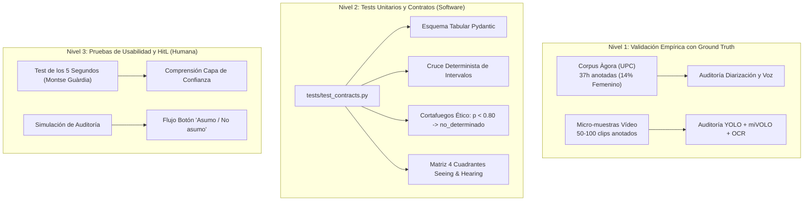

# Protocolo de Pruebas y Validación (TESTING)
## Proyecto: «Attention Is All She Needs» (AIASN) — Reto «Mujeres por la IA Abierta»

> **Propósito:**  
> Este documento establece el marco formal de pruebas, verificación algorítmica y validación empírica del proyecto AIASN. Atiende a las exigencias directas formuladas por las mentoras y mentores del reto:
> 1. **Dra. Verónica Vilaplana (TALP-UPC):** Evaluación cuantitativa sobre micro-muestras anotadas a mano y auditoría de la bolsa `"unknown"` (Diap. 91 y 95).
> 2. **Dra. Montse Guàrdia Güell (Consell Social UPC):** Pruebas integradas desde el *Sprint 0* (*Test Early / Fail Fast*, min `1:27:45`) y validación de usabilidad con personas no técnicas.
> 3. **Dr. José Adrián Rodríguez Fonollosa (TALP-UPC):** Recuperación empírica del *Ground Truth* de habla femenina (**14 %**) sobre el corpus `Àgora`.
> 4. **Jorge Teixeira (ComunidadIA-OS / GPUL):** Reproductibilidad automatizada mediante tests unitarios con `pytest`.

---

## 1. Arquitectura de Pruebas en Tres Niveles



---

## 2. Nivel 1: Pruebas con Datos Reales y *Ground Truth*

### 2.1. Validación de Voz y Diarización sobre `Àgora` (UPC)
* **Objetivo:** Verificar que el pipeline de audio (`whisper-large-v3` diarizado vía AI Endpoints de OVHcloud) recupera de forma consistente la proporción de habla femenina frente a la anotación de referencia a mano.
* **Corpus de referencia:** Subconjunto de 5 debates del corpus `Àgora` (`agora_trs.gz`), con anotaciones XML formales de cambio de turno, canal de audio y género verificado.
* **Criterio de éxito:**
  $$\left| \text{Ratio Femenino Predicho} - 14\% \right| \le 3.5\%$$
* **Tratamiento de incertidumbre:** Los turnos con baja relación señal-ruido o solapamiento de voces que obtengan certidumbre $p < 0.80$ se contabilizan en la métrica de cobertura y se derivan a la categoría `no_determinado`.

### 2.2. Validación de Visión y Presencia sobre Micro-Muestras de Vídeo
* **Objetivo:** Auditar la precisión del detector de personas (`YOLO11m`), seguimiento (`ByteTrack`), clasificador de atributos (`miVOLO`) y lectura de rótulos (`EasyOCR`).
* **Metodología (Vilaplana Diap. 95):** Se anota manualmente una muestra de 50 fotogramas clave distribuidos en planos frontales, laterales y planos generales con múltiples contertulios (procedentes del videopodcast *«Quanta, quanta IA!»* y debates institucionales del CSIC).
* **Control del Sesgo de la Diapositiva 91:**
  * En la prueba empírica de Vilaplana, el 50 % de las mujeres cayeron en la categoría `"unknown"` debido a inclinaciones de cabeza o ángulos difíciles.
  * **Test de salvaguarda:** Se comprueba que el software **nunca descarta la categoría `"unknown"`**, sino que la visibiliza en el informe bajo el estado `⚠️ Cobertura Parcial` y busca resolverla mediante el texto de los rótulos (OCR).

---

## 3. Nivel 2: Tests Unitarios Automatizados (`pytest`)

El repositorio incluye la suite ejecutable en el directorio `tests/` para verificar de forma determinista la integridad del código:

### 3.1. Ejecución Rápida
```bash
# Ejecutar todas las pruebas unitarias
pytest tests/ -v
```

### 3.2. Casos de Prueba Implementados en `tests/test_contracts.py`

1. **`test_audio_contract_schema`:**  
   Comprueba que cualquier exportación de audio cumple estrictamente con las 4 columnas requeridas: `tiempo_i`, `tiempo_f`, `transcripcion`, `genero_inferido`.
2. **`test_ethical_abstention_threshold`:**  
   Verifica que cualquier predicción de género con confianza inferior a $0.80$ es forzada determinísticamente a `no_determinado` (cortafuegos ético *Fairness by Design*).
3. **`test_temporal_overlap_determinism`:**  
   Comprueba que la función en Python de cruce temporal calcula los segundos exactos de coincidencia entre los intervalos de habla y los intervalos de aparición en vídeo, sin pérdidas de redondeo ni alucinaciones.
4. **`test_four_quadrants_classification`:**  
   Verifica que una persona con presencia visual pero sin voz en ese intervalo es clasificada correctamente en el **Cuadrante 2 (Presencia muda)**, activando la bandera anti-*equality-washing*.
5. **`test_zero_facial_retention`:**  
   Verifica que las estructuras de datos que almacenan los tracks de vídeo contienen únicamente coordenadas espaciales (`x1, y1, x2, y2`) y tiempos, sin persistir vectores ni descriptores biométricos identificativos.

---

## 4. Nivel 3: Pruebas de Usabilidad y Supervisión Humana (*HitL*)

Siguiendo las pautas de innovación de **Montse Guàrdia** (`0:35:00` y `1:47:19`) y de ética de **Karina Gibert** (`1:00:50`):

1. **Test de Comprensión en 5 Segundos:**  
   Se presenta la salida gráfica (la *Constelación del Protagonismo* y la *Capa de Confianza*) a una persona sin perfil técnico. La prueba se supera si en menos de 5 segundos identifica con claridad:
   * Si el evento cumple o incumple la paridad efectiva.
   * Si la presencia de mujeres fue con voz experta (Cuadrante 1) o meramente decorativa/muda (Cuadrante 2).
2. **Simulación de la Pantalla «Asumo / No asumo»:**  
   Se valida que la interfaz no permite exportar el certificado o informe de paridad sin que la persona responsable interactúe con el modal de supervisión humana, revisando los casos dudosos marcados como `no_determinado`.

---

## 5. Integración Continua (CI)

En el marco de la colaboración comunitaria en `ComunidadIA-OS`:
* Todo nuevo Pull Request debe pasar satisfactoriamente la suite de `pytest`.
* Los cambios en contratos tabulares requieren actualización de los esquemas `Pydantic` correspondientes.
