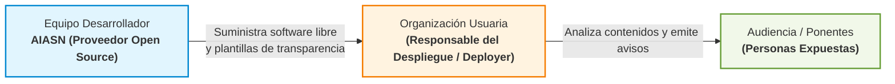

<!--
SPDX-FileCopyrightText: 2026 Equipo 1: Attention Is All She Needs (Alba Camiña García, Pilar de la Fuente Diez, Rocío Jiménez Villén)
SPDX-License-Identifier: Apache-2.0
-->

# Encuadramiento Normativo, Posición Jurídica y Delimitación de Riesgos
## Proyecto: «Attention Is All She Needs» (AIASN)

> **Posición Jurídica del Equipo:**  
> A juicio del equipo desarrollador y con arreglo a las directrices técnicas publicadas por la Comisión Europea, **AIASN** se sitúa preliminarmente bajo el **Reglamento Europeo de IA (RIA / Reglamento UE 2024/1689)** como un prototipo de software libre en fase de investigación y desarrollo precomercial (Art. 2.8 y Art. 2.12), cuyas funcionalidades de estimación de género por imagen y voz encajan en el régimen de **riesgo limitado** (sujeto al deber de transparencia del Art. 50.3 para la entidad que lo despliegue).  
> Esta interpretación técnica se fundamenta en que el sistema **no encaja en las prácticas prohibidas** (Art. 5 RIA) ni en los supuestos de alto riesgo (Anexo III RIA), al no inferir atributos especialmente protegidos del Art. 9.1 RGPD, no realizar identificación biométrica remota 1:N, excluir la inferencia biométrica de emociones y **no destinarse a la toma de decisiones individuales sobre personas trabajadoras** (como selección, evaluación de rendimiento, asignación de tareas, promoción o despido del Anexo III.4 RIA), circunscribiéndose su aplicación corporativa a la auditoría agregada de igualdad en eventos, juntas, paneles y comunicación institucional.  
> El análisis de contenidos públicos se apoya en la excepción de **minería de textos y datos para investigación** (Art. 67 del RDL 24/2021 / Directiva UE 2019/790), el **interés legítimo y fines de investigación estadística del RGPD** (Arts. 6.1.f y 89 del Reglamento UE 2016/679) con salvaguardas de biometría efímera en memoria RAM (*Zero Biometric Retention*), y el soporte técnico al cumplimiento de la Ley Orgánica 2/2024 de Paridad. Corresponderá en todo caso a las autoridades de supervisión y a las entidades que desplieguen el sistema confirmar esta categorización en cada caso de uso concreto.

[← Volver al Índice de Documentación](./indice_de_documentacion.md) · [Ver Marco Normativo y Mercado Completo](./marco_normativo_y_mercado.md)

---

## 1. Ficha de Encuadramiento Jurídico (Evaluación Preliminar del Equipo)

| Parámetro | Posición / Evaluación del Equipo | Fundamento Normativo de Referencia |
| :--- | :--- | :--- |
| **Naturaleza del software** | Prototipo de código abierto para auditoría de igualdad y pluralismo en medios audiovisuales | Licencia Apache-2.0 · Estándar REUSE · Art. 2.12 RIA |
| **Nivel de riesgo estimado en el RIA** | **Riesgo Limitado** (sujeto a transparencia del Art. 50.3 si se usan modelos de cara o voz; clasificación en revisión continua según directrices europeas) | Arts. 3.40, 50.3 y Considerando 132 del RIA (UE 2024/1689) · ADR-0012 |
| **Fase regulatoria del prototipo** | Actividad de investigación, desarrollo y prueba previa a la comercialización | Art. 2.8 RIA |
| **Deslinde de roles RIA** | **Proveedor de software de código abierto** (*Open Source Provider*). La entidad usuaria que analice emisiones asume el rol de **Responsable del despliegue** (*Deployer*). | Art. 3.2, Art. 3.4 y Art. 2.12 RIA |
| **Tratamiento de datos personales** | Tratamiento sobre emisiones audiovisuales públicas con agregación estadística ($k \ge 5$) y destrucción de vectores biométricos en memoria volátil | Arts. 6.1.f, 25 y 89 del RGPD (UE 2016/679) · ADR-0004 |
| **Propiedad intelectual** | Reproducción analítica automatizada de obras para investigación y prototipado sin redistribución comercial | Art. 67 del Real Decreto-ley 24/2021 · Directiva UE 2019/790 |

---

## 2. Fundamentos Normativos en los que se APOYA la Herramienta

El diseño del prototipo y su metodología de análisis se apoyan en las siguientes habilitaciones y salvaguardas:

### 2.1. Reglamento (UE) 2024/1689 de Inteligencia Artificial (RIA)
1. **Exención de I+D previa a la puesta en servicio (Art. 2.8 RIA):** El RIA excluye de las obligaciones previas a las actividades de investigación, ensayo y desarrollo precomercial de sistemas de IA.
2. **Salvaguarda de software libre y de código abierto (Art. 2.12 RIA):** Los modelos y componentes publicados bajo licencias abiertas que no sean de alto riesgo ni entren en prácticas prohibidas cuentan con un régimen de exención de trámites administrativos de conformidad previa.
3. **Mecanismos para la transparencia (Art. 50.3 RIA):** Aunque la obligación de informar recae sobre quien despliega el sistema (*deployer*), AIASN facilita por diseño las plantillas de aviso ([`docs/plantilla_aviso_art50_y_encargo_tratamiento.md`](./plantilla_aviso_art50_y_encargo_tratamiento.md)) y fichas técnicas ([`MODEL_CARD.md`](../MODEL_CARD.md)).

### 2.2. Protección de Datos (RGPD UE 2016/679 y LOPDGDD 3/2018)
1. **Interés legítimo en el escrutinio de la esfera pública (Art. 6.1.f RGPD):** La verificación de la representación equilibrada en emisiones públicas responde a un interés legítimo de transparencia y rendición de cuentas democrática.
2. **Fines de investigación estadística (Art. 89 RGPD) con salvaguardas técnicas:**
   * **Biometría Efímera (*Zero Retention*, ADR-0004):** Los vectores faciales de 512 dimensiones se procesan exclusivamente en memoria RAM volátil para el seguimiento de planos dentro del vídeo y se destruyen inmediatamente tras el cálculo (`.drop(columns="embedding")`), sin persistencia en disco ni bases de datos.
   * **Resultados agregados:** Los indicadores se presentan a nivel colectivo por programa o debate, sin confeccionar historiales ni perfiles individuales.

### 2.3. Propiedad Intelectual y Derechos de Autor (RDL 24/2021 y Directiva UE 2019/790)
1. **Minería de Textos y Datos (Art. 67 RDL 24/2021):** Ampara la extracción automatizada y reproducción técnica sobre grabaciones y contenidos accesibles legalmente con fines de investigación científica y tecnológica.
2. **Trazabilidad estricta de licencias:** Todos los vídeos de la suite de demostración oficial ([`DATASET_CARD.md`](../DATASET_CARD.md)) cuentan con licencias libres **Creative Commons (CC BY y CC BY-SA)** o son emisiones institucionales parlamentarias públicas. Los contenidos televisivos empleados en calibraciones internas se procesaron en local sin redistribución.

### 2.4. Marco Promotor de Igualdad
1. **Constitución Española (Arts. 9.2, 14 y 20):** Mandato a los poderes públicos de promover las condiciones para que la igualdad sea real y efectiva, y tutela de la libre investigación científica.
2. **Ley Orgánica 2/2024 de Representación Paritaria:** Establece el principio de presencia equilibrada (mínimo 40 %) en órganos de decisión y entidades de interés público, sirviendo AIASN como herramienta de apoyo técnico para su verificación objetiva.
3. **Directiva CSRD (UE 2022/2464) y Estándar ESRS S1:** Marco de reporte corporativo de diversidad e igualdad.

---

## 3. Delimitación de Riesgos y Supuestos que el Equipo Entiende que NO Aplican

Con arreglo a la arquitectura implementada y la interpretación de los textos comunitarios:

| Disposición | Carga o Prohibición | Criterio del equipo sobre por qué NO aplica |
| :--- | :--- | :--- |
| **Art. 5.1(g) RIA** | Prohibición de categorización biométrica que deduzca atributos sensibles (raza, opiniones políticas, afiliación sindical, religión, vida u orientación sexual). | **No encaja:** El sexo biológico, la presentación de género y la edad **no forman parte** de la lista taxativa de categorías prohibidas del Art. 5.1(g). |
| **Art. 5.1(f) RIA** | Prohibición de reconocimiento biométrico de emociones en empleo y educación. | **No encaja:** AIASN **excluye cualquier modelo biométrico de inferencia emocional** sobre expresiones faciales o voz (ADR-0009). El *Índice de Clima Conversacional* opera exclusivamente sobre el texto transcrito (ASR), práctica que las Directrices de la Comisión `C(2025) 884` (Secc. 2.3) aclaran que **no constituye biometría**. |
| **Art. 5.1(e) RIA** | Prohibición de crear bases de datos faciales mediante *scraping* indiscriminado. | **No encaja:** AIASN **no crea ni almacena bases de datos faciales**. No guarda vectores en disco ni realiza búsquedas 1:N contra galerías externas; el seguimiento es efímero e intra-vídeo (ADR-0004). |
| **Anexo III, punto 1(a) RIA** | Alto Riesgo en Identificación Biométrica Remota (tiempo real o diferido). | **No encaja:** La norma exige la comparación contra una **base de datos de referencia** preexistente (Art. 3.41). AIASN no utiliza bases de datos de referencia ni identifica la identidad civil mediante biometría. |
| **Anexo III, punto 1(b) RIA** | Alto Riesgo en Categorización Biométrica. | **No encaja:** El considerando 54 del RIA remite a los atributos especialmente protegidos del **Art. 9.1 RGPD** (donde no figura el sexo). El borrador de directrices de la Comisión sobre Alto Riesgo (19/05/2026, §§ 169–170) señala expresamente que los sistemas que estiman edad o género a partir de imágenes faciales **quedan fuera del Anexo III.1(b)** (borrador no vinculante pendiente de adopción definitiva). |
| **Anexo III, puntos 2 a 8 RIA** | Alto Riesgo sectorial (empleo y gestión de trabajadores, educación, justicia, control migratorio). | **No encaja:** En el ámbito corporativo y laboral, AIASN audita de forma **agregada e institucional** la paridad en emisiones, paneles corporativos, convenciones y reuniones colegiadas (en soporte de la Ley 2/2024 y el reporte CSRD). La herramienta **tiene expresamente prohibido su uso para tomar decisiones sobre personas trabajadoras individuales** (evaluación de rendimiento, ascensos, asignación de tareas, selección de candidatos o despidos conforme al Anexo III.4 RIA), eliminando el supuesto de alto riesgo laboral. |
| **Proyecto de Ley de IA (España)** | Obligaciones y régimen sancionador de la futura ley estatal. | **No es exigible como norma en vigor:** El proyecto de ley (BOCG Serie A, núm. 97-1) **ha decaído formalmente** tras la disolución de las Cortes Generales (Real Decreto 806/2026, BOE-A-2026-20742). Se toma como referencia doctrinal de buenas prácticas y acompañamiento preventivo, sin carácter vinculante. |

---

## 4. Deslinde de Responsabilidades: Proveedor vs. Responsable del Despliegue

1. **Responsabilidad de AIASN (proveedor de código abierto):**  
   Aportar un software reproducible, documentado exhaustivamente ([`MODEL_CARD.md`](../MODEL_CARD.md), [`DATASET_CARD.md`](../DATASET_CARD.md)), con cálculo determinista sin alucinaciones y con diseño de biometría efímera en memoria RAM.
2. **Responsabilidad de la entidad que despliega la herramienta (*Deployer*):**  
   Evaluar la conformidad con su contexto específico y, en su caso, informar con carácter previo a las personas que intervienen en los contenidos de que la emisión puede ser analizada con herramientas de auditoría agregada de género (Art. 50.3 RIA).

---

## 5. Hoja de Ruta Ética hacia `v1.0.0` (ADR-0013)

Como medida de mejora continua, el equipo mantiene en estado de **Propuesta evolutiva** la **[`ADR-0013`](./adr/0013-atribucion-de-genero-por-evidencias-textuales.md)**:
* En versiones futuras (`v1.0.0`), se prevé transitar hacia una atribución de género basada **exclusivamente en evidencias textuales explícitas** (cargos leídos en rótulos por OCR y menciones lingüísticas en la transcripción).
* Esta transición permitiría prescindir completamente de los modelos de visión y voz para esta tarea, situando al sistema fuera del ámbito de la categorización biométrica y eliminando incluso las cargas de transparencia del Art. 50.3 para quien lo despliegue.
