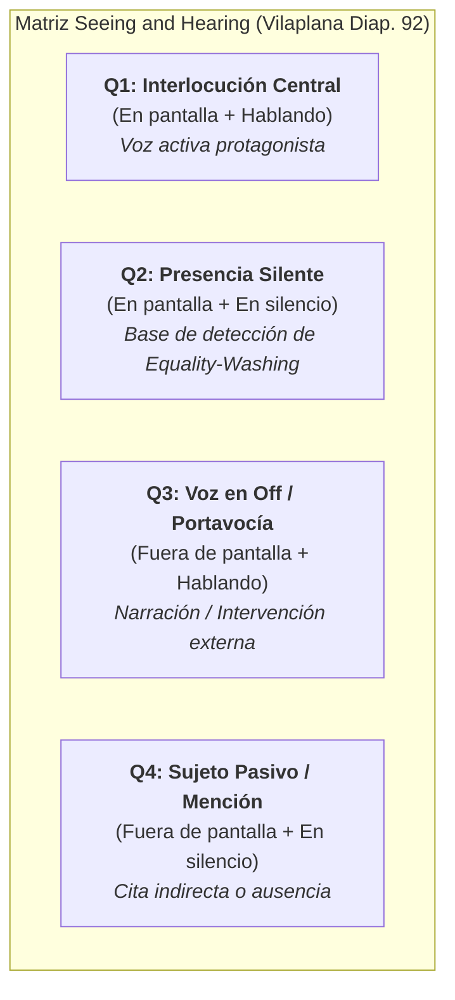
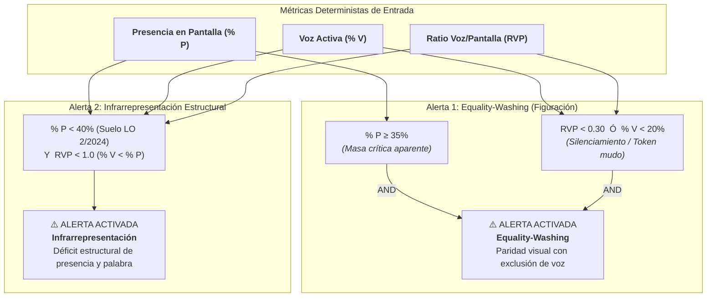
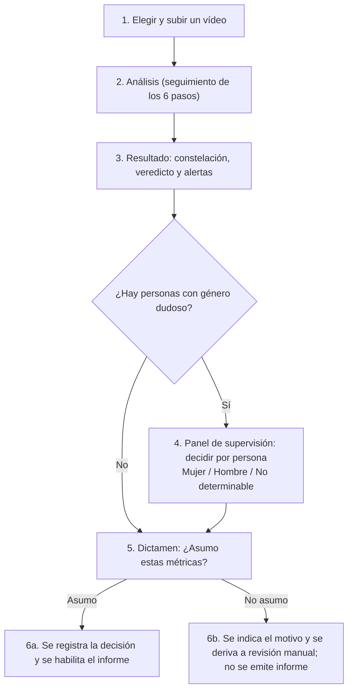

<!--
SPDX-FileCopyrightText: 2026 Equipo 1: Attention Is All She Needs (Alba Camiña García, Pilar de la Fuente Diez, Rocío Jiménez Villén)
SPDX-License-Identifier: Apache-2.0
-->

# 21 — Especificación Técnica de Alertas del Dashboard, Señales Multimodales y Supervisión Humana (HitL)

**Proyecto:** Attention Is All She Needs (AIASN) — Reto «Mujeres por la IA Abierta»  
**Tipo:** Especificación técnica de ingeniería · *Single Source of Truth* (SSoT) de la lógica de alertas y visualización del frontend.  
**Estado:** Vigente y canónico.  
**Relación documental:** Operacionaliza la arquitectura de `06` (§4.1, regla anti-*equality-washing*) y `07` (§5.5, motor de fusión determinista); el marco de supervisión humana y gobernanza se apoya en `20` (Reglamento Europeo de IA — RIA), `18` (marco normativo y de mercado) y `19` (exclusión biométrica y análisis de clima textual).

---

## 0. Propósito y Principio Rector

Este documento establece la formulación matemática determinista, los umbrales de activación y las pautas de experiencia de usuario (UX) para el cuadro de mando interactivo (*La Constelación del Protagonismo*).

### Principio Rector: Separación Estricta entre Inferencia y Veredicto
El sistema desacopla taxativamente la extracción de señales y el cómputo del veredicto:
1. **Capa de Inferencia (Modelos Abiertos):** Los modelos de visión (`YOLO11m` + `ByteTrack`), audio (`whisper-large-v3` diarizado) y NLP (`bge-m3` / LLM) actúan exclusivamente como **extractores de evidencias tabulares estructuradas con marcas temporales** ($t_i, t_f$).
2. **Capa de Veredicto (Motor Determinista en Python):** Todos los porcentajes, ratios de palabra, índices compuestos y disparadores de alertas son calculados **mediante código auditable en Python sin modelos de caja negra intermedios**, garantizando la total reproducibilidad ante el tribunal evaluador.

---

## 1. Definición Formal de Métricas Base

A partir de los metadatos tabulares extraídos por los adaptadores de inferencia sobre una pieza audiovisual de duración total $T_{\text{total}}$, el motor determinista computa:

1. **Cuota de Presencia en Pantalla ($\% P_{\text{fem}}$):**
   $$\% P_{\text{fem}} = \frac{\sum_{k} \text{screen\_time}(k \in \text{Pistas Visuales Femeninas})}{T_{\text{total}}} \times 100$$
   *Obtenido mediante muestreo selectivo STRIDE (1 fps) con `YOLO11m + ByteTrack`.*

2. **Cuota de Voz Activa ($\% V_{\text{fem}}$):**
   $$\% V_{\text{fem}} = \frac{\sum_{j} \text{duration}(j \in \text{Turnos Habla Femenina})}{\sum_{m} \text{duration}(m \in \text{Total Turnos Habla Identificados})} \times 100$$
   *Obtenido mediante la diarización acústica de `whisper-large-v3` (restando silencios intermedios).*

3. **Ratio Voz/Pantalla (RVP):**
   $$\text{RVP}_{\text{fem}} = \frac{\% V_{\text{fem}}}{\% P_{\text{fem}}}$$
   * **Interpretación pericial:** Mide la densidad discursiva del colectivo en relación con su exposición en cámara. En un diálogo o debate audiovisual ordinario con alternancia activa de planos de escucha y palabra, el rango normal de un participante sustantivo se sitúa entre **$0{,}70$ y $1{,}20$**.
   * Un $\text{RVP} < 1{,}0$ indica que la presencia en pantalla supera a la voz, pero **no constituye por sí mismo una alerta de figuración** si la voz activa es suficiente. La figuración patológica requiere una asimetría extrema ($\text{RVP} < 0{,}30$).

4. **Prominencia Espacial (Centralidad y Ocupación de Escena):**
   * **Centralidad ($C \in [0, 1]$):** Proximidad euclídea media del centro del *bounding box* al eje central óptico del plano.
   * **Área Relativa ($A \in [0, 1]$):** Superficie media ocupada por el recuadro de detección respecto a la resolución total del fotograma.

5. **Test de Bechdel Digital / Conversacional (`evaluar_bechdel_conversacional` en `aiasn/core/fusion.py`):**
   Adaptación determinista del Test de Bechdel-Wallace (1985) a contenidos digitales y audiovisuales de no-ficción (debates, pódcast, mesas redondas, informativos) para medir la **autoridad relacional** sin gasto adicional de GPU:
   * **Regla 1 · Pluralidad femenina ($\ge 2$ mujeres con voz activa):** Verifica que intervengan al menos dos mujeres distintas (`hablante_id` / `rotulo_nombre` diferenciados) en los cuadrantes de habla activa ($Q_1, Q_3$), rompiendo el *Efecto Token* o síndrome de la mujer única (*Kanter, 1977*).
   * **Regla 2 · Identidad y autoridad acreditada:** Verifica que al menos dos mujeres estén identificadas con nombre propio o cargo mediante rótulo en pantalla (`rotulo_nombre` / `rotulo_cargo` por OCR).
   * **Regla 3 · Interlocución horizontal directa ($\text{Mujer}_A \rightarrow \text{Mujer}_B$):** Contabiliza las transiciones consecutivas de turno de palabra entre dos mujeres distintas sin que un hombre actúe como mediador o eje obligatorio de validación ($\text{transiciones\_mujer\_a\_mujer} \ge 1$).
   * **Puntuación y Veredicto (`0/3` a `3/3`):** Otorga `supera_bechdel_digital = True` únicamente cuando se cumplen simultáneamente las tres reglas (`3/3`), diagnosticando en caso contrario si el fallo se debe a *Efecto Token* (una sola mujer) o a *Aislamiento Relacional* (dos o más mujeres cuyos turnos están siempre mediados por hombres).

---

## 2. Clasificación Audiovisual en 4 Cuadrantes (*Seeing and Hearing*)

Siguiendo el marco metodológico de la Dra. Verónica Vilaplana (UPC, Taller de Imagen y Vídeo), el cruce de los intervalos temporales de audio y vídeo asigna cada instante a una de las cuatro tipologías operativas:

* **Q1 (Interlocución Central):** Persona visible en plano mientras emite voz activa.
* **Q2 (Presencia Silente — Disparador de Figuración):** Persona visible en plano que no tiene asignado turno de palabra. Si este estado se prolonga desproporcionadamente respecto a la voz activa, se activa la alerta de *equality-washing*.
* **Q3 (Voz en Off):** Intervención de voz sin correspondencia facial simultánea en el encuadre.
* **Q4 (Referencia Externa):** Mención de referentes en el discurso sin presencia visual directa.

---

## 3. Reglas Canónicas de Alerta Deterministas

El sistema desdobla la detección en **dos alertas complementarias e independientes** para evitar falsos positivos y distinguir la ausencia de la cosmética visual:

---

### 3.1. Alerta 1: Equality-Washing (Figuración Cosmética)

Cuantifica la incoherencia pericial entre la hipervisibilidad visual en encuadre y el silenciamiento sustantivo de la palabra (traducción algorítmica del Cuadrante 2 de Vilaplana).

> **Condición de Disparo Determinista:**
> $$\text{Equality-Washing} \iff (\% P_{\text{fem}} \ge 35\%) \quad \mathbf{AND} \quad \left( \text{RVP}_{\text{fem}} < 0{,}30 \quad \mathbf{OR} \quad \% V_{\text{fem}} < 20\% \right)$$

#### Justificación Científica, Empírica y Normativa de los Umbrales:
1. **Presencia $\ge 35\%$ (Masa Crítica de Kanter y Directiva UE 2022/2381):**  
   En la sociología de las organizaciones (*Rosabeth Moss Kanter, 1977, American Journal of Sociology*), los colectivos con una presencia inferior al 20 % actúan como meros testimonios aislados (*tokens*); la barrera para alcanzar una **«masa crítica»** (*critical mass*) con capacidad de influencia real comienza a partir del **35 %**. Este umbral coincide con el suelo del **33 % al 40 %** fijado por la **Directiva (UE) 2022/2381** (*Women on Boards*). Un metraje con $\ge 35\%$ de encuadre proyecta públicamente paridad y superación de la barrera de figuración.
2. **Voz Activa $< 20\%$ (El Techo del «Token Mudo» y Datos Globales de Medios):**  
   Tener presencia visual sin alcanzar el 20 % de la palabra en un debate equivale a un silenciamiento efectivo:
   * **UNESCO / GMMP (2020):** Constata que a nivel global las mujeres apenas acceden al **19 % de las intervenciones como expertas** en noticias y debates de televisión.
   * **Gender Gap Tracker (*Asr et al., 2021, PLOS ONE*):** Cuantifica que las citas directas de autoridad femenina en medios sufren un techo estructural del **21 %**.
   * **Línea Base del Reto (`Àgora` — Adrián Fonollosa / TV3):** El *ground truth* anotado a mano en el dataset oficial sitúa el habla femenina efectiva en el **14 %**.
3. **Ratio Voz/Pantalla ($\text{RVP}$) $< 0{,}30$ (Cuadrante 2 de Vilaplana):**  
   Un $\text{RVP} < 0{,}30$ demuestra matemáticamente que la persona pasa **más del 70 % de su tiempo en pantalla en silencio absoluto**, siendo utilizada como plano mudo de reacción o adorno escénico.
4. **Protección Jurídica contra la Publicidad Engañosa:**  
   La activación simultánea mediante condición **$\text{AND}$** demuestra una discrepancia sustancial tipificable como práctica desleal bajo la **Directiva (UE) 2024/825** (*Empowering Consumers for the Green Transition / Social Claims*) y la **Ley 34/1988 General de Publicidad** (art. 3.a).

---

### 3.2. Alerta 2: Infrarrepresentación Estructural con Brecha de Voz

Distingue la figuración cosmética del déficit cuantitativo directo (poca presencia física y escasa palabra).

> **Condición de Disparo Determinista:**
> $$\text{Infrarrepresentación} \iff (\% P_{\text{fem}} < 40\%) \quad \mathbf{AND} \quad (\text{RVP}_{\text{fem}} < 1{,}0) \quad [\% V_{\text{fem}} < \% P_{\text{fem}}]$$

#### Justificación y Utilidad:
* **El Suelo del $40\%$ (Ley Orgánica 2/2024 y Directiva 2022/2381):**  
  La Ley Orgánica 2/2024 fija el umbral de presencia equilibrada en una horquilla mínima del 40 %. Aunque dicha ley regula órganos directivos y comités, actúa como el estándar legal de referencia en España.
* **RVP $< 1{,}0$:**  
  Indica que además de no alcanzar el suelo paritario en imagen, su porcentaje de palabra ni siquiera iguala a su presencia en pantalla (doble penalización).
* **Diagnóstico de Producción:** Permite a las direcciones de medios y organizadores de conferencias diagnosticar si el problema reside en la convocatoria de ponentes (falta de expertas invitadas) o en la moderación (asimetría en la concesión de turnos).

---

### 3.3. Comportamiento Comparativo de las Dos Alertas

| Escenario Audiovisual Observado | Cuota Pantalla | Cuota Voz | RVP | Alerta 1 (Washing) | Alerta 2 (Infrarrepresentación) | Diagnóstico Pericial del Sistema |
| :--- | :---: | :---: | :---: | :---: | :---: | :--- |
| **Caso A (Muestra CSIC / Demo v2)** | 26,8 % | 19,0 % | 0,71 | ❌ **No activa** (cumple voz $<20\%$, pero $\%P < 35\%$) | ✅ **ACTIVADA** ($\%P < 40\%$ y $\text{RVP} < 1{,}0$) | **Infrarrepresentación Estructural:** Faltan mujeres en el panel; las presentes tienen turno acorde a su cuota de plano. |
| **Caso B (Vídeo Corporativo / Manel Encubierto)** | 45,0 % | 12,0 % | 0,27 | ✅ **ACTIVADA** ($\%P \ge 35\%$ y $\text{RVP} < 0{,}30$) | ❌ **No activa** (pantalla supera el 40 %) | **Equality-Washing:** Paridad cosmética en imagen combinada con silenciamiento discursivo. |
| **Caso C (Mesa Paritaria Equilibrada)** | 42,0 % | 44,0 % | 1,05 | ❌ **No activa** | ❌ **No activa** | **Paridad Efectiva:** Presencia equilibrada y autoridad discursiva simétrica. |

---

## 4. Composición del Índice Global de Representación (0–100)

En la cabecera ejecutiva del dashboard se presenta el **Índice Global de Representación**, calculado como una media ponderada de cuatro dimensiones objetivas:

$$I_{\text{global}} = w_1 \cdot S_{\text{pantalla}} + w_2 \cdot S_{\text{voz}} + w_3 \cdot S_{\text{espacio}} + w_4 \cdot S_{\text{autoridad}}$$

| Dimensión | Ponderación | Señal Subyacente | Puntuación Paritaria ($100$ pts) |
| :--- | :---: | :--- | :--- |
| **1. Presencia en Pantalla ($S_{\text{pantalla}}$)** | $w_1 = 0{,}30$ | Cuota de presencia visual observada ($\% P_{\text{fem}}$). | $100$ si $\% P_{\text{fem}} \ge 40\%$ (escala lineal normalizada). |
| **2. Tiempo de Voz Activa ($S_{\text{voz}}$)** | $w_2 = 0{,}20$ | Cuota de habla neta efectiva ($\% V_{\text{fem}}$). | $100$ si $\% V_{\text{fem}} \ge 40\%$. |
| **3. Protagonismo Espacial ($S_{\text{espacio}}$)** | $w_3 = 0{,}25$ | Centralidad óptica y tamaño relativo de plano. | Ratio de centralidad femenina / centralidad masculina $\approx 1{,}0$. |
| **4. Autoridad y Dinámica ($S_{\text{autoridad}}$)** | $w_4 = 0{,}25$ | Turnos de apertura/cierre, ratio de expertas y citas de referentes (M/H). | Apertura/cierre paritario y ausencia de interrupciones asimétricas. |

---

## 5. Supervisión Humana (*Human-in-the-Loop* — HitL)

En estricto cumplimiento del **Artículo 14 del Reglamento Europeo de IA (RIA)**, el sistema integra la supervisión humana directa para evitar sesgos automatizados ante situaciones de incertidumbre:

1. **Umbral Ético de Abstención ($p < 0{,}80$):**  
   Cuando la confianza del clasificador acústico o visual se sitúa por debajo del umbral de calibración ($p < 0{,}80$), o ante discrepancias irresolubles entre el detector facial y la diarización:
   * **El sistema no fuerza una etiqueta binaria ficticia.**
   * El tramo temporal se etiqueta de forma determinista como **`no_determinado`**.
2. **Derivación a Revisión Humana en la UI:**  
   En el dashboard, estos segmentos dudosos se señalan visualmente con un distintivo visible: **`[ → Revisión Humana ]`**.
3. **Pantalla Operativa de Arbitraje («Asumo / No asumo») — especificación objetivo:**  
   La operadora técnica dispone de dos controles auditables:
   * `[ Validar Clasificación ]`: Asigna manualmente la etiqueta tras contrastar el fotograma y la transcripción.
   * `[ Asumir Abstención ]`: Confirma el tramo como `no_determinado`, excluyéndolo del denominador para no distorsionar las métricas de paridad (*diseño objetivo*; el comportamiento previsto para la primera versión que guarde decisiones está en la sección 8.4).

---

## 6. Transparencia Algorítmica y Límites Regulatorios (RIA)

1. **Género Percibido (Art. 50 RIA):**  
   El sistema documenta explícitamente que la métrica reportada constituye una estimación algorítmica de **género percibido** a partir de señales audiovisuales secundarias, y no un registro de la identidad registral de las personas.
2. **Exclusión de Biometría Emocional (Art. 5.1.f RIA):**  
   El sistema no infiere estados de ánimo, expresiones faciales ni tonos vocales de ira o estrés.
3. **Análisis de Clima Comunicativo sobre Texto Transcrito:**  
   El módulo de NLP analiza la dinámica dialéctica colectiva (*técnico-asertivo / colaborativo / disenso*) exclusivamente sobre el texto transcrito de los turnos, basándose en la teoría de la **«interlocución válida» de Adela Cortina**. Al operar sobre texto y no sobre biometría, queda plenamente amparado bajo el Derecho de la Unión (Directrices C(2025) 884).

---

## 7. Fuentes y Referencias Científico-Normativas

1. **Sociología de las Organizaciones y Masa Crítica:** Kanter, R. M. (1977). *Some Effects of Proportions on Group Life: Skewed Sex Ratios and Responses to Token Women*. *American Journal of Sociology*, 82(5), 965–990.
2. **Monitoreo Global de Medios:** Macharia, S. et al. (2020). *Who Makes the News? Global Media Monitoring Project (GMMP)*. WACC / UNESCO.
3. **Análisis Computacional de Brecha de Género:** Asr, F. T. et al. (2021). *Big media data for gender equality: Introducing the Gender Gap Tracker*. *PLOS ONE*, 16(1), e0245533.
4. **Líneas Base del Reto:** 
   * Fonollosa, J. A. (2026). *Àgora Speech Dataset (14 % de habla femenina)*. TALP-UPC.
   * Vilaplana, V. (2026). *Computer Vision Baseline: Seeing and Hearing 4-Quadrant Framework*. IDEAI-UPC.
5. **Bloque Normativo Imperativo:**
   * **Reglamento (UE) 2024/1689 (Reglamento Europeo de IA — RIA):** Arts. 14 (supervisión humana) y 50 (transparencia).
   * **Directiva (UE) 2024/825:** Sobre alegaciones de sostenibilidad y prácticas desleales (*Green/Social Claims*).
   * **Directiva (UE) 2022/2381:** Sobre el equilibrio de género en los consejos de administración (*Women on Boards*).
   * **Ley Orgánica 2/2024, de 1 de agosto:** De representación paritaria y presencia equilibrada.
   * **Ley 34/1988, de 11 de noviembre:** General de Publicidad (art. 3.a).

---

## 8. Flujo de Usuario, Vistas por Rol y Pantalla «Asumo / No asumo» (#6)

> **Naturaleza de esta sección:** especificación funcional **objetivo**. La tabla 8.5 distingue lo que ya existe en el frontend piloto de lo que está en hoja de ruta.

### 8.1. Principios

1. **El sistema nunca emite un informe definitivo de forma autónoma** (Art. 14 RIA; advertencia de Karina Gibert y Ángela Gasch sobre el caso *Toeslagenaffaire*): una persona responsable decide si asume o no el resultado.
2. **La IA aumenta a la persona, no la sustituye:** el panel presenta la evidencia (tramo, fotograma, texto) para que la decisión sea informada y trazable.
3. **Dos niveles de decisión humana**, sin mezclarlos:
   * **Por persona dudosa** (confianza < 0,80): asignar *Mujer*, *Hombre* o *No determinable*. Equivale a los controles `[ Validar Clasificación ]` y `[ Asumir Abstención ]` de la sección 5.
   * **Sobre el dictamen completo:** botones **«Asumo»** y **«No asumo»**.

### 8.2. Flujo de usuario

### 8.3. Vistas por rol

| Rol | Objetivo | Qué ve | Qué decide |
| :--- | :--- | :--- | :--- |
| **Operadora / técnica** | Inspeccionar y corregir el análisis | Tramos y fotogramas dudosos, métricas de audio y vídeo al segundo, rótulos leídos por OCR, panel de supervisión | Género de las personas dudosas; **Asumo / No asumo** |
| **Auditora / ESG** | Valorar el cumplimiento y reportar | Semáforos de cumplimiento (LO 2/2024, CSRD), Índice Global, alertas 1 y 2 e informe firmado | Si el informe se incorpora a la memoria de sostenibilidad |
| **Ciudadana** | Entender el resultado en 5 segundos | Capa de confianza en 4 estados y la constelación, en lenguaje llano | Nada (solo lectura); valoración ciudadana como línea futura |

### 8.4. Especificación funcional de los botones «Asumo / No asumo»

| Elemento | Regla |
| :--- | :--- |
| **Estados** | `pendiente` → `asumido` o `no_asumido`. Mientras esté `pendiente`, el resultado se muestra como **«Sin supervisión humana»** y no se emite informe ni sello. |
| **Habilitación de «Asumo»** | Solo cuando cada persona dudosa tiene una decisión (incluida *No determinable*). Las personas marcadas *No determinable* se excluyen del denominador, como indica la sección 5, **en el diseño objetivo**. |
| **«No asumo»** | Exige un motivo breve (lista cerrada: *datos insuficientes*, *error de detección*, *otro*) y marca el vídeo como **derivado a revisión manual**. |
| **Efecto sobre las métricas (primera versión con persistencia)** | Las decisiones se **guardan y se muestran** en la sección de supervisión, pero **no recalculan** los KPIs ni el grafo: estos se generan en `gold` con las personas de género conocido y no se rehacen tras la revisión. La pantalla avisa «Métricas calculadas antes de la revisión humana». Recalcular `silver` y `gold` (o relanzar solo la capa `gold`) queda en hoja de ruta. |
| **Registro** | Cada decisión guarda el identificador **pseudonimizado** de la persona operadora (`operador_supervision_id`), la fecha y hora, el estado, el motivo y la huella `SHA-256` de las métricas asumidas. No se guarda ningún dato biométrico. |
| **Reversibilidad** | Se puede cambiar una decisión mientras no se haya emitido el informe; cada cambio queda registrado. |
| **Accesibilidad (WCAG 2.2 AA)** | Controles nativos `button`, operables con teclado, estado en texto e icono (nunca solo color), `aria-pressed` y foco visible. |

### 8.5. Estado de implementación (v0.1.0)

| Pieza | Estado |
| :--- | :--- |
| Subir y analizar un vídeo, seguimiento de pasos | ✅ Implementado |
| Resultado: constelación, veredicto y alertas 1 y 2 | ✅ Implementado |
| Panel de supervisión por persona (*Mujer / Hombre / No determinable*) | ⚠️ Parcial: **las decisiones solo viven en memoria** y se pierden al recargar |
| Botones **«Asumo / No asumo»** sobre el dictamen | ❌ Hoja de ruta |
| Registro con identificador pseudonimizado y bloqueo del informe sin decisión | ❌ Hoja de ruta |
| Endpoint en la API para guardar las decisiones (por ejemplo POST /videos/{video_id}/supervision) | ❌ Hoja de ruta: hoy la API solo expone /health y /videos |
| Vistas por rol | ❌ Hoja de ruta: hoy es una única página; «En palabras sencillas» es lo más cercano a una vista no técnica, y la capa ciudadana solo existe como maqueta |

### 8.6. Alertas

Las condiciones visuales y las reglas deterministas de las dos alertas (*equality-washing* e infrarrepresentación) están definidas en la **sección 3**.
