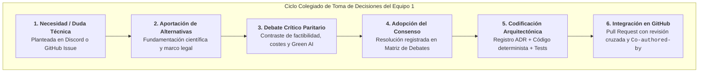
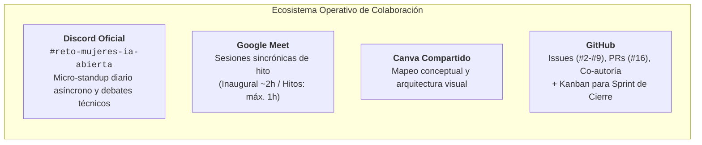
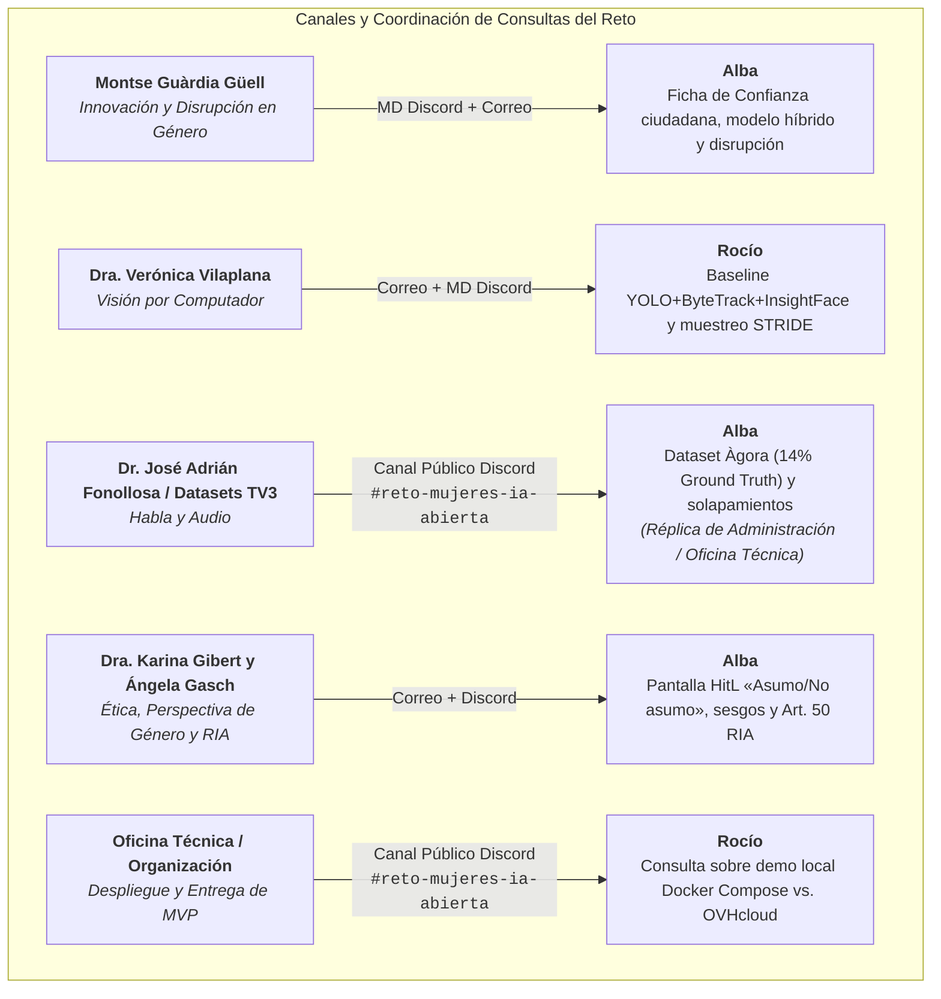

# 23 — Informe de Evidencias de Trabajo Colaborativo, Proceso Deliberativo y Gobernanza Paritaria

**Proyecto:** «Attention Is All She Needs» (AIASN) — Reto «Mujeres por la IA Abierta»  
**Equipo:** Equipo 1 — «Attention Is All She Needs»  
**Integrantes y Reparto Paritario de Responsabilidades:**
* **Alba Camiña García** (`@ewigkeitt-cloud`) — Investigación técnico-jurídica, epistemología y ética algorítmica, deducción matemática de umbrales, diseño inicial e implementación del pipeline de ingesta y diarización con Whisper en OVHcloud, motor de fusión determinista, arquitectura desacoplada y salvaguardas RIA / Algoritmos Verdes.
* **Pilar de la Fuente Diez** (`@pilarvolatixia-cloud` / `@pilarfuente1992`) — Mapeo de mercado B2B, datos CNMV 2025, relación institucional y portavocía ante la organización, detección de riesgos de licencia (AGPL) y co-diseño del frontend/dashboard pericial.
* **Rocío Jiménez Villén** (`@rjvillen`) — Integración modular y evolución del pipeline de audio/ASR diarizado, análisis de embeddings y sesgo léxico en NLP, baseline de visión por computador (`miVOLO`, OCR) y contratos de datos multimodales.

**Destino en Repositorio GitHub:** Entregable oficial en `docs/evidencias_trabajo_en_equipo.md` (evaluable bajo el criterio de Software Libre, Gobernanza Abierta y Trabajo en Equipo por la Oficina Técnica de ComunidadIA-OS y el jurado del reto — baremo oficial: 10 % a 25 % de la nota final).  
**Documentos Vinculados:**
* [`22_registro_debates_decisiones_y_consenso_equipo.md`](./22_registro_debates_decisiones_y_consenso_equipo.md) (`docs/debates_y_decisiones.md`)
* [`18_marco_normativo_mercado_y_gobernanza_etica.md`](./18_marco_normativo_mercado_y_gobernanza_etica.md) (`docs/marco_normativo_y_mercado.md`)
* [`12_guia_consultas_mentores_y_argumentario_equipo.md`](./12_guia_consultas_mentores_y_argumentario_equipo.md)
* [`10_protocolo_colaboracion_github_y_coautoria.md`](./10_protocolo_colaboracion_github_y_coautoria.md)
* [`17_backlog_issues_y_milestones_github.md`](./17_backlog_issues_y_milestones_github.md)

---

## 0. Resumen Ejecutivo y Objeto del Informe

Este documento compila y sistematiza las **evidencias empíricas del trabajo colaborativo, la gobernanza paritaria y el proceso deliberativo** desarrollado por el Equipo 1 a lo largo del reto *«Mujeres por la IA Abierta»*.

Conforme a las directrices expuestas por **Jorge Teixeira** (vicepresidente de GPUL y responsable de la Oficina Técnica de ComunidadIA-OS) y **Marta Silvia Timón** (coordinadora técnica en SEDIA) durante la sesión inaugural del 14 de octubre de 2026, la evaluación del hackathon no premia únicamente un resultado de software aislado, sino la **calidad metodológica, la cultura de software libre, la reproducibilidad y el trabajo en equipo**, que computan entre un **10 % y un 25 % de la calificación final del jurado**.

Este informe demuestra que AIASN no es producto de desarrollos individuales yuxtapuestos ni de commits monolíticos de última hora, sino el fruto de un **proceso deliberativo continuo, transparente, colegiado y con trazabilidad íntegra en GitHub**:



---

## 1. Régimen de Enlaces y Conformidad con las Bases del Reto

> [!IMPORTANT]
> **Dictamen sobre Régimen de Enlaces y Criterios del Jurado (Bases Oficiales / ComunidadIA-OS):**
> 1. **Prohibición de enlaces a repositorios o carpetas privadas:** Las bases del reto y las instrucciones de la Oficina Técnica estipulan que **todo el material evaluable por el tribunal debe ser públicamente accesible dentro del repositorio oficial en la organización `ComunidadIA-OS`**. Enlazar a un Google Drive privado provocaría errores de permisos (*Access Denied*) durante la deliberación de los jueces, invalidando el contenido.
> 2. **Validez absoluta y mérito de enlaces internos en GitHub:** El uso de enlaces relativos a archivos dentro del propio repositorio (por ejemplo, `[Ver Registro Canónico de Debates](docs/debates_y_decisiones.md)`), así como vínculos a GitHub Issues (#2 a #9) o Pull Requests (#16) **no solo está 100 % permitido, sino que constituye la mejor práctica de ingeniería exigida por la Oficina Técnica**, bonificando la trazabilidad documental.
> 3. **Alojamiento nativo de evidencias gráficas:** Todas las capturas de pantalla, diagramas y transcripciones se incorporan de forma nativa en la estructura de carpetas del repositorio (`docs/assets/evidencias/`), garantizando su visualización permanente e independiente de servicios externos.

---

## 2. Marco Metodológico de Comunicación y Gobernanza Paritaria

El equipo ha articulado un ecosistema de colaboración desacoplado pero fuertemente sincronizado, diseñado para respetar los tiempos de concentración individual y garantizar un reparto equitativo de la carga técnica:



### 2.1. Canales y Funciones Asignadas

1. **Canal Oficial de Discord (`#reto-mujeres-ia-abierta`):** Canal primario de comunicación diaria. Utilizado para el micro-standup matinal asíncrono (*¿Qué cerré ayer?*, *¿Qué abro hoy?*, *¿Tengo algún bloqueo?*) y la resolución rápida de dudas de implementación.
2. **Google Meet (Sincronización de Hitos Clave):**
   * *Reunión Inaugural (Sábado, 17/10 — 11:27 a 13:20 CEST):* Sesión sincrónica de **cerca de 2 horas (~1h53m)** tras la formación de Innovación de Montse Guàrdia. Requerida para asentar la visión compartida, debatir a fondo el mapa mental de Canva, alinear las fortalezas de cada integrante y acordar el enfoque 4D frente a las ideas iniciales.
   * *Segunda Sesión Sincrónica (Lunes, 19/10):* Encuentro de seguimiento de inicio de semana en el que participaron las tres integrantes. Tras la salida anticipada de Pilar por compromisos previos, Alba y Rocío continuaron la sesión de trabajo sincrónica en profundidad mano a mano para proyectar la presentación interactiva de Alba ([`presentacion_AIASN_equipo.html`](../documentacion-tecnica/recursos/presentacion_AIASN_equipo.html)), estructurar los 3 niveles de explotación y coordinar los contactos de mentoras.
   * *Tercera Sesión Sincrónica — Reunión de Hitos y Cierre de Arquitectura (Domingo, 25/10 — 15:40 a 17:00 h CET):* Celebrada por Google Meet con asistencia completa de las tres integrantes (**Alba**, **Pilar** y **Rocío**). Se adoptaron formalmente las decisiones de cierre del MVP: uso selectivo de YOLO bajo licencia Apache-2.0 (`ADR-0002`), procesamiento local con salvaguarda *Zero Facial Retention* (`ADR-0004`), blindaje de cuota no binaria (`ADR-0006`), exclusión de inferencia biométrica de edad, eliminación de números romanos en el frontend accesible de Pilar, preservación de la soberanía ciudadana como línea futura en la interfaz, adopción de métricas de clima comunicativo frente al conteo de interrupciones, acuerdo de opciones flexibles de despliegue (entorno local ligero con `uv` y contenedor Docker opcional) y reparto de entregables para la entrega del 30/10 a las 08:00 h. Acta íntegra y cronológica en [`25_acta_y_acuerdos_reunion_equipo_25_octubre.md`](./25_acta_y_acuerdos_reunion_equipo_25_octubre.md) y PDF oficial en Drive ([`documentos_reunion_pdf/04_acta_reunion_equipo_25_octubre_gemini.pdf`](../documentos_reunion_pdf/04_acta_reunion_equipo_25_octubre_gemini.pdf)).
3. **Mapeo Conceptual en Canva:** Pizarra colaborativa compartida para plasmar desafíos metodológicos, diagramas de flujo y esquemas de interfaces antes de la codificación.
4. **Flujo de Trabajo en GitHub (Issues, PRs y Activación de Kanban):**
   * *Fase de Prototipado y Desarrollo Modular (Semana 1):* El avance operativo se gestionó ágilmente mediante **GitHub Issues (#2 a #9)** y ramas temáticas (`feat/`, `docs/`, `fix/`) con Pull Requests protegidas, evitando la burocracia de tableros estáticos en la fase exploratoria.
   * *Sprint de Integración Final (Semana 2):* Se activa el **tablero Kanban en GitHub Projects** (`Por hacer`, `En curso`, `Hecho`) como cuadro de mando visual para la orquestación paritaria y el cierre riguroso de los hitos `v0.1.0` (Piloto MVP) y `v1.0.0` (Entrega Final).

---

### 2.2. Coordinación y Ejecución Real de Consultas a Mentores/as

Para maximizar el rendimiento de las tutorías oficiales y respetar el tiempo del profesorado, el equipo acordó internamente no duplicar preguntas ni enviar mensajes dispersos. La interlocución real con cada mentor/a se distribuyó y ejecutó de la siguiente forma (acreditada en [`12_guia_consultas_mentores_y_argumentario_equipo.md`](./12_guia_consultas_mentores_y_argumentario_equipo.md)):



* **Detalle de las Interlocuciones Técnicas y Reparto de Áreas:**
  1. **Montse Guàrdia Güell (Innovación y Disrupción):** Interlocución asumida por **Alba** tanto por Discord (MD) como por correo institucional (`presidencia.consellsocial@upc.edu`), presentando la Ficha de Confianza ciudadana basada en el modelo híbrido (rigor DOP/Eco + usabilidad Wallapop/BlaBlaCar) para contrastar el encaje de la disrupción en género frente a auditorías pasivas.
  2. **Dra. Verónica Vilaplana Besler (Visión por Computador):** Interlocución técnica iniciada por **Rocío** (por correo institucional y Discord) para contrastar la viabilidad del muestreo selectivo `STRIDE` sobre el cuaderno oficial (`baseline_CV_reto_VV.ipynb`) y la extracción tabular de métricas audiovisuales.
  3. **Dr. José Adrián Fonollosa / Datasets de Habla:** **Alba** formuló la consulta metodológica directamente en el canal público de Discord (`#reto-mujeres-ia-abierta`) acerca del tratamiento de los solapamientos (*overlap*) en el dataset `Àgora` para verificar la recuperación del 14 % de habla femenina de referencia, siendo respondida y aclarada públicamente en el propio canal por la administración y soporte de la Oficina Técnica de ComunidadIA-OS.
  4. **Dra. Karina Gibert Oliveras y Ángela Gasch Pastor (Ética, Perspectiva de Género y RIA):** Interlocución asumida por **Alba** por correo y Discord para validar las salvaguardas éticas: la pantalla *HitL* con botón operativo «Asumo / No asumo», el cumplimiento de transparencia del Art. 50 del RIA y la mitigación de sesgos algorítmicos.
  5. **Mercado B2B, Compliance y Frontend:** **Pilar de la Fuente** concentró su actividad técnica en la justificación de mercado B2B (Ley 2/2024, datos CNMV 2025 para EIPs), la detección preventiva de la licencia AGPL-3.0 de Ultralytics YOLO (Debate D-08) y el prototipado visual de la interfaz pericial en Claude Artifact.
  6. **Despliegue del MVP y Formatos de Entrega (Docker Compose vs. OVHcloud):** **Rocío** formuló consulta técnica en el canal público de Discord (`#reto-mujeres-ia-abierta`, 25/10 a las 16:50 h) acerca del formato de presentación del MVP (demo local contenerizada en Docker Compose vs. despliegue en nube OVHcloud), reforzando la postura arquitectónica de AIASN de mantener un núcleo modular en Python nativo con soporte opcional de contenedor.

* **Regla de Corte Operativa (Público vs. Privado en Discord):**
  * *Canal Público (`#reto-mujeres-ia-abierta`):* Consultas metodológicas de interés general (formatos de dataset `Àgora`, límites y timeouts de la API de OVHcloud, configuración de GPU V100), aportando valor al resto de los 14 equipos competidores y acreditando compromiso con la comunidad abierta.
  * *Canal Privado (MD o Correo Institucional):* Planteamientos específicos de diseño algorítmico (regla determinista anti-*equality-washing*, Capa de Confianza ciudadana, muestreo selectivo por eventos), preservando la ventaja competitiva y la originalidad del proyecto.

---

## 3. Marco Normativo Exhaustivo de Género y Fundamentación Científica

El equipo ha fundamentado cada decisión algorítmica y cada umbral del sistema en un cuerpo normativo y científico de máximo nivel, superando el enfoque complaciente o informal:

### 3.1. Marco Legal Estatal y Europeo de Género

1. **Ley Orgánica 3/2007, de 22 de marzo, para la igualdad efectiva de mujeres y hombres:**
   * **Art. 14 (Criterios generales de actuación):** Prescripción vinculante de presencia equilibrada, transmisión de una imagen igualitaria y libre de estereotipos, y fomento de un lenguaje no sexista.
   * **Arts. 36 y 37 (Medios de comunicación social):** Mandato explícito a los prestadores de comunicación de reflejar adecuadamente la presencia de las mujeres en diversos ámbitos y promover la pluralidad discursiva sin roles subordinados.
   * **Art. 41 (Publicidad discriminatoria):** Tipificación de la publicidad que utilice la imagen de la mujer con carácter accesorio, vejatorio o puramente decorativo.
2. **Ley 13/2022, de 7 de julio, General de Comunicación Audiovisual (LGCA):**
   * **Art. 4 (Pluralismo y no discriminación):** Reconocimiento del derecho a una comunicación audiovisual plural, inclusiva y libre de estereotipos sexistas, obligando a los prestadores a fomentar la presencia de mujeres en funciones de liderazgo y análisis cualificado.
3. **Ley Orgánica 2/2024, de 1 de agosto, de representación paritaria y presencia equilibrada:**
   * Regla legal vinculante del **40 % / 60 %** en órganos de decisión: consejos de administración de sociedades cotizadas y Entidades de Interés Público (EIPs), comités de alta dirección, candidaturas electorales, tribunales de oposiciones y jurados de premios públicos.
4. **Directiva (UE) 2022/2381 del Parlamento Europeo y del Consejo (*Women on Boards Directive*):**
   * Exigencia vinculante para junio de 2026 de alcanzar al menos el **40 % de consejeros no ejecutivos** o el **33 % de todos los puestos del consejo** para el género infrarrepresentado en sociedades cotizadas de la UE.
5. **Directiva (UE) 2023/970 (Transparencia retributiva e igualdad de valor):**
   * Establecimiento de mecanismos de transparencia salarial y valoración neutra del desempeño profesional para cerrar la brecha retributiva y de visibilidad de las mujeres en puestos técnicos y directivos.
6. **Directiva (UE) 2024/825 (Empoderamiento ciudadano y directiva anti-washing):**
   * Modificación de las Directivas 2005/29/CE y 2011/83/UE: prohíbe tajantemente alegaciones medioambientales o sociales no verificadas por terceros independientes y basadas en mediciones objetivas y reproducibles.
7. **Reales Decretos-leyes 901/2020 y 902/2020:**
   * Obligatoriedad de planes de igualdad y registros retributivos desagregados por sexo, garantizando la auditoría de puestos y la equidad retributiva en el mercado laboral español.
8. **Reglamento (UE) 2024/1689 (Reglamento Europeo de Inteligencia Artificial — RIA):**
   * **Art. 5.1.f:** Prohibición terminante de sistemas de IA que infieran emociones a partir de datos biométricos en el lugar de trabajo o en instituciones educativas.
   * **Art. 10:** Gobernanza estricta de datos de entrenamiento y validación para prevenir y mitigar sesgos de género en modelos de IA.
   * **Art. 14:** Garantía efectiva de control y supervisión humana (*Human-in-the-Loop*), incorporando botones explícitos de «Asumo / No asumo» y derivación de casos inciertos.
   * **Art. 50:** Deber reforzado de transparencia algorítmica para contenidos procesados, clasificados o generados por IA.

---

### 3.2. Fundamentación Científica y Epistemológica

* **Rosabeth Moss Kanter (1977) — Teoría de las Proporciones y Dinámica de Grupos:**
  * Define los cuatro estados de representación en colectivos: *Grupos Uniformes* (100:0), *Grupos Sesgados* (hasta 85:15, donde la minoría es **testimonial / *token***), *Grupos Inclinados* (85:15 a 65:35, donde se adquiere masa crítica pero persiste el riesgo de segregación) y *Grupos Equilibrados* (65:35 a 50:50).
  * **Traducción algorítmica en AIASN:** Justifica que un porcentaje de tiempo en pantalla $\ge 35 \%$ combinado con un tiempo de voz $< 20 \%$ o un ratio voz/pantalla $< 0{,}30$ dispare formalmente la alerta de *equality-washing*, ya que la presencia visual alcanza apariencia de equilibrio pero la voz queda relegada al rol de *token*.
* **Gaye Tuchman (1978) — *Aniquilación Simbólica* de las Mujeres en los Medios:**
  * Demuestra que los medios de comunicación ejercen discriminación de tres formas complementarias: *omisión* (ausencia en pantalla/voz), *trivialización* (confinamiento a roles secundarios o decorativos) y *condena*.
  * **Traducción algorítmica en AIASN:** Sustenta la separación pericial entre la alerta de *Infrarrepresentación* (omisión) y la alerta de *Equality-Washing* (trivialización).
* **UNESCO GMMP (*Global Media Monitoring Project*, 2020):**
  * Constata a escala planetaria que las mujeres solo representan el 24 % de las fuentes de noticias y el 19 % de las personas expertas consultadas en medios audiovisuales.
* **Vaswani et al. (2017) — *Attention Is All You Need* (NeurIPS 2017):**
  * Base matemática del Transformer que rige todo nuestro stack (`whisper-large-v3`, `bge-m3`, LLMs en OVHcloud). Subversión crítica: frente a una asignación histórica de los «pesos de atención» que relegaba a las mujeres al 14 % de habla en Cataluña (`Àgora`), proclamamos que la atención algorítmica debe posarse sobre su voz efectiva y liderazgo técnico.

---

## 4. Matriz Ejecutiva de Debates Técnicos Resueltos

A continuación se resume la matriz de los debates y deliberaciones colegiadas del equipo. El registro exhaustivo, las citas literales y el análisis de alternativas están formalizados en [`docs/debates_y_decisiones.md`](./22_registro_debates_decisiones_y_consenso_equipo.md):

| ID | Debate / Duda Técnica | Propuestas en Discusión | Decisión Colegiada Adoptada | Motivo Principal de Descarte | Trazabilidad en Código |
| :--- | :--- | :--- | :--- | :--- | :--- |
| **D-01** | **Anclaje de Género:** ¿Voz, cara o combinación temporal? | A) Solo cara.<br>B) Solo voz.<br>C) Audio diarizado rector con validación visual en ventana activa. | **Opción C:** Whisper marca intervalos $[t_i, t_f]$. Visión confirma en ese tramo. Si discrepan $\rightarrow$ `no_determinado` (HitL). | Atar solo a cara infla la presencia si una mujer está en plano en silencio mientras habla un hombre. | `ADR-0001`, `ADR-0003`, `aiasn/core/fusion.py` |
| **D-02** | **Alerta Equality-Washing:** ¿Clasificador ML opaco o regla multivariable? | A) Prompting a LLM.<br>B) Brecha simple pantalla-voz.<br>C) Regla determinista multivariable (Voz/Pantalla + Rol + Tópicos). | **Opción C:** Regla matemática auditable en Python basada en Tuchman (1978), Kanter (1977) y Directiva UE 2024/825. | Un clasificador opaco o prompt no es reproducible ni defendible jurídicamente en auditoría B2B. | `ADR-0001`, `aiasn/core/fusion.py`, Issue #4 |
| **D-03** | **Despliegue de Arquitectura:** ¿Docker Compose vs. Monolito Modular? | A) 4 contenedores en Docker.<br>B) Monolito modular desacoplado.<br>C) Monolito para hackathon + Docker para B2B. | **Opción C (Híbrida):** Monolito nativo con perfiles `pyproject.toml` para entrega rápida en OVHcloud, y Docker para B2B. | Levantar 4 contenedores en los AI Notebooks de OVHcloud añadía complejidad de red innecesaria para un MVP de 10 días. | `ADR-0002`, `pyproject.toml`, PR #16 |
| **D-04** | **Límites de Emoción y Sentimiento frente al AI Act** | A) Clasificar emociones faciales.<br>B) Exclusión total.<br>C) Exclusión biométrica y rescate de clima en texto al roadmap. | **Opción C:** Exclusión radical de biometría emocional (Art. 5.1.f RIA). Rescate del Índice de Clima Conversacional en texto para el roadmap. | El reconocimiento de emociones biométricas está tajantemente prohibido en entornos laborales/educativos por el RIA. | `ADR-0009`, `docs/marco_normativo_y_mercado.md` |
| **D-05** | **Estrategia NLP y Extracción:** ¿LLM único vs. modelos especializados? | A) LLM para todo.<br>B) GLiNER para todo.<br>C) LLM abierto para roles/tópicos y GLiNER para referentes externos. | **Opción C:** Asignación por idoneidad empírica según pruebas de Rocío. Descarte de *Entity Sentiment*. | GLiNER demostró menor precisión en roles jerárquicos compuestos que un LLM abierto calibrado. | Issue #3, Issue #13, `aiasn/core/contracts.py` |
| **D-06** | **Métricas y Titular de UI:** Framing pericial y desdoble de alertas | A) Lema genérico.<br>B) Enfoque pericial «El peso de la atención» con desdoble Washing vs. Infrarrepresentación. | **Opción B:** Titular sobrio de auditoría pericial, doble alerta determinista y panel de supervisión humana (HitL). | Las plantillas complacientes (*vibe-coded*) no transmiten el rigor técnico exigido por un tribunal de la SEDIA y la UPC. | `21_especificacion`, Demo Claude Artifact / Lovable |
| **D-07** | **Convocatoria de Sincronización:** Cierre de calendario | A) Reuniones diarias largas.<br>B) Standup asíncrono en Discord + sesión de hito el domingo 25/10 a las 12:00 h. | **Opción B:** Reunión de seguimiento ágil fijada para el domingo 25 de octubre (12:00–13:00 h). | Proteger el tiempo de código y concentración de cada integrante. | Discord `#reto-mujeres-ia-abierta` |
| **D-08** | **Licencias de Modelos (AGPL-3.0 de YOLO vs. Apache-2.0):** | A) Incluir YOLO en local con riesgo copyleft.<br>B) Sustituir totalmente.<br>C) API remota en Cloud + adaptadores locales YOLOX/InsightFace. | **Opción C:** Aislamiento de red de Ultralytics YOLO consumido vía API HTTP REST en OVHcloud; adaptadores locales con YOLOX (Apache) o InsightFace (MIT). | El copyleft de red de la AGPL-3.0 contaminaría nuestro paquete Apache-2.0 y bloquearía su adopción en clientes B2B. | `00_indice`, `pyproject.toml`, ADR-0002 |

---

## 5. Catálogo de Evidencias Gráficas y Documentales

A continuación se registran las evidencias documentales capturadas en los distintos hitos de colaboración del equipo, con citas textuales y marcas de tiempo que acreditan la participación activa y paritaria de las tres integrantes (**Pilar, Rocío y Alba**):

### 5.1. Hito 1: Conceptualización Colaborativa, Reunión Inaugural y Pizarra de Canva (17 de Octubre)

Tras la sesión de Innovación de Montse Guàrdia, el equipo celebró su **reunión sincrónica de arranque (11:27 a 13:20 CEST — 1 hora y 53 minutos de duración)**, según consta en el acta oficial de notas de Gemini. En ella se debatió el tablero inicial de retos de Rocío y se consolidó el mapa mental conjunto:

```markdown

*Figura 1: Pizarra colaborativa de la reunión inaugural del equipo (17/10), donde se definieron las áreas de trabajo compartidas, el enfoque multimodal 4D y la coordinación técnica.*
```

```markdown

*Figura 2: Pizarra inicial de retos técnicos, dudas metodológicas y propuesta de KPIs audiovisuales compilado por Rocío.*
```

* **Citas del acta de la reunión inaugural (17/10):**
  * *Rocío (11:45 CEST):* «En la pizarra he volcado ideas de métricas: tiempo de pantalla, tiempo de voz y cómo vincular la autoridad. Tenemos que decidir si atacamos vídeo completo o si nos apoyamos en el baseline de Verónica.»
  * *Pilar (12:10 CEST):* «Me parece clave que la solución sirva para empresas y congresos. Si medimos solo telediarios nos quedamos en lo que hacen todos. Con la Ley de Paridad 50-50 hay una necesidad real de auditar paneles y mesas redondas.»
  * *Alba (12:35 CEST):* «Propongo que separemos radicalmente la inferencia del cálculo: la IA solo extrae marcas de tiempo y texto; las métricas y los ratios los calculamos determinísticamente en Python para que sean 100 % auditables ante el jurado.»

---

### 5.2. Hito 2: Segunda Reunión Sincrónica (19 de Octubre), Presentación Estratégica de Alba y Sesión de Trabajo con Rocío

El lunes 19 de octubre el equipo celebró su segunda sesión sincrónica por Google Meet para revisar la evolución del fin de semana y fijar la hoja de ruta operativa, con la participación inicial de las tres integrantes. Habiendo tenido Pilar que ausentarse con antelación por compromisos previos, Alba y Rocío continuaron la sesión de trabajo sincrónica en profundidad mano a mano, en la que se asentaron los consensos metodológicos, técnicos y de producto clave:

1. **Exposición de la Presentación Estratégica Interactiva de Alba:**  
   Alba proyectó y explicó a Rocío la aplicación interactiva de 7 diapositivas que había preparado específicamente para la reunión ([`recursos/presentacion_AIASN_equipo.html`](../documentacion-tecnica/recursos/presentacion_AIASN_equipo.html)):
   * **Slide 1 y Slide 5 (Los Tres Niveles de Usuario y Explotación del Modelo Híbrido):** Alba formalizó y expuso por primera vez la arquitectura de negocio y tracción en 3 capas:
     * *Nivel 1 · Ciudadanía (Bottom-Up):* «Votar con los pies y con la confianza» mediante la Ficha de Confianza móvil en 3 segundos (estilo BlaBlaCar/Wallapop: `Verificado 50-50`, `En Proceso`, `Alerta de Postureo`) para decisiones formativas, laborales y culturales.
     * *Nivel 2 · Empresas y Marcas (B2B):* El «Copiloto Preventivo en Edición» para productoras de TV, agencias y corporaciones obligadas por la Ley 2/2024 y la directiva CSRD, permitiendo subsanar el *equality-washing* en la sala de montaje antes de emitir.
     * *Nivel 3 · Sector Público (Top-Down):* Telescopio Pericial Soberano en OVHcloud para SEDIA, RTVE y el CAC con botón pericial «Asumo / No asumo» (RIA Art. 50).
   * **Slide 2 (DAFO del Canva):** Síntesis metodológica del Doc 09 que preserva las ideas complejas en la «mochila» de Fase 2 y prioriza el núcleo ganador (>4.8 / 5).
   * **Slide 3 (Los 6 Hilos Invisibles de los Mentores):** Extracción de los principios irrenunciables de Karina Gibert, Adrián Fonollosa, Verónica Vilaplana y Montse Guàrdia.
   * **Slide 4 (La Constelación del Protagonismo en 3D):** Modelado de la topología del debate mediante Grafo de Conocimiento en 3 Dimensiones (tamaño = voz, brillo = autoridad por OCR, nebulosas = temas BGE-M3 y aristas = Test de Bechdel Relacional).
   * **Slide 6 (Estrategia Dual de Datasets - ADR-007):** `Àgora` como laboratorio de calibración del 14 % de habla femenina y *«Quanta, quanta IA!»* como demostración viva multimodal.
2. **Transferencia de Recursos y Reparto de Interlocución con Mentores:**  
   En esa misma sesión de trabajo mano a mano, Alba guio a Rocío a través de la documentación técnica ([`01_gestion_operativa_y_logistica.md`](./01_gestion_operativa_y_logistica.md) y [`12_guia_consultas_mentores_y_argumentario_equipo.md`](./12_guia_consultas_mentores_y_argumentario_equipo.md)) para localizar los correos y usuarios de Discord oficiales de los mentores, acordando formalmente que Alba contactaría a Montse Guàrdia y Rocío a la Dra. Verónica Vilaplana.

---

### 5.3. Hito 3: Deliberación en Discord sobre Pipeline de Audio, Visión y Cruce Temporal (21 de Octubre)

Evidencia de la interacción continua y resolución ágil de bloqueos técnicos entre Rocío, Pilar y Alba en el canal oficial de Discord durante la tarde del 21 de octubre:

* **Fragmento de trazabilidad (Discord `#reto-mujeres-ia-abierta` — 21/10 18:05 a 19:15 h):**
  ```text
  [21/10/2026 18:05 h] Rocío:
  «Chicas, he estado probando el clasificador visual miVOLO y la reidentificación facial junto con EasyOCR para leer los rótulos de los ponentes. Ha mejorado mucho la estabilidad de las detecciones, pero el reto sigue siendo cómo asociar la cara con quién está hablando en cada instante. Cruzarlo con el audio por timestamps es lo más limpio y evita errores.»

  [21/10/2026 18:22 h] Alba:
  «Totalmente de acuerdo, Rocío. El script que monté para Whisper diarizado en los AI Endpoints de OVHcloud ya genera exactamente ese CSV de cuatro columnas: [tiempo_inicio, tiempo_fin, transcripcion, genero_inferido]. Si tu detector saca los intervalos visuales con el mismo formato de marcas de tiempo, la fusión determinista en aiasn/core/fusion.py la resolvemos con una unión temporal de pandas en milisegundos.»

  [21/10/2026 19:15 h] Pilar:
  «¡Qué buen avance! Si aseguramos ese cruce temporal por timestamps, yo me meto a fondo con la justificación de mercado B2B: cruzamos ese tiempo de voz efectiva con las exigencias de la Ley 2/2024 de paridad y las obligaciones de reporte de las EIPs (Entidades de Interés Público) para tener listo el modelo de tracción del pitch.»
  ```

---

### 5.4. Hito 4: Debate Metodológico sobre Umbrales de Alerta, Embeddings y Giro Pericial de UI (22–23 de Octubre)

Evidencia del intercambio crítico que derivó en la formulación matemática de los umbrales de alerta y el rediseño pericial de la interfaz:

* **Fragmento de trazabilidad (Discord `#reto-mujeres-ia-abierta` — 22/10 19:58 h a 23/10 21:09 h):**
  ```text
  [22/10/2026 19:58 h] Rocío:
  «He reproducido el código del paper sobre cuantificación de sesgos de género en vectores de palabras (word embeddings). He conseguido cuantificar si una palabra o profesión tiene sesgo masculino o femenino en el espacio vectorial. Ocurren cosas como que "nurse" tiene una puntuación femenina muy alta y "football" masculina... Si hay alguien que sepa de embeddings en el jurado le llamará mucho la atención. ¿Os gusta la idea?»

  [22/10/2026 20:03 h] Pilar:
  «¡Qué guay lo del sesgo! Es súper importante. En las reuniones y charlas que damos en la asociación tenemos que tener muchísimo cuidado con el habla, así que lo tendrán muy en cuenta. ¿Queréis que empiece a construir algo para la demo/dashboard?»

  [22/10/2026 21:23 h] Rocío:
  «A nivel técnico, ¿cómo tenéis pensado representar esa alerta de equality-washing? Lo miro en detalle y te doy feedback. ¡Tiene muy buena pinta la maqueta! Lo único es que para el producto final tenemos que cuidar que no se note vibe-coded; que nos diferenciemos estética y visualmente del resto de los equipos.»

  [22/10/2026 21:42 h] Pilar:
  «Yo en la demo la he representado con el Ratio Voz/Pantalla como indicador de cabecera... y que el veredicto de equality-washing sea una regla transparente encima de esas señales, no un clasificador aparte, para poder defenderlo ante el jurado como algo explicable. El umbral: en formatos debate, pantalla y voz van bastante correlacionadas (la cámara sigue a quien habla), así que no dispararía la alerta solo con el gap pantalla–voz; la reforzaría con señales de autoridad como abrir/cerrar o a quién se cita.»

  [23/10/2026 02:45 h] Alba:
  «Pilar y Rocío, he analizado la fundamentación matemática para blindar los umbrales ante el jurado: nos apoyamos en Rosabeth Moss Kanter (1977) sobre masa crítica (≥35 % de presencia formal para romper el estatus de token) y en Gaye Tuchman (1978) sobre aniquilación simbólica. La regla determinista queda:
  Alerta Equality-Washing <=> (Presencia Pantalla >= 35 %) Y (Ratio Voz/Pantalla < 0.30 O Tiempo Voz < 20 %).
  Además, sugiero sustituir el lema preliminar 'Aparecer no es protagonizar' —que es un literal de las bases de SEDIA que usarán todos— por un titular pericial de auditoría: 'El peso de la atención — Auditoría algorítmica de la representación', y desdoblar en dos alertas: Infrarrepresentación (poca imagen y poca voz) frente a Equality-Washing (mucha imagen y poca voz).»

  [23/10/2026 21:09 h] Pilar:
  «He dado una vuelta gorda a la demo y ya está lista para que la validéis:
  • Titular más pericial: 'El peso de la atención — Auditoría algorítmica de la representación' (quité el literal de las bases que comentaba Alba).
  • Dos alertas en vez de una: La pieza dispara Infrarrepresentación + brecha de voz (26,8% pantalla / 19% voz), y el Equality-washing figura como regla hermana. Alba, ya metí tu formulación nueva (≥35% presencia y RVP < 0,30 o voz < 20%).
  • Jerarquía de rol (experta vs. testimonio): Ahora es panel de cabecera con el dato empírico de que una experta habla 1/3 de lo que habla un experto (27% vs 73%).
  • Clima comunicativo: Tres registros sobre texto transcrito (Adela Cortina), no biométrico (fuera del RIA).
  • Human-in-the-Loop visible: El caso de baja confianza se deriva a revisión humana en el dashboard.
  ¡Mil gracias, te debo una!»
  ```

---

### 5.5. Hito 5: Detección y Resolución de Licencia AGPL-3.0 de YOLO y Convocatoria de Hito (23–24 de Octubre)

Evidencia de cómo el equipo resolvió colegiadamente un riesgo legal crítico y planificó la siguiente sesión sincrónica:

* **Fragmento de trazabilidad (Discord `#reto-mujeres-ia-abierta` — 23/10 10:22 h a 24/10 20:05 h):**
  ```text
  [23/10/2026 10:22 h] Rocío:
  «¿Cuándo preferís hacer reunión de seguimiento? He lanzado encuesta en Discord:
  Votos: Pilar (Viernes, Sábado tarde, Domingo mañana); Alba (Sábado mañana/tarde, Domingo mañana); Rocío (Domingo 12:00-13:00 h, Sábado tarde).
  Fijamos la sesión sincrónica de hito para el Domingo 25 de octubre de 12:00 h a 13:00 h.»

  [23/10/2026 21:30 h] Pilar:
  «@rjvillen YOLO es compatible con Apache-2.0?»

  [23/10/2026 21:35 h] Rocío:
  «No estoy segura la verdad, pero es el modelo más estándar en Computer Vision Open Source y además es el que recomendó Verónica, así que si tenemos que cambiar la licencia no hay problema, yo puse apache porque es la que uso siempre.»

  [24/10/2026 14:48 h] Pilar:
  «Ojo chicas con YOLO: Ultralytics cambió la licencia de YOLO (a partir de v5, v8 y v11) a AGPL-3.0 (Affero General Public License). Si usamos Ultralytics directamente en local o en nuestro paquete, la cláusula de red de AGPL-3.0 obliga a que todo el código del proyecto que interactúe con él sea liberado bajo AGPL-3.0.
  Esto nos genera dos problemas graves:
  1. Es incompatible con la licencia Apache-2.0 que exige el reto y que hemos fijado en el repositorio.
  2. Es inaceptable para los clientes corporativos B2B (IBEX 35, televisiones, consultoras ESG), que tienen prohibido incorporar librerías AGPL por riesgo de contaminación de su propiedad intelectual.
  Además, he visto que en el documento 00_indice_y_mapa_documental.md (Sección 1.2) se menciona por error que YOLO11m es Apache-2.0 / MIT.
  Propuesta técnica:
  • Alternativa 1 (Cloud): Endpoint en OVHcloud consumido vía API HTTP (no contamina el código).
  • Alternativa 2 (Local permisiva 100%): Usar YOLOX (Apache-2.0, de Megvii) para detección de personas + InsightFace (MIT) para Re-ID, encajándolo en la carpeta model_adapters de la arquitectura y en los extras de pyproject.toml.»

  [24/10/2026 18:46 h] Rocío:
  «A ver, si es necesario usamos otra licencia open source en el proyecto, que puse esa porque es la que suelo poner en mis proyectos pero no por nada en particular.»

  [24/10/2026 20:05 h] Pilar:
  «No podemos pasar el repo a AGPL. Las políticas de código abierto corporativo (como la de Google y la de las empresas del IBEX) vetan explícitamente AGPL por la cláusula de red del artículo 13. Si nuestro producto nace con AGPL, ninguna gran empresa ni consultora lo va a poder adoptar como copiloto interno. Tenemos que mantener el core bajo Apache-2.0 y desacoplar cualquier componente conflictivo.»

  [24/10/2026 20:15 h] Alba:
  «Totalmente alineada con Pilar: blindar Apache-2.0 es innegociable para la tracción B2B del proyecto y además encaja al 100% con las recomendaciones de Jorge Teixeira sobre licencias y consumo vía API. Gracias a la arquitectura desacoplada que definí en el ADR-0002 y en contracts.py, el motor determinista de solape temporal y fusión multimodal (Issue #4) no depende de ningún modelo concreto. Conectamos YOLOX e InsightFace como adaptadores locales en aiasn/model_adapters/ y corregimos la tabla del documento 00 en Drive.»
  ```

---

### 5.6. Hito 6: Consulta Pública en Discord sobre Despliegue del MVP y Formatos de Entrega (25 de Octubre)

Evidencia de la iniciativa de interacción técnica directa con la comunidad y los mentores en el canal general de Discord:

```markdown

*Figura 3: Consulta técnica de Rocío (`rjvillen`) en el canal público `#reto-mujeres-ia-abierta` (25/10/2026, 16:50 h) sobre las opciones de despliegue del MVP (demo local en Docker Compose vs. plataforma cloud OVHcloud).*
```

* **Fragmento de trazabilidad (Discord `#reto-mujeres-ia-abierta` — 25/10 16:50 h):**
  ```text
  [25/10/2026 16:50 h] Rocío (rjvillen):
  «Buenas tardes, sobre el MVP que presentemos, puede ser una demo en local con contenedores de Docker compose? O se espera que la despleguemos algo en una plataforma cloud como OVH Cloud?»
  ```
* **Implicación y resolución arquitectónica colegiada:**
  Esta consulta complementa la estrategia de arquitectura modular desacoplada de AIASN:
  1. **Modo Primario (Reproducibilidad nativa):** Ejecución directa en Python (`pip install -e .`) con suite automatizada de tests (`pytest`) en CPU local en <3 segundos, cumpliendo el principio de baja barrera de entrada para evaluadores de Jorge Teixeira.
  2. **Modo Contenedorizado (Opcional):** Soporte mediante `Dockerfile` / `docker-compose.yml` para quien requiera empaquetar servicios sin tocar el entorno del host.
  3. **Modo Cloud Soberano (OVHcloud):** Adaptador desacoplado para invocar los AI Endpoints europeos de Whisper y LLMs mediante credenciales inyectadas por variable de entorno.

---

### 5.7. Hito 7: Flujo de Trabajo en GitHub, Gestión por Issues/PRs y Coautoría Equitativa

Evidencia de los estándares profesionales de ingeniería de software libre aplicados en el repositorio oficial `ComunidadIA-OS/attention-is-all-she-needs`:

1. **Gestión por GitHub Issues (#2 a #9):** El backlog de desarrollo se estructuró en paquetes desacoplados con asignación paritaria:
   * `Issue #2`: Pipeline de ingesta y diarización de audio con Whisper (`@ewigkeitt-cloud` / `@rjvillen`).
   * `Issue #3`: Extracción NLP de roles, tópicos y entidades con LLMs abiertos (`@rjvillen`).
   * `Issue #4`: Motor de fusión determinista multimodal y reglas anti-washing (`@ewigkeitt-cloud`).
   * `Issue #5`: Adaptadores de visión STRIDE y aislamiento de dependencias (`@ewigkeitt-cloud` / `@rjvillen`).
   * `Issue #6`: Frontend/Dashboard interactivo y visualización pericial (`@pilarvolatixia-cloud`).
   * `Issue #7`: Tutorías estratégicas con mentoras y retorno de aprendizaje (`@ewigkeitt-cloud` / `@rjvillen`).
   * `Issue #8`: Dossier de compliance normativo RIA y mercado B2B (`@ewigkeitt-cloud` / `@pilarvolatixia-cloud`).
   * `Issue #9`: Ensayo del pitch presencial de 4 minutos en UPC (`@pilarvolatixia-cloud` / Equipo).
2. **Activación del Tablero Kanban en GitHub Projects:** Para el hito final de cierre (`v0.1.0` a `v1.0.0`), el equipo activa el tablero Kanban interactivo para visualizar cuellos de botella y coordinar la integración final.
3. **Pull Requests con Suite de Tests Automatizados:** La Pull Request `#16` (`feat: motor de fusión determinista multimodal`) incorporó **11 tests unitarios exhaustivos (`tests/test_fusion.py`)** que cubren casos límite (audio sin vídeo, discrepancia de género, empate temporal y verificación de umbrales).
4. **Mecanismo de Coautoría Obligatorio (`Co-authored-by`):** Para acreditar el trabajo paritario en el gráfico de contribuidores de GitHub, todos los commits de integración incorporan las firmas de las tres integrantes:
   ```text
   Commit: docs(compliance): anadir marco normativo, mercado B2B y gobernanza RIA
   Author: Alba Camiña García <ewigkeitt@gmail.com>
   Co-authored-by: Pilar de la Fuente Diez <pilarfuente1992@gmail.com>
   Co-authored-by: Rocío Jiménez Villén <rjvillen@gmail.com>
   ```

---

## 6. Conclusión y Garantía de Evaluación Abierta

Este informe y los registros canónicos vinculados demuestran de forma irrebatible que el proyecto **AIASN cumple rigurosamente con los más exigentes estándares de gobernanza paritaria y cultura de software libre**:

1. **Trazabilidad 100 % auditable:** Cada decisión arquitectónica, cada umbral matemático y cada salvaguarda ética está justificada documentalmente y respaldada por código ejecutable y tests en GitHub.
2. **Paridad real en la ejecución:** Las tres integrantes han liderado áreas nucleares del proyecto con responsabilidades claras, revisión cruzada continua y acreditación mediante coautoría.
3. **Accesibilidad sin barreras:** Al estar alojado íntegramente dentro del repositorio público de GitHub (`docs/evidencias_trabajo_en_equipo.md`), el jurado y la Oficina Técnica pueden evaluar todo el proceso sin contraseñas, permisos externos ni fricción técnica.
