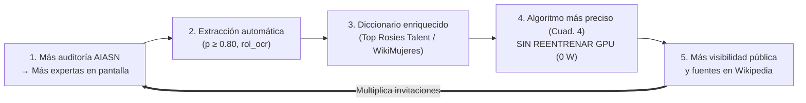

<!--
SPDX-FileCopyrightText: 2026 Equipo 1: Attention Is All She Needs (Alba Camiña García, Pilar de la Fuente Diez, Rocío Jiménez Villén)
SPDX-License-Identifier: Apache-2.0
-->

# Fundamentos: misión, principios de arquitectura y círculo virtuoso

Contenido que sale del README para mantenerlo breve; no se ha modificado salvo los enlaces.

[← Volver al README](../README.md)

---

## 🎯 Declaración de Propósito y Misión Social
1. **Justicia Epistémica frente a la Aniquilación Simbólica:** No toleramos la invisibilización de las mujeres en los medios ni su confinamiento a roles testimoniales o asistenciales. Reivindicamos su autoridad intelectual y su protagonismo activo como expertas y líderes de opinión.
2. **Rigor Matemático contra el *Equality-Washing*:** Rechazamos el postureo corporativo y la paridad cosmética de foto. La igualdad real se acredita con evidencias cuantitativas reproducibles: tiempo de voz activa, interlocución horizontal directa y reconocimiento público en pantalla, calculados determinísticamente y sin alucinaciones generativas.
3. **Democratización de la Validación (*Social Open Steward*):** Rompemos el monopolio de las auditorías opacas y costosas. La tecnología de AIASN es y será siempre 100 % libre, soberana y gratuita para la ciudadanía, las escuelas, las universidades, los periodistas independientes y las organizaciones sociales.
4. **Del Círculo Vicioso al Círculo Virtuoso:** Transformamos la auditoría en un motor de cambio sistémico (*Green AI Flywheel*). Cada contenido auditado enriquece los directorios públicos de talento (`Top Rosies Talent`, `WikiMujeres`) para nutrir con referentes femeninos verificados a los futuros modelos de inteligencia artificial y a la sociedad entera.

## Principios Rectores de Arquitectura
1. **Separación Estricta entre Inferencia y Cálculo:** Los modelos de IA abierta extraen transcripciones, coordenadas y probabilidades; el **100 % de los tiempos, porcentajes, solapes y ratios los calcula determinísticamente Python (`pandas`)**, eliminando cualquier riesgo de alucinación generativa.
2. **Prioridad al Dato Declarado sobre la Biometría:** El nombre y el cargo leídos en un rótulo por OCR (*«Dra. Maria Pons — Catedràtica d'Economia»*) prevalecen sobre la inferencia biométrica. El rótulo declara nombre y cargo, no el género: este se trata siempre como **atribuido o percibido**, con abstención por debajo de 0,80 y revisión humana.
3. **Privacidad por Diseño (Biometría efímera y no retención de vectores faciales):** Los vectores faciales (*embeddings*) se calculan exclusivamente en memoria volátil para agrupar las apariciones de una misma persona dentro de un vídeo, y se descartan antes de escribir en el lake: **no se almacenan plantillas biométricas permanentes ni se identifica a nadie mediante su cara contra un registro externo**. Se conservan datos tabulares derivados por persona (posición en pantalla, género atribuido y su probabilidad). Con Docker Compose, al terminar se borran los ficheros temporales (fotogramas, audio y vídeo remuestreado en `tmp/`) y, si todos los pasos han ido bien, el vídeo subido a `landing/` (`PRIVACY__DELETE_MEDIA_AFTER_RUN`); sin Docker está desactivado por defecto, para depurar. Si el borrado falla, se registra y los ficheros permanecen (véase [`ETHICS_CHECKLIST.md`](../ETHICS_CHECKLIST.md), punto 3.5).
4. **Detector de *Equality-Washing* (Matriz *Seeing and Hearing*):** Clasifica cada aparición en 4 cuadrantes:
* **Cuadrante 1 (Voz Activa):** En pantalla y hablando $\rightarrow$ Liderazgo y voz experta.
* **Cuadrante 2 (Presencia Muda):** En pantalla y en silencio $\rightarrow$ Alerta de figuración / lavado de imagen.
* **Cuadrante 3 (Voz en Off):** Fuera de pantalla y hablando $\rightarrow$ Narración o locución.
* **Cuadrante 4 (Pasivo):** Solo mencionado en el texto o subtítulo.
5. **Test de Interlocución Femenina (TIF, [ADR-0011](./adr/0011-adopcion-test-interlocucion-femenina-tif.md)):** Adaptación AIASN del Test de Bechdel-Wallace a la no ficción, 100 % determinista (`evaluar_bechdel_conversacional`, con alias `evaluar_interlocucion_femenina`, en `aiasn/core/fusion.py`; 0 W GPU). Veredicto en **tres estados**: `no_evaluable` (sin datos de género determinado, menos de dos personas con voz —no hay conversación— o ninguna presencia masculina), `no_supera` (no aparece ninguna mujer o solo una) y `evaluado`, que puntúa de 0 a 3: (1) pluralidad femenina (≥ 2 mujeres distintas con voz activa), (2) identidad acreditada (≥ 2 mujeres con rótulo de nombre o cargo por OCR) y (3) interlocución horizontal directa (≥ 1 transición de turno Mujer_A → Mujer_B). Solo supera con 3/3.
6. **Supervisión Humana (*Human-in-the-Loop*) — parcial:** Conforme a las recomendaciones de Karina Gibert y Ángela Gasch (SEDIA), el diseño prevé una pantalla operativa con el botón **«Asumo / No asumo»** previa a la emisión de cualquier informe o certificado de paridad (especificada en [`docs/especificacion_alertas_dashboard_y_hitl.md`](./especificacion_alertas_dashboard_y_hitl.md)). **Estado en v0.1.0:** el panel de revisión de personas con género dudoso y los botones «Asumo / No asumo» guardan cada decisión en la API (`POST /videos/{id}/supervision`), sin recalcular las métricas. La revisión aún no bloquea el informe, y el recálculo y las vistas por rol están en la hoja de ruta.

> 🏛️ **Registro Formal de Decisiones de Arquitectura (ADRs):** Todas las decisiones técnicas y éticas del proyecto están formalizadas bajo el estándar de Michael Nygard en el catálogo [`docs/adr/`](./adr/README.md).

## 🔄 Del «Círculo Vicioso» al «Círculo Virtuoso» de Referentes (`Top Rosies Talent` + `WikiMujeres`)
> **Nombre estratégico/comercial:** *Círculo Virtuoso de Referentes Femeninos (Green AI Flywheel)*
> **Nombres técnicos de ingeniería:** *Retroalimentación Incremental sin Reentrenamiento (`Zero-Retraining Feedback Loop`)* / *Enriquecimiento Autónomo del Diccionario de Referentes*

1. **Más auditoría $\rightarrow$ Más expertas en pantalla:** Las empresas y medios usan AIASN (y la extensión en caliente en edición) para cumplir la paridad real (Cuadrante 1), invitando y rotulando a más mujeres profesionales.
2. **Más expertas en pantalla $\rightarrow$ Extracción automática ($p \ge 0{,}80$):** AIASN lee de forma autónoma sus rótulos (`rol_ocr`) y sus intervenciones mediante consenso multimodal (`EasyOCR` + `Whisper` + `GLiNER`).
3. **Extracción $\rightarrow$ Diccionario más rico (`Top Rosies Talent` / `ReDivIAcat` / `WikiMujeres`):** Esos nombres y cargos verificados se añaden solos al diccionario ligero (`.csv`/`.json`), tanto en local desconectado (*offline/batch*) como sincronizado.
4. **Diccionario más rico $\rightarrow$ Algoritmo más inteligente sin reentrenar GPU (*Green AI*):** En el siguiente vídeo que se audite, el detector ya conoce a esas profesionales cuando alguien las cita en una conversación (Cuadrante 4), **sin gastar un solo euro ni vatio de GPU en reentrenar la red neuronal**.
5. **Más visibilidad $\rightarrow$ Más invitaciones:** Al quedar registradas con evidencias de vídeo en **`Top Rosies Talent`** (IDEAI-UPC / donesCOEINF) y **`WikiMujeres`**, más organizadores las encuentran y las llaman para nuevos debates (vuelta al punto 1, multiplicando el efecto).

