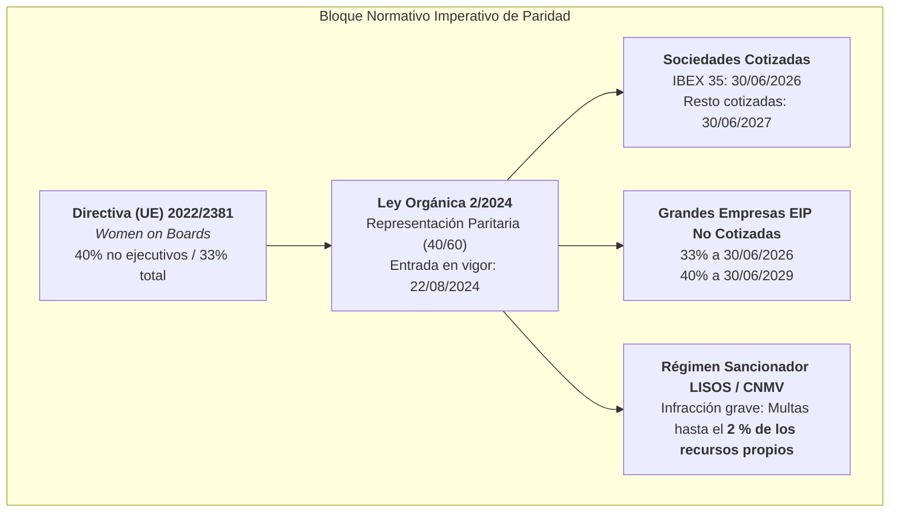
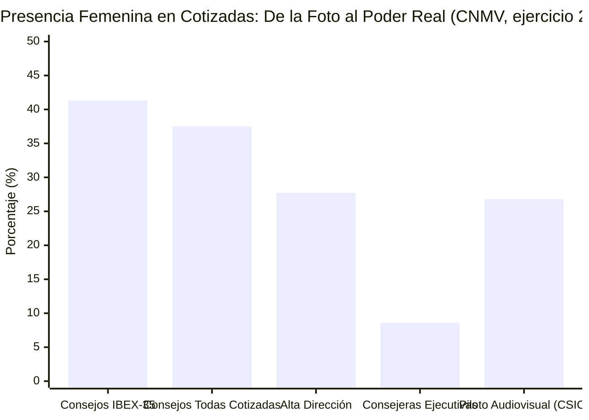
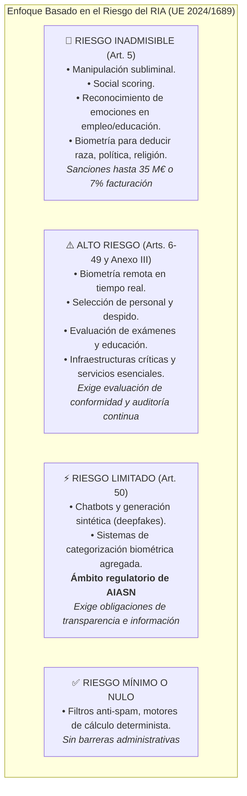

# 18 — Marco Normativo, Mercado B2B y Gobernanza Ética Integral

**Proyecto:** «Attention Is All She Needs» (AIASN) — Reto «Mujeres por la IA Abierta»  
**Tipo:** Documento maestro canónico · *Single Source of Truth* (SSoT) de Cumplimiento Normativo, Análisis de Mercado y Gobernanza Ética.  
**Destino en Repositorio GitHub:** Entregable oficial en `docs/marco_normativo_y_mercado.md` (evaluable por el jurado de la SEDIA, IDEAI-UPC, donesCOEINF y Oficina Técnica).  
**Bases Legales de Referencia:** Ley Orgánica 2/2024 (BOE), Reglamento (UE) 2024/1689 (RIA / DOUE), Directiva (UE) 2022/2381 (*Women on Boards*), Directiva (UE) 2022/2464 (CSRD / ESRS S1), Directiva (UE) 2024/825 (*Social Claims*), RGPD (UE 2016/679) y Art. 67 RDL 24/2021.  
**Créditos y Reparto de Autoría Colegiada (Taxonomía CRediT / Doc 10):**
* **Investigación Técnico-Jurídica (RIA, RGPD, Propiedad Intelectual), Marco Ético y Epistemología:** Alba Camiña García (`@ewigkeitt-cloud`) — *Conceptualization, Methodology, Formal Analysis (EU AI Act DOUE, RGPD Zero Facial Retention, IP/TDM RDL 24/2021, Epistemic Framework & Vaswani formulation)*.
* **Investigación de Mercado B2B, Datos CNMV y Cuotas Corporativas (Issue #8):** Pilar de la Fuente Diez (`@pilarvolatixia-cloud`) — *Data Curation, Investigation (CNMV Reports, Ley 2/2024 Corporate Targets, TAM Market Sizing)*.
* **Supervisión Técnica de Requisitos Multimodales (Audio/NLP):** Rocío Jiménez Villén (`@rjvillen`) — *Validation (Audio/NLP Interface Requirements)*.

---

## 0. Resumen Ejecutivo y Objeto Pericial

Este documento consolida el blindaje técnico-jurídico, la fundamentación de mercado y el modelo de gobernanza ética de la plataforma **AIASN**. 

AIASN audita la **presencia, voz efectiva y autoridad de las mujeres en la comunicación audiovisual pública y corporativa** (retransmisiones, debates, vídeos institucionales y paneles). Transforma la verificación de la igualdad —tradicionalmente restringida a recuentos formales de firmas o memorias de Responsabilidad Social Corporativa (RSC) estáticas— en una **auditoría algorítmica objetiva, determinista y trazable segundo a segundo**.

El proyecto articula una **doble tracción estratégica**:
1. **Tracción Corporativa e Institucional B2B (*Top-Down*):** Proporciona a las grandes empresas no cotizadas consideradas Entidades de Interés Público (EIP) y a los medios públicos una herramienta pericial para cumplir con la **Ley Orgánica 2/2024**, certificar sus estados de sostenibilidad **CSRD (Estándar ESRS S1)** y blindarse frente al riesgo legal y reputacional de **publicidad engañosa y *equality-washing*** (Directiva UE 2024/825).
2. **Soberanía Ciudadana Abierta (*Bottom-Up*):** Entrega a la sociedad civil una plataforma de código abierto para auditar el cumplimiento paritario real («votar con los pies y con la confianza»).

---

## 1. El Marco Normativo de Paridad y Presencia Equilibrada

Tal como destacó la **Dra. Karina Gibert** en la sesión inaugural del reto (*«esto no son recomendaciones de buenas intenciones: es ley de obligado cumplimiento»*), el sistema se apoya en el bloque normativo europeo y español:

### 1.1. Ley Orgánica 2/2024, de 1 de agosto (Ley de Paridad)
Traspone al ordenamiento español la **Directiva (UE) 2022/2381**. Publicada en el BOE el 2 de agosto de 2024, entró en vigor formalmente el **22 de agosto de 2024**:
* **Principio de Presencia Equilibrada (Regla 40/60):** Ningún sexo puede superar el 60 % ni situarse por debajo del 40 % en los órganos de decisión.
* **Calendario Escalonado de Cumplimiento:**
  * **Sociedades cotizadas del IBEX 35:** 40 % en consejo de administración y alta dirección antes del **30 de junio de 2026**.
  * **Resto de sociedades cotizadas:** 40 % antes del **30 de junio de 2027**.
  * **Grandes empresas no cotizadas consideradas Entidades de Interés Público (EIP):** **33 % antes del 30 de junio de 2026** y **40 % antes del 30 de junio de 2029**.
* **Régimen Sancionador Disuasorio:** El incumplimiento continuado o la falsedad en la información de igualdad constituye infracción grave tipificada en la legislación laboral y del mercado de valores, acarreando sanciones de hasta el **2 % de los recursos propios de la entidad**, además de la inhabilitación para contratar con el sector público (Art. 71.1.d de la Ley 9/2017 de Contratos del Sector Público — LCSP).

### 1.2. Directiva (UE) 2024/825 y Marco contra el *Equality-Washing*
La **Directiva (UE) 2024/825** (*Empowering Consumers for the Green Transition / Social Claims*) tipifica como **práctica comercial desleal y publicidad engañosa** realizar alegaciones de compromiso social o paritario (*equality-washing* o *purplewashing*) que no estén respaldadas por metodologías científicas objetivas y verificación independiente. Se complementa con el Art. 3.a de la **Ley 34/1988 General de Publicidad**, que declara ilícita la comunicación que presente a las mujeres de forma accesoria, figurativa o discriminatoria.

---

## 2. La Realidad Fáctica del Mercado: Evidencia Oficial CNMV (ejercicio 2024)

El punto de partida del proyecto es la divergencia estructural entre la paridad cuantitativa en órganos formales y el ejercicio real de la autoridad:

### 2.1. Cifras Oficiales de Gobierno Corporativo (CNMV, ejercicio 2024)
* **Consejos de Administración del IBEX 35:** Las mujeres alcanzaron el **41,3 %** (ejercicio 2024), por encima del objetivo legal del 40 %.
* **Total de Sociedades Cotizadas:** La presencia femenina en consejos se sitúa en el **~37,5 %** (37,4 % – 37,52 %) *(cifra pendiente de reverificar para el ejercicio 2024)*.
* **Alta Dirección:** Se reduce al **27,7 %** en el IBEX 35 y al **~25 %** en el resto de cotizadas *(cifras pendientes de reverificar para el ejercicio 2024)*.
* **Consejeras Ejecutivas (Máximo Poder de Decisión):** Apenas alcanzan el **8,6 %** (ejercicio 2024).

### 2.2. La Tesis Pericial: «Presencia Formal frente a Presencia Real»
El análisis de la CNMV demuestra que la presencia femenina se concentra mayoritariamente en puestos no ejecutivos e institucionales, produciéndose un desplome conforme se accede a los comités ejecutivos y a las portavocías directivas (del 41,3 % al 8,6 %).

**La traslación al plano audiovisual:**  
La ley tradicional mide exclusivamente la composición nominal en registros mercantiles. Ningún regulador audita lo que ocurre en la comunicación externa, eventos y campañas:
* **Presencia Formal:** La entidad exhibe paridad cosmética colocando a mujeres en planos generales o fotografías institucionales.
* **Presencia Real:** En la ejecución audiovisual, las mujeres sufren silenciamiento discursivo, tiempos de habla reducidos e interrupciones sistemáticas.
* **Evidencia Empírica del Piloto:** En la mesa redonda del CSIC analizada en nuestro prototipo, las mujeres representan el **26,8 % del tiempo en pantalla** pero su **tiempo de voz activa cae al 19,0 %** ($\text{RVP} = 0{,}71$), mientras que los puestos de moderación (quien reparte los turnos) y las citas de autoridad técnica son acaparados por varones.

---

## 3. Mercado B2B, TAM y Directiva CSRD

### 3.1. El Nicho Estratégico: Grandes Empresas No Cotizadas (EIP)
La inmensa mayoría de auditoras y herramientas de compliance se dirigen exclusivamente a las ~35 empresas del IBEX o a las ~115 cotizadas en bolsa, un segmento hipersaturado y ya monitorizado por la CNMV.

**La oportunidad desatendida:**
* **Ámbito Subjetivo de la Ley 2/2024:** Obliga también a las grandes empresas que cumplan conjuntamente dos requisitos:
  1. Ser **Entidad de Interés Público (EIP)** conforme a la Ley 22/2015 de Auditoría de Cuentas (aseguradoras, entidades de crédito, fondos de pensiones, mutuas y grandes grupos no cotizados).
  2. Contar con **más de 250 personas trabajadoras** y además superar los **50 M€ de cifra neta de negocios** o los **43 M€ en total de activo**.
* **El Universo Fáctico:** En España operan más de **5.000 grandes empresas** (>250 empleados según el DIRCE / INE 2024). Las EIPs no cotizadas representan un mercado de cientos de corporaciones que están **obligadas por ley (33 % en 2026 y 40 % en 2029)** y sujetas al mismo régimen sancionador, pero **no remiten sus cuentas a la CNMV**. Vuelan a ciegas sin observatorios ni herramientas analíticas accesibles.

### 3.2. Directiva (UE) 2022/2464 sobre Información de Sostenibilidad (CSRD)
Afecta a más de 50.000 empresas en la UE. El estándar **ESRS S1 (*Own Workforce*)** impone la obligación de reportar métricas cuantitativas verificadas sobre igualdad, brecha salarial y representación en órganos colegiados con auditoría externa (*limited assurance*). AIASN genera automáticamente los metadatos y reportes auditables requeridos para estas memorias.

### 3.3. Dimensionamiento del Mercado Total (TAM) en Tres Niveles y Proporcionalidad

Siguiendo el **principio de proporcionalidad** del compliance corporativo en España (donde la exigencia se adapta al tamaño y perfil de riesgo de la entidad sin asfixiar la operación), AIASN estructura su alcance en tres niveles:

| Nivel de Mercado | Colectivo Diana | Volumen Estimado | Estado del Mercado y Encaje de AIASN |
| :--- | :--- | :---: | :--- |
| **Nivel 1 (Validación)** | Sociedades Cotizadas (IBEX 35 + mercado continuo) | ~115 entidades | Saturado por CNMV y consultoras Big Four. Sirve para validar y contrastar la precisión del producto. |
| **Nivel 2 (Nicho B2B)** | Grandes Empresas EIP No Cotizadas (>250 emp. / >50 M€) y Pymes Audiovisuales | Cientos de corporaciones EIP + miles de pymes de medios | **Mercado prioritario de monetización.** Obligadas por ley (33 % en 2026, 40 % en 2029) sin herramientas adaptadas. |
| **Nivel 3 (Impacto Social y Sector Público)** | Corporaciones Públicas (RTVE, CCMA), Universidades, ONGs y Ciudadanía | Miles de instituciones | Demanda de transparencia y cumplimiento del **Esquema Nacional de Seguridad (ENS)** mediante ejecución local abierta. |

### 3.4. De «Auditoría Anual Estática» a «Compliance ESG Continuo y Preventivo» (ISO 37301)
En la gobernanza corporativa moderna coexisten tres funciones complementarias. AIASN permite a las organizaciones dar el salto desde la tradicional memoria anual reactiva hacia un sistema de **compliance preventivo en tiempo real**:

| Dimensión | Compliance Corporativo (Enfoque AIASN) | Auditoría Interna Tradicional | Gestión de Riesgos |
| :--- | :--- | :--- | :--- |
| **Foco Principal** | Cumplimiento normativo (LO 2/2024, Directiva 2024/825, CSRD) | Eficacia del control interno | Riesgos estratégicos y reputacionales |
| **Horizonte Temporal** | **Preventivo y continuo** (antes/durante la emisión o campaña) | Periódico (anual, a toro pasado) | Continuo |
| **Órgano de Reporte** | Órgano de administración / Comité de Ética y RSC | Comité de auditoría | Dirección general |
| **Valor Aportado por AIASN** | Detecta el *equality-washing* antes de publicar o cerrar la memoria anual | Genera las actas y tablas `.csv` verificables para el auditor | Cuantifica la brecha entre presencia formal y voz real |

### 3.5. Doctrina de la Evidencia Documental Trazable y Conexión con la Ley 2/2023
La jurisprudencia del Tribunal Supremo y los estándares **ISO 37301** (Sistemas de gestión de compliance) y **UNE 19601** establecen un principio probatorio taxativo: **un código ético o un Plan de Igualdad genérico guardado en un cajón no acredita diligencia debida ante un regulador o tribunal; la clave es la evidencia documental y trazable de que el control se aplicaba**.
* **Prueba Pericial Trazable:** AIASN sustituye las declaraciones de intenciones por registros empíricos auditables al segundo (`tiempo_i`, `tiempo_f`, `rol_ocr`, ratio voz/pantalla) validados mediante supervisión humana (**«Asumo / No asumo»**).
* **Integración con el Sistema Interno de Información (Ley 2/2023):** Para todas las empresas de más de 50 personas trabajadoras (obligadas por la Ley 2/2023, que transpone la Directiva UE 2019/1937 de *Whistleblowing*), los informes objetivos de AIASN permiten documentar y verificar con datos neutrales cualquier incidencia o reclamación interna sobre sesgos de representación o relegación profesional en actos corporativos.

### 3.6. El «Triángulo de Decisión de Compra B2B» (CCO + DPO + RSC/ESG) y Viabilidad Económica
En el mercado corporativo español, la adopción de herramientas de IA fracasa cuando el departamento de RSC quiere comprarla pero el **Delegado de Protección de Datos (DPO)** o el **Compliance Officer (CCO)** la bloquean por riesgos legales. AIASN está diseñado por arquitectura para obtener el visto bueno simultáneo de los tres decisores:

1. **Responsable de RSC / ESG:** Obtiene de forma automatizada los indicadores cuantitativos del estándar **ESRS S1 (CSRD / Ley 11/2018)** y la **Ley Orgánica 2/2024**, más el sello de confianza para licitaciones públicas y procesos de *Due Diligence* (M&A).
2. **Delegado de Protección de Datos (DPO — RGPD / LOPDGDD / ISO 27701):** Aprueba la herramienta porque aplica ***Zero Facial Retention* en RAM (ADR-0004)** y **procesamiento *Split* en local** (el vídeo bruto no necesita subirse a nubes externas, enviando únicamente texto y metadatos tabulares anónimos).
3. **Compliance Officer (CCO — ISO 37301 / LISOS):** Cuenta con un motor determinista auditable bajo licencia empresarial limpia (**Apache-2.0**) que previene sanciones de la LISOS, la CNMV y la AEPD.

* **Benchmarking de Precios en España y Margen Bruto (>90 %):**  
  En el mercado español, la implantación inicial de un programa de compliance oscila entre **3.500 € y 12.000 €**, con cuotas de mantenimiento o software SaaS de **200 € a 500 €/mes** en pymes (y tarifas superiores en grandes EIPs). Dado que el coste computacional de AIASN (*Green AI* con muestreo `STRIDE`) es **inferior a 0,30 € por hora de vídeo**, un modelo de suscripción B2B en la banda estándar de mercado (200 € – 500 €/mes) ofrece un **margen bruto superior al 90 %**, resultando hasta 10 veces más económico y ágil que una consultoría manual tradicional.

---

## 4. Análisis Integral del Reglamento Europeo de IA (RIA / UE 2024/1689)

El Reglamento (UE) 2024/1689 no regula tecnologías abstractas, sino **usos de la IA según su nivel de riesgo para los derechos fundamentales**.

### 4.1. Delimitación Positiva: Por qué AIASN NO es de Alto Riesgo ni Práctica Prohibida
1. **Ámbito de Aplicación Material (Auditoría de Contenido Público):** El sistema analiza emisiones audiovisuales públicas y eventos institucionales. No se despliega en salas de contratación laboral, no califica personal en su puesto de trabajo ni evalúa estudiantes en instituciones educativas (excluyéndose de la prohibición del Art. 5.1.f y del Anexo III).
2. **Separación entre Inferencia y Cálculo (ADR-0001):** La IA abierta solo extrae texto y rectángulos de detección con marcas temporales ($t_i, t_f$); todo el cálculo de ratios, métricas y veredictos se ejecuta mediante código determinista en Python, impidiendo fallos de caja negra.
3. **Categorización Biométrica de Género Percibido:**
   * El Art. 5.1.g prohíbe la categorización biométrica que deduzca origen racial, convicciones políticas, afiliación sindical, religión u orientación sexual. **La presentación de género y la edad no forman parte de este catálogo prohibido**.
   * Al destinarse a la auditoría agregada de medios y no a decisiones laborales o policiales individuales, **no es un sistema de alto riesgo**; queda encuadrado en el régimen de **riesgo limitado con obligación de transparencia del Artículo 50.3 del RIA**.

### 4.2. La Frontera entre Biometría y Texto: Exclusión de Emociones y Rescate del Clima Conversacional (ADR-0009)
En estricta coherencia con las directrices de la Comisión Europea (`C(2025) 884`) y las enseñanzas de la Dra. Karina Gibert, el sistema formaliza una separación metodológica tajante:

* **Inferencia Emocional Biométrica: EXCLUIDA PERMANENTEMENTE.**  
  El Art. 3.39 del RIA define el reconocimiento de emociones como la inferencia de estados anímicos a partir de **datos biométricos (cara, voz o postura corporal)**. Además de estar prohibido en el empleo y la educación (Art. 5.1.f) y ser de alto riesgo en el resto, Karina Gibert advirtió de su sesgo intrínseco (etiquetar como «agresiva» o «conflictiva» a una mujer que habla con firmeza técnica). AIASN descarta cualquier modelo de análisis emocional visual o acústico.
* **El Análisis sobre Texto Escrito NO es Biometría:**  
  Las Directrices de la Comisión Europea `C(2025) 884` (Secc. 2.3) aclaran expresamente que el análisis de sentimiento o clasificación léxica sobre **texto transcrito (ASR) no utiliza datos biométricos** y, por tanto, queda plenamente fuera de la prohibición del Art. 5.
* **El Giro Epistémico de AIASN (Adela Cortina):**  
  AIASN no juzga el estado psicológico individual de la ponente. Audita la calidad democrática del espacio público mediante el **Índice de Clima Conversacional**, analizando la distribución del registro lingüístico colectivo (*técnico-asertivo / colaborativo / disenso*) sobre la transcripción literal, fundamentado en la teoría de la *«interlocución válida»* de Adela Cortina.

### 4.3. Supervisión Humana Efectiva (*Human-in-the-Loop* — Art. 14 RIA)
El sistema materializa la supervisión humana preceptiva en tres niveles operativos:
1. **Umbral de Calibración Ética ($p < 0{,}80$, ADR-0005):** Cuando la certeza de clasificación acústica o visual es inferior al 80 %, el sistema no impone una etiqueta forzada; se abstiene deterministamente asignando el estado **`no_determinado`**.
2. **Señalización Visual en UI:** Los casos dudosos se muestran con el indicador **`[ → Revisión Humana ]`**.
3. **Pantalla de Arbitraje Operativo:** La operadora técnica dispone del control **«Validar Clasificación / Asumir Abstención»**, garantizando que ninguna métrica dudosa altere el veredicto sin supervisión.

---

## 5. Protección de Datos (RGPD) y Privacidad por Diseño

El tratamiento de material audiovisual público se rige por el Reglamento General de Protección de Datos (UE 2016/679):

1. **Base Jurídica del Tratamiento:** Interés legítimo (Art. 6.1.f RGPD) e investigación científica/estadística (Art. 89 RGPD) sobre contenidos emitidos en abierto en los que las figuras públicas cuentan con una reducida expectativa de privacidad.
2. **Biometría Efímera (*Zero Retention Policy* — ADR-0004):**  
   Los vectores biométricos faciales (embeddings de 512D) se procesan **exclusivamente en memoria RAM volátil** para mantener el seguimiento entre planos durante la sesión y **se destruyen automáticamente al finalizar el procesamiento**. Nunca se exportan, persisten en disco ni almacenan en bases de datos.
3. **Privacidad por Agregación ($k$-Anonimato):**  
   El sistema no publica perfiles individuales. Todos los indicadores se calculan en agregado con un umbral de $k \ge 5$ intervinientes, impidiendo la re-identificación o evaluación personal de sujetos pasivos.
4. **Tratamiento Nominativo Estrictamente Restringido:**  
   Solo se asocian nombres propios cuando estos figuran impresos públicamente en los rótulos de emisión (*lower thirds* / *chirons* extraídos mediante EasyOCR/PaddleOCR).
5. **Arquitectura *Split Edge-to-Cloud*, Sostenibilidad (*Green AI*) y Esquema Nacional de Seguridad (ENS):**  
   Para eliminar cualquier riesgo de transferencia de vídeo o imagen bruta hacia servidores externos y minimizar el impacto ambiental:
   * **Extracción Visual Efímera en Local (*Edge / On-Premise*):** El archivo `.mp4` se procesa en la máquina local aplicando muestreo `STRIDE`. Los fotogramas e inferencias faciales se destruyen en la RAM local sin salir nunca a la red.
   * **Transmisión Exclusiva de Texto y Datos Tabulares Anónimos (`.csv` / `.tsv`):** Hacia la capa de análisis o nube (como los AI Endpoints de OVHcloud para LLMs y embeddings o el motor de fusión) solo viajan tablas ligeras de metadatos estadísticos (`tiempo_i`, `tiempo_f`, `persona_id`, `genero_inferido`, `confianza`, `rol_ocr`) y transcripciones textuales.
   * **Doble Dividendo de Sostenibilidad (*Green Networking & Zero Cloud Storage*):** Pasar de transmitir varios gigabytes de vídeo HD (1,5 – 4 GB/hora) a un fichero `.csv` de apenas 20 – 50 KB supone una **reducción del 99,99 % en tráfico de red y almacenamiento en centros de datos**, abatiendo tanto la huella de carbono (Alcance 3 ESG) como el coste operativo.
   * **Adecuación al Sector Público (ENS):** Este diseño permite a corporaciones públicas (RTVE, CCMA/TV3, universidades, ministerios) y contratistas de la Administración auditar contenidos sensibles dentro de su propio perímetro de seguridad, facilitando el cumplimiento del **Esquema Nacional de Seguridad (ENS)** y los estándares **ISO 27001 / ISO 27701**.

---

## 6. Propiedad Intelectual, Minería de Datos, Licencias y Protección del Sello Oficial

### 6.1. Excepción Legal de Minería de Textos y Datos (Art. 67 RDL 24/2021)
El procesamiento analítico de debates televisivos (TV3, RTVE, betevé) y videopodcasts científicos (*«Quanta, quanta IA!»*) está legalmente amparado por el **Artículo 67 del Real Decreto-ley 24/2021**, que transpone la **Directiva (UE) 2019/790 sobre Derechos de Autor en el Mercado Único Digital**:
* Autoriza la reproducción y extracción automatizada de obras accesibles legítimamente para fines de investigación y desarrollo por entidades científicas y tecnológicas.
* **Salvaguarda de no redistribución:** El repositorio de código **no redistribuye ni aloja los archivos de vídeo brutos con copyright**. El paquete procesa los contenidos en local o sobre URLs públicas de origen, exportando únicamente los metadatos numéricos derivados.

### 6.2. Estrategia de Licencias y Aislamiento del Copyleft de Ultralytics YOLO
Para salvaguardar la licencia abierta permisiva del proyecto (**Apache 2.0**) requerida por el jurado (Jorge Teixeira / ComunidadIA-OS) y apta para explotación B2B:
* **El Problema Detectado:** A raíz de la alerta preventiva planteada por Pilar sobre el cambio de licencia de la librería Ultralytics YOLO a **AGPL-3.0** (cuyo efecto de copyleft de red obligaría a publicar todo el software vinculado bajo AGPL-3.0).
* **La Solución de Arquitectura Desacoplada (ADR-0002 y ADR-0008):**
  1. *Por Archivo Tabular (`.csv` / `.tsv` — `CSVPrecomputedAdapter`):* Conforme a la doctrina de la *Free Software Foundation* (FSF), los notebooks experimentales de investigación que usan `YOLO11m` exportan tablas de datos planas que el motor determinista lee como programa independiente, impidiendo cualquier contaminación de licencia.
  2. *En Local Permisivo B2B (`PermissiveYOLOXAdapter`):* El patrón adaptador (`aiasn/core/compliance.py`) prevé ejecutar la detección con **YOLOX** (Apache-2.0 de Megvii vía ONNX Runtime MIT) y **EasyOCR** (Apache-2.0), o vía API HTTP REST en los AI Endpoints de OVHcloud, como vía libre de copyleft. **Estado actual: hoja de ruta.** El prototipo usa Ultralytics YOLO (AGPL-3.0) e InsightFace (código MIT, pesos de uso no comercial), y `PermissiveYOLOXAdapter` es un esqueleto sin inferencia sobre vídeo; un despliegue comercial requeriría completarlo y revisar la licencia de los pesos faciales.

### 6.3. Primacía del Valor Social, Democratización de la Validación, Círculo Virtuoso (`Top Rosies Talent`) y Blindaje del Sello Oficial frente al Lavado de Cara
Conforme al **Código Ético y Estatuto de Propósito Social (`CODE_OF_CONDUCT.md`)** del proyecto:
1. **Primacía del Valor Social y Democratización de la Validación (*Social Open Steward*):** El fin último de AIASN no reside en la explotación monetaria, sino en el **valor social, la mejora de la justicia epistémica y la democratización de la validación** (rompiendo el monopolio de las auditorías opacas y prohibitivas). Los ingresos B2B procedentes de grandes corporaciones obligadas por ley tienen carácter instrumental para sostener el proyecto y garantizar que la validación algorítmica sea **100 % libre, soberana y gratuita a perpetuidad para la ciudadanía, escuelas, universidades, periodistas y ONGs**.
2. **Círculo Virtuoso de Visibilidad de Referentes Femeninas sin Reentrenamiento (*Green AI Flywheel* — Offline/Batch y Sincronizado):** Cada vídeo auditado cuyos rótulos (`rol_ocr`) y menciones son extraídos automáticamente con alta confianza ($p \ge 0{,}80$, mediante consenso multimodal OCR + Audio/NLP) —reservando la supervisión humana (*HitL*) únicamente para los casos dudosos ($p < 0{,}80$) o el clic final de exportación del lote contra *Data Poisoning*— alimenta un diccionario estructurado ligero (`.csv` / `.json`) de mujeres expertas interoperable con **`Top Rosies Talent`**, **`ReDivIAcat`** y **`tFemTIC`** (iniciativas de `IDEAI-UPC` y `donesCOEINF` lideradas por Karina Gibert) y con **`WikiMujeres` / `Wikidata`**. Tanto en ejecución 100 % local desconectada (*offline/batch*) como sincronizada, el motor cruza determinísticamente los nuevos vídeos con ese diccionario acumulado, reduciendo las omisiones del Cuadrante 4 con **coste cero de GPU en reentrenamiento (*fine-tuning*)**.
3. **Separación entre Código Libre y Sello Oficial (Art. 6 de Apache-2.0):** Mientras el Artículo 2 de la licencia `Apache-2.0` permite a cualquier entidad descargar el código para autodiagnóstico interno, el **Artículo 6 (*Trademarks*)** reserva en exclusiva el uso del nombre, marca y **Sello Oficial («AIASN Trust Verified — Libre de Equality-Washing»)**.
4. **Cláusula Anti-Lavado de Cara (*No-Wash Policy*), Ventana de 3 Años y Rehabilitación Activa (*Self-Cleaning*) en Código (`emitir_sello_auditoria`):**
   * **Ventana Temporal de Prescripción (3 Años):** Siguiendo el plazo del **Art. 72.6 de la Ley 9/2017 (LCSP)** y del **Art. 4 de la LISOS**, se deniega automáticamente el Sello Oficial Pleno a entidades que en los **últimos 3 años** hayan recibido sanciones firmes en el orden social/igualdad (**LISOS**), prohibición de contratar por carecer de Plan de Igualdad en **REGCON** (**Art. 71.1.d LCSP** y **RD 901/2020**), o condenas penales corporativas (**Art. 31 bis CP**).
   * **Vía de Rehabilitación Activa (*Self-Cleaning* — Art. 57.6 Directiva 2014/24/UE):** Para incentivar la mejora real, una entidad con antecedentes en los últimos 3 años que haya reparado el daño, registrado su Plan de Igualdad en REGCON y aportado una **auditoría histórica de los últimos 2 a 3 años/ciclos** acreditando progresión sostenida recibe el estado transitorio verificable **«Sello en Observación / Rehabilitación Verificada»**.
   * **Prohibición de *Cherry-Picking*, Extensión en las 4 Modalidades (*Shift-Left Parity*) y Regla de No-Compensación:** Una pieza aislada no puede usarse para obtener el sello ni compensa déficits estructurales. Además, el motor determinista está diseñado para inyectarse como extensión ligera en las **4 modalidades de creación y montaje**: Vídeo (`OBS Studio`, `DaVinci Resolve`, `Premiere`), Audio/Podcasts (`Audacity`, `Audition`, `Reaper`), Imagen/Cartelería de congresos (`Canva`, `Figma`, `GIMP`) y Texto/Prensa (`WordPress`, `Docs`), alertando en caliente antes de emitir. Si no se cumplen los requisitos en `ElegibilidadEticaEntidad`, el código estampa la leyenda indeleble: `USO EXCLUSIVO DE AUTODIAGNOSTICO INTERNO — NO VALIDO COMO SELLO PUBLICO`.
   * **Firma Criptográfica `SHA-256`, ID Pseudonimizado del Botón «Asumo» y Revocación Pública:** Cada informe válido genera un hash inmutable `SHA-256` sobre las métricas, los parámetros y el **identificador de rol o token pseudonimizado de la persona operadora (`operador_supervision_id`)** que pulsa «Asumo» (Art. 14 RIA), garantizando trazabilidad pericial ante la AESIA sin exponer datos civiles personales en abierto (Art. 5.1.c RGPD). Cualquier alteración posterior invalida el hash y activa la revocación inmediata a través del canal ético de gobernanza (Ley 2/2023 / ISO 37301).
5. **Modelo de Amenazas Adversarias (Art. 15 RIA / OWASP ML-LLM) y Guardarraíles para Agentes (`SECURITY.md` y `AGENTS.md`):**
   * **Defensa frente a Inyección Indirecta de Prompts (*OWASP LLM01*) y Evasión Adversaria (*Art. 15.4 RIA*):** Como los LLMs nunca calculan métricas y el motor determinista cruza voz + pantalla en los 4 cuadrantes, cualquier texto trampa en un rótulo o el uso de figurantes mudos/carteles estáticos es neutralizado automáticamente (disparando la Alerta de *Equality-Washing*).
   * **Defensa frente a *Data Poisoning* (*OWASP ML02*) y Deserialización Insegura:** El diccionario del Círculo Virtuoso exige consenso ($p \ge 0{,}80$) y firma con `operador_supervision_id` para lotes federados, y `BaseVisionAdapter` restringe las entradas a tablas planas y pesos seguros (`.onnx`, `.safetensors`).
   * **Guardarraíles para Agentes de Código (`AGENTS.md` público en el repositorio):** Instruye automáticamente a cualquier asistente de IA (Copilot, Cursor, Claude, Antigravity) para bloquear cualquier cambio que introduzca licencias AGPL en el núcleo, retenga vectores biométricos o rebaje el umbral ético ($\tau = 0{,}80$).
6. **Soberanía Lingüística Cooficial, Inclusividad y Accesibilidad Universal por Diseño y Reutilización en todas las Administraciones Públicas del Estado (ADR-010):**
   * **Cooficialidad Lingüística Nativa (`es`, `ca`, `gl`, `eu`) + `en`:** Procesamiento nativo sin traducción intermedia mediante `whisper-large-v3`, `bge-m3`, `EasyOCR` y `GLiNER` multilingüe.
   * **Reutilización e Interoperabilidad en el Sector Público (Art. 157 Ley 40/2015 LRJSP, ENI y ENS):** Licencia permisiva `Apache-2.0` (`REUSE` FSFE), ejecución `[core]` sin requisito de GPU y arquitectura *Split Edge-to-Cloud* que habilita su transferencia directa entre ministerios, comunidades autónomas, radiotelevisiones públicas, universidades y ayuntamientos.
   * **Accesibilidad Universal por Diseño (Directiva UE 2019/882, RD 1112/2018, WCAG 2.2 AA y Normas UNE 153101 / 153010):** Generación automática en código (`emitir_sello_auditoria`) del campo `resumen_lectura_facil` para lectores de pantalla (`NVDA`/`JAWS`) y ciudadanía, paleta Okabe-Ito con doble codificación e inclusividad no binaria (ADR-0006).

---

## 7. Checklist Canónico de Despliegue Ético y Auditoría

Este checklist resume los 10 puntos de control obligatorio que certifican la conformidad legal y ética del prototipo ante la AESIA, la CNMV y el tribunal evaluador:

- [x] **1. Ausencia de Prácticas Prohibidas (Art. 5 RIA):** No se realiza reconocimiento de emociones faciales ni acústicas, ni social scoring, ni perfilado discriminatorio.
- [x] **2. Aviso de Transparencia Activo (Art. 50.3 RIA):** Toda salida analítica declara explícitamente que opera mediante categorización de género percibido.
- [x] **3. Supervisión Humana Funcional (*HitL* - Art. 14 RIA):** Panel interactivo con controles de validación y abstención («Asumo / No asumo») para $p < 0{,}80$.
- [x] **4. Biometría Efímera (*Zero Facial Retention*):** Vectores faciales destruidos en RAM; prohibición absoluta de bases de datos biométricas permanentes.
- [x] **5. Tratamiento Exclusivo en Agregado:** Métricas calculadas a nivel de pieza o evento; ausencia de juicios morales sobre individuos particulares.
- [x] **6. Desacoplamiento Algorítmico (Inferencia vs. Cálculo):** Ratios y veredictos calculados por código determinista en Python, no por clasificadores generativos opacos.
- [x] **7. Amparo Legal de Minería de Datos:** Análisis amparado en el Art. 67 del RDL 24/2021; no redistribución de archivos brutos con derechos de autor.
- [x] **8. Conformidad de Licencias Open Source:** Arquitectura modular desacoplada del copyleft AGPL de Ultralytics mediante API y adaptadores Apache-2.0 / MIT.
- [x] **9. Rigor Normativo en Benchmarks:** Uso de la Ley Orgánica 2/2024 (suelo del 40 %) y datos oficiales CNMV (ejercicio 2024) como benchmarks comparativos auditables.
- [x] **10. Trazabilidad de Sesgos y Cobertura:** Declaración transparente de tasas de incertidumbre y porcentaje de muestra en estado `no_determinado`.

---

## 8. Fuentes y Referencias Oficiales

1. **Reglamento Europeo de IA (RIA):** Reglamento (UE) 2024/1689 del Parlamento Europeo y del Consejo, DOUE L 1689 de 12/07/2024.
2. **Directrices sobre Prácticas Prohibidas de IA:** Comisión Europea, Comunicación `C(2025) 884`, 04/02/2025.
3. **Ley Orgánica 2/2024 de Representación Paritaria:** BOE núm. 186 de 02/08/2024.
4. **Informes Oficiales de Gobierno Corporativo CNMV (ejercicio 2024):** Comisión Nacional del Mercado de Valores (`https://www.cnmv.es`).
5. **Directiva de Equilibrio de Género en Consejos:** Directiva (UE) 2022/2381 del Parlamento Europeo y del Consejo (*Women on Boards*).
6. **Directiva de Información de Sostenibilidad Corporativa (CSRD):** Directiva (UE) 2022/2464 y Estándar ESRS S1 (*Own Workforce*).
7. **Directiva contra Alegaciones Engañosas:** Directiva (UE) 2024/825 sobre el empoderamiento de los consumidores para la transición ecológica y alegaciones sociales.
8. **Real Decreto-ley 24/2021 sobre Propiedad Intelectual:** BOE núm. 263 de 03/11/2021 (Transposición de la Directiva UE 2019/790).
9. **Marco Ético ALTAI:** *Assessment List for Trustworthy Artificial Intelligence*, Grupo de Expertos de Alto Nivel de la Comisión Europea (AI HLEG).
10. **Demografía Empresarial DIRCE 2024:** Instituto Nacional de Estadística (INE), Directorio Central de Empresas.

